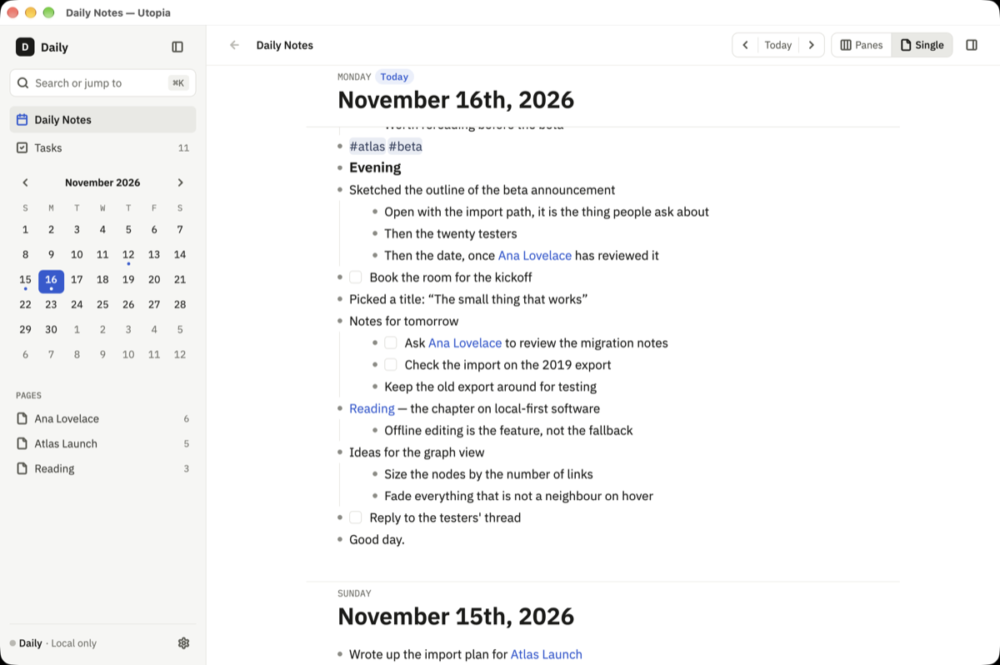
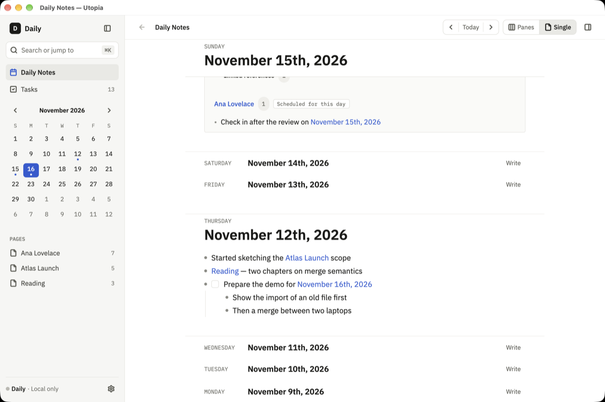
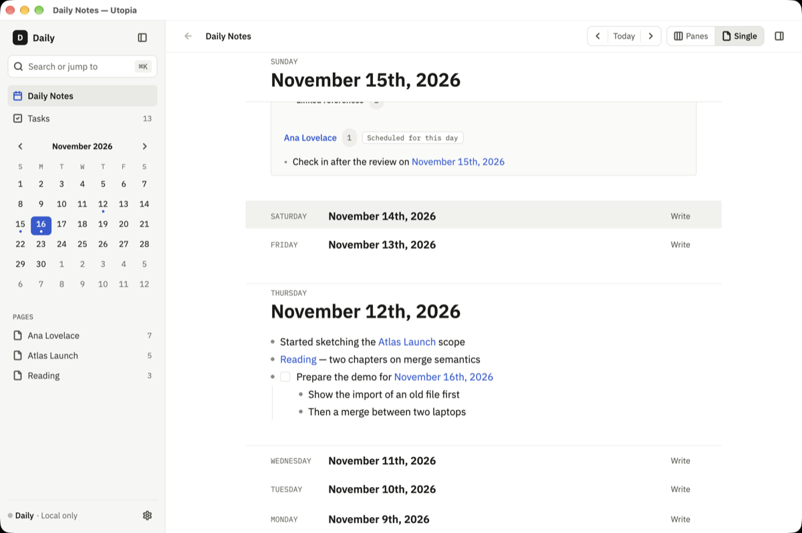
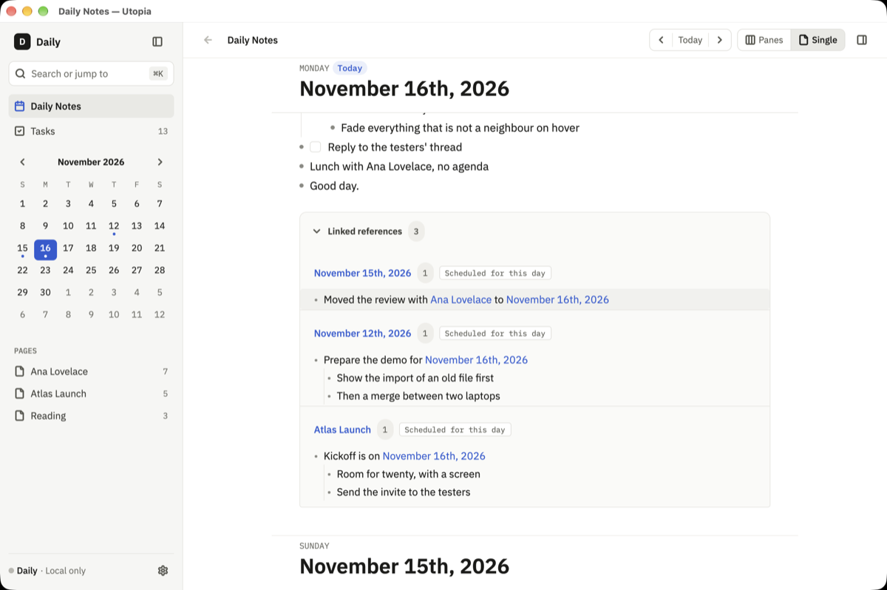
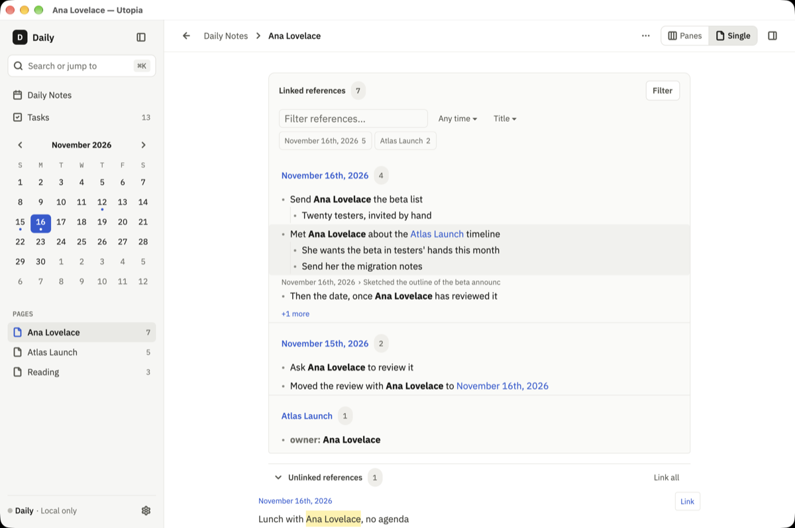
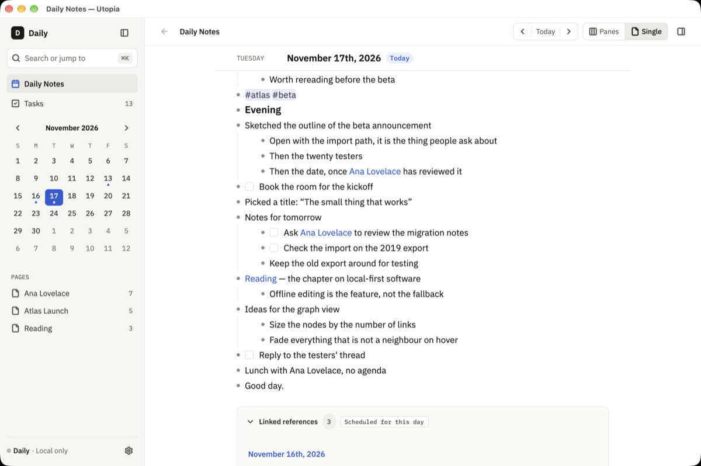
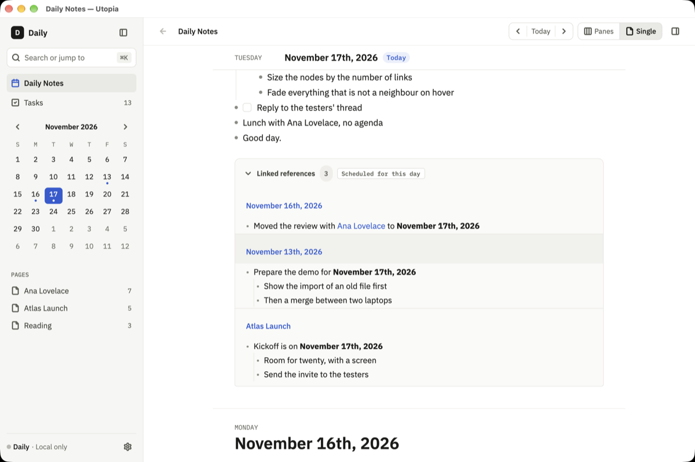
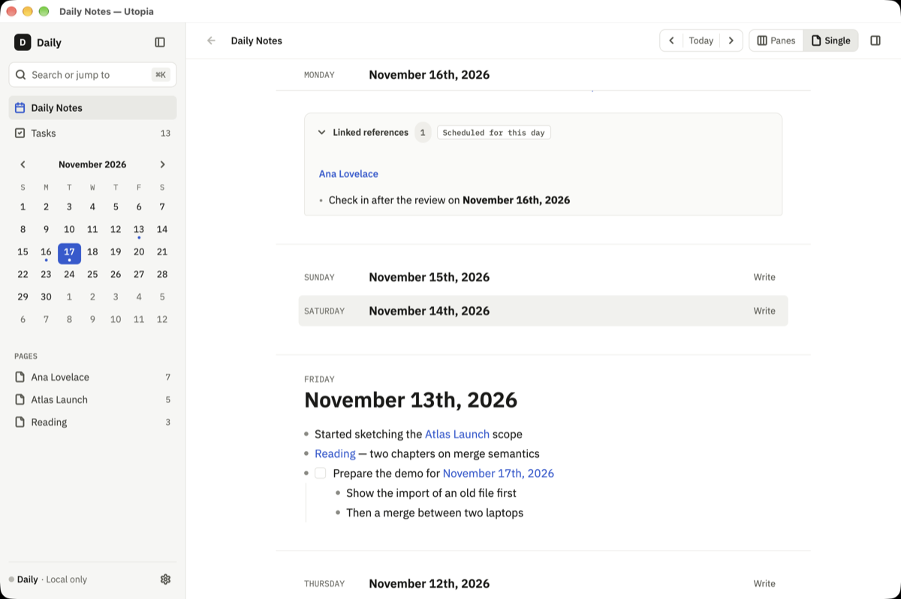
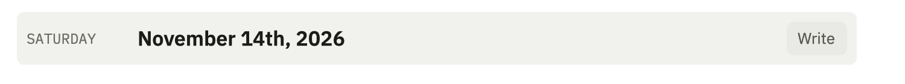
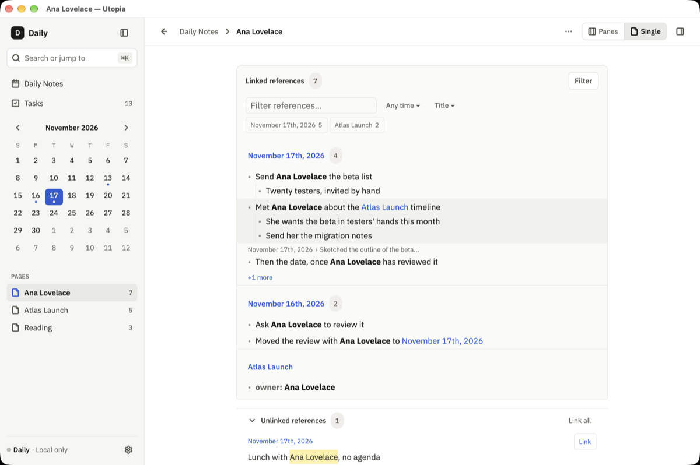

# Design critique findings

This document collects every finding from the `/craft:craft-critique` runs. Use it as the
backlog before you fix anything. Each finding has an id, an impact, the place, the problem,
the reason it matters and a fix. The fix is a proposal. Choose the fixes before you start.

**Impact levels** (from the critique rules):

- **Blocks** — the finding blocks or misleads the user.
- **Slows** — the finding slows the user down.
- **Careless** — the finding makes the screen look careless.

**Status values:** `open`, `chosen`, `fixed`, `partly fixed`, `won't fix`. Each closed finding has a **Resolution** line.

**Runs:**

| Date | Scope | Method |
|---|---|---|
| 2026-11-16 | Daily Notes feed | Real app, scratch graph from `xtask seed-daily`, 1280×852 pt, light and dark, scroll, edit, hover, Write, Tab |
| 2026-11-16 | Daily Notes, second pass | `seed-daily` now has date links and a plain-text mention |
| 2026-11-16 | Design system | `DESIGN.md`, `crates/utopia-ui/src/theme.rs`, token use in `crates/utopia-ui/src`, contrast calculations |
| 2026-11-17 | Fixes (branch `fix/design-critique-daily-notes`) | DESIGN.md rewritten, Daily Notes fixes, re-captured light and dark; shots in `docs/verification/fix-design-critique-daily-notes/` |

Values read from screenshots are estimates (±2 pt).

---

## 1. Daily Notes feed: day header and day sections

### C-DAY-1 — The sticky day header shows half-cut text · Blocks · fixed
- **Where:** The stuck day header, while the feed scrolls (DESIGN.md §3.5).
- **Problem:** A line of text shows between the stuck title and its bottom divider, with
  the top half of each letter cut off. In the second pass it also cuts through the
  "Linked references" header of a day.
- **Why:** The text cannot be read and looks like a rendering bug.
- **Fix:** Extend the header's opaque `paper` fill down to its bottom border, or put the
  border at the edge of the fill.

- **Resolution:** The first diagnosis was wrong. A red test fill showed that the header does cover the list: the text is cut exactly at its bottom edge. A row half under the edge looked like a rendering bug because the 1 px `line` edge is faint. The compact header (C-DAY-2) shows much less of this, and DESIGN.md §3.5 now states that nothing shows through. §7 records the GPUI drawing order.
### C-DAY-2 — The stuck header is too tall · Slows · fixed
- **Where:** The same stuck header.
- **Problem:** When stuck, it keeps the weekday label, the Today pill and the 30 pt title,
  about 100 pt in total. With the 52 pt top bar, about 18 % of the window is always chrome.
  It also repeats the next day's heading as that heading scrolls into view.
- **Why:** This goes against DESIGN.md §1.1, "Chrome never competes with the notes".
- **Fix:** When the header is stuck, use a compact form: one row with the weekday and the
  title at 17/600, like the empty-day row. Collapse the Today pill into that row.

- **Resolution:** The pinned header is one 44 px row (weekday, 17/600 title, Today pill) and shows only after the day's own title has scrolled under it (DESIGN.md §3.5; `long_day_keeps_its_date_at_the_top`).
### C-DAY-3 — The gaps around an empty-day group are not equal · Slows · fixed
- **Where:** A group of empty days in the feed (§3.6).
- **Problem:** The first empty row sits against the divider above it (0 pt gap). There is
  about 40 pt below the last row.
- **Why:** §2.3 asks for 40 pt above and below each divider. With 0 pt above, the group
  looks like part of the day before it.
- **Fix:** Use the same gap above and below the group.

- **Resolution:** Every day divider now has 40 px above and 24 px below (`DAY_DIVIDER_BELOW`), for open days and empty-day groups alike (DESIGN.md §2.3).

### C-DAY-4 — The empty-day rows are not evenly spaced · Careless · fixed
- **Where:** Rows inside an empty-day group.
- **Problem:** The first gap is about 46 pt and the gaps after it are about 48 pt.
- **Why:** An uneven pitch makes the list look ragged.
- **Fix:** Give each row a fixed height (`EMPTY_DAY_HEIGHT`) and put `EMPTY_DAY_GAP`
  (4 pt) between rows, as §3.6 says.

- **Resolution:** The divider and its space moved out of the first row, so every row is 44 px with 4 px gaps (DESIGN.md §3.6).
### C-DAY-5 — The empty-day row hover runs edge to edge with square corners · Careless · fixed
- **Where:** The pointer on an empty-day row.
- **Problem:** The hover fill covers the full width of the divider, with square corners.
  Other row hovers stay inside the column with radius 6 (§4.5).
- **Why:** The same kind of piece shows two different hovers.
- **Fix:** Use the row hover from §4.5: inset, radius 6, 8 pt past the text on each side.
  See SYS-9 for the hover token.

- **Resolution:** The row hover is inset: `--hover`, radius 6, 8 px past the text (`ROW_HOVER_BLEED`).

### C-DAY-6 — "Write" has no hover of its own · Careless · fixed
- **Where:** The "Write" button on an empty-day row.
- **Problem:** The capture with the pointer on "Write" looks the same as the capture with
  the pointer on the row.
- **Why:** §3.4 gives a ghost button a `hover` fill. Without it, you cannot see that the
  button is a separate target.
- **Fix:** Use `quiet_control` (or its hover) for "Write".

- **Resolution:** "Write" uses `quiet_control_in_row`: its hover is `--selected`, so it shows on the row's `--hover` fill (DESIGN.md §3.4).
---

## 2. Linked and unlinked references

### C-REF-1 — Today's title is a blue link inside today's references · Blocks · fixed
- **Where:** The Linked references panel inside a day in the feed.
- **Problem:** "Kickoff is on **November 16th, 2026**" links to the day that is already on
  screen.
- **Why:** §3.7 says that the current page's name in a reference is bold `ink`, not a
  link. The page view does this correctly ("Ana Lovelace" is bold), so only the feed is
  wrong.
- **Fix:** Use the page view's current-page rule for the day in the feed.

- **Resolution:** The feed passes each day's title to its references as the current page, so the day is bold `--ink`. Date links typed in another form (for example ISO) are still links; see "Still open".
### C-REF-2 — Every group in the feed has "Scheduled for this day" · Slows · fixed
- **Where:** Reference group headings in the feed.
- **Problem:** The label shows on all groups, including a normal page (Atlas Launch).
  `page_view.rs:2301` sets it as `daily && g.page.id != *page`. Each group heading also
  shows a count badge of "1".
- **Why:** A label that is on every group tells the reader nothing. With the count badge,
  each heading holds three items.
- **Fix:** Show the label only on references that really schedule something (see SYS-6).
  Hide the count badge when it is 1.

- **Resolution:** "Scheduled for this day" is in the panel header once, on daily pages (FR-1.12); a group shows its count only when it is above 1 (DESIGN.md §3.7; `a_days_references_say_scheduled_once_in_the_header`).

### C-REF-3 — The unlinked-reference rows do not line up with the column · Slows · fixed
- **Where:** Page view, Unlinked references, when open.
- **Problem:** The date and the text start about 16 pt to the left of the column edge
  that the Linked references panel uses.
- **Why:** The ragged left edge makes the section look like it belongs to something else.
- **Fix:** Start the rows on the same edge as the panel content.

- **Resolution:** The unlinked header and rows start on the groups' edge (`UNLINKED_INSET`).
### C-REF-4 — A reference breadcrumb is cut in the middle of a word · Careless · fixed
- **Where:** Page view, Linked references, the breadcrumb above a nested reference.
- **Problem:** It reads "…Sketched the outline of the beta announc", with no ellipsis.
- **Why:** It looks like a bug, and you cannot tell that the text continues.
- **Fix:** Truncate with an ellipsis ("…announ…"), or cut at a word boundary.

- **Resolution:** A path part longer than 40 characters is cut at the last whole word and ends with "…" (`path_label`, unit test).
---

## 3. Outline blocks

### C-BLK-1 — Tag chips almost touch · Careless · won't fix
- **Where:** A block with `#atlas #beta`.
- **Problem:** The gap between the two chips is about 2 pt.
- **Why:** The two chips look like one bar.
- **Fix:** Put at least 4 pt between neighbouring chips.

- **Resolution:** Two chips share the one space between them, about 4 px wide, and a GPUI text run cannot be made wider. A 4 px gap would leave no inner padding. DESIGN.md §3.1 now states the real rule (2 px).
---

## 4. Sidebar

### C-SIDE-1 — Counts fail contrast on the active and hovered nav rows · Blocks · fixed
- **Where:** The open to-do count on the Tasks row (and every count on a nav row) when the
  row is active or under the pointer.
- **Problem:** `muted` (#6F6F68) on `selected` (#E9E9E5) is 4.16:1, and on `nav_hover`
  (#EDEDEA) it is 4.31:1. In dark mode, `muted` on `selected` is 4.26:1.
- **Why:** Small text needs 4.5:1. §2.1 says that every pair passes, but these pairs come
  from the spec's own nav rules.
- **Fix:** On an active or hovered row, draw the count in `ink_3`, or darken `muted` until
  it reaches 4.5:1 on `selected`. Add these pairs to the contrast test in `theme.rs`.

- **Resolution:** Sidebar counts are `--ink-3`. `--muted` is now `#6C6C65`, which passes on `--hover` and `--nav-hover`. The contrast test checks the new pairs.
---

## 5. Keyboard and accessibility

### C-A11Y-1 — Tab reaches no controls, and there is no focus ring · Blocks · open
- **Where:** All screens. Seen on the feed: two Tab presses changed nothing on screen.
- **Problem:** Tab means Indent inside the editor and does nothing outside it.
  `FOCUS_RING` and `FOCUS_RING_OFFSET` are defined in `theme.rs` but used in 0 places.
- **Why:** Without a mouse, you cannot reach "Write", "Today", the reference headers or
  "Link". §3.4 and §5 require Tab focus with a 2 pt `link` ring.
- **Fix:** Decide a focus order for the chrome (see SYS-4), give the controls focus
  handles, and draw the ring from the token.

---

## 6. Design system (DESIGN.md and theme.rs)

This run reviews the system, not a screen. The "render" is the set of screenshots above:
most screen findings come from a gap in the spec. The code is disciplined: there are **0**
raw colours outside `theme.rs`, and most sizes come from named constants (113 `px(n)`
literals remain, 32 of them `px(0.)`).

### SYS-1 — DESIGN.md is out of date · Blocks · fixed
- **Problem:**
  - §2.1 says "No dark mode yet", but `Theme::dark()` exists and follows the system.
  - §6 lists the right panel and the command palette as not designed, but both are in
    the app.
  - §3.2 says the "Recent days" list was removed. AGENTS.md still describes it.
  - §2.2 asks for letter-spacing and antialiased smoothing. `theme.rs` says gpui 0.2.2
    cannot do either.
- **Why:** A spec that is wrong in some places is not trusted in the others.
- **Fix:** Update or remove each stale line. Add a "Last checked against the app" date at
  the top.

- **Resolution:** Dark mode, the right panel, the palette, letter-spacing and the recent days list are corrected in DESIGN.md and AGENTS.md. DESIGN.md has a "Last checked against the app" date.
### SYS-2 — The token list is not complete · Blocks · fixed
- **Problem:** §2.1 says "don't hardcode values outside this list", but §4.5 uses
  `--danger` and `--danger-bg`, which are not in the list. `theme.rs` has 11 colour tokens
  that the spec does not define: `selection`, `code_bg`, `banner_bg`, `highlight_bg`,
  `danger`, `danger_bg`, `warning`, `success`, `scrim`, `pdf_highlight`, `pdf_selection`.
  Their dark values are not in the spec either.
- **Why:** The spec and the code disagree on what a token is. A new screen cannot know
  which colours it may use.
- **Fix:** Add every token to §2.1 with its light value, its dark value and its use. Add a
  dark column to the table.

- **Resolution:** §2.1 lists all 32 colour tokens with light and dark values; `theme.rs` cites it.
### SYS-3 — The spec uses web terms that gpui cannot do · Blocks · fixed
- **Problem:** CSS custom properties, `position: sticky`, `writing-mode: vertical-rl`,
  `accent-color`, `margin-left: 31px; padding-left: 13px`, `:focus-visible`-style outlines,
  `aria-pressed`, landmarks, the URL, letter-spacing. AGENTS.md "Known limits" records
  each workaround after the fact.
- **Why:** The person who builds the screen must guess a mapping each time. Some guesses
  become bugs (C-DAY-1 comes from a sticky header made without `position: sticky`).
- **Fix:** Add a "Platform mapping" section: for each web term, give the gpui equivalent,
  or say "not possible, do X instead". Write new rules in platform-neutral terms.

- **Resolution:** New §7 "Platform mapping (GPUI 0.2)".
### SYS-4 — Focus is required but not specified · Blocks · fixed
- **Problem:** §3.4 says "Every interactive element must be a real button … so keyboard
  Tab works". gpui has no such element. The spec gives no focus order and does not say
  how Tab shares the key with Indent.
- **Why:** This gap is the cause of C-A11Y-1.
- **Fix:** Specify the focus order per screen (sidebar → top bar → content → panel), the
  key that leaves the editor to the chrome (for example Escape, then Tab), and the ring.

- **Resolution:** §5 specifies focus order, the Tab/Indent split and the ring. Building it is C-A11Y-1, still open.
### SYS-5 — Some contrast pairs that the spec implies fail · Blocks · fixed
- **Problem:** See C-SIDE-1: `muted` on `selected` 4.16:1, on `nav_hover` 4.31:1, on
  `highlight_bg` 4.43:1. In dark mode, `muted` on `selected` is 4.26:1. §2.1 says
  "The pairs above already pass".
- **Fix:** List every text/background pair that the components create, not only the token
  pairs, and test each one in `theme.rs`.

- **Resolution:** See C-SIDE-1. §2.1 names the remaining trap (`--muted` on `--selected`).
### SYS-6 — Behaviour rules are missing, and each gap became a screen bug · Slows · fixed
- **Problem:** The spec says nothing about:
  - the sticky day header (→ C-DAY-1, C-DAY-2);
  - when "Scheduled for this day" applies (→ C-REF-2);
  - the hover of an empty-day row and of "Write" (→ C-DAY-5, C-DAY-6);
  - how a reference breadcrumb truncates (→ C-REF-4).
- **Why:** Each missing rule caused a guess, and each guess caused a finding.
- **Fix:** Add each rule to the component that owns it in §3.

- **Resolution:** Rules added: pinned header (§3.5), Scheduled label (§3.7), row and Write hover (§3.4, §3.6), breadcrumb (§3.7), current day in feed references (§3.7).
### SYS-7 — Ranges in place of values · Slows · fixed
- **Problem:** "28 to 32px tall", "padding 0 8 to 10px", "400 or 500", "13/20 or 12/18",
  "480 to 720", "11 in sidebar".
- **Why:** Each range is a decision that the spec leaves to the builder, and two builders
  will choose differently.
- **Fix:** Give one value per role. If two values are both real, make them two named
  variants.

- **Resolution:** One value per role: ghost text button 32/10 and quiet control 28/8 are two named variants; label weight 500; caption is its own role; pane width 560.
### SYS-8 — The spec breaks its own spacing scale · Slows · fixed
- **Problem:** §2.3 allows 4, 8, 12, 16, 20, 24, 32, 40, 48, 56, 64, 96. The spec also uses
  31, 13, 15, 14, 10, 7, 6, 18, 28, 72 and 92 for gaps and paddings.
- **Why:** A rule that the spec itself does not follow is not a rule.
- **Fix:** Split "spacing" (gaps and paddings, on the scale) from "dimensions" (fixed sizes
  such as 34, 36, 44, 52, 92). Move each off-scale gap onto the scale, or name it as a
  dimension with a reason.

- **Resolution:** §2.3 splits spacing (on the scale, now with 72) from dimensions (a table), and lists the six in-component paddings that may be off the scale. Tasks gaps moved to 12 and 8.
### SYS-9 — Too many greys that look the same · Slows · partly fixed
- **Problem:** Six surface fills (`paper`, `shelf`, `well`, `hover`, `selected`,
  `nav_hover`) and three borders. The borders contrast with `paper` at 1.16, 1.24 and
  1.32:1, so you cannot see the difference between them. There are four hover fills for
  the same idea: `hover` (ghost button), `nav_hover` (sidebar), `shelf` (property row),
  `well` (task row).
- **Why:** Near-same tokens are chosen at random, and the same piece then looks different
  on different screens (C-DAY-5).
- **Fix:** Keep one hover fill and one selected fill for rows and buttons. Keep two border
  weights (`line`, `line_strong`). Map the old names to the new ones in one change.

- **Resolution:** Two hover fills only: `--hover` on paper and well, `--nav-hover` on shelf (property row and task row moved to `--hover`). The three borders stay, each with one written role, because they are never side by side.
### SYS-10 — The type scale has too many sizes · Slows · partly fixed
- **Problem:** 11 sizes: 11, 12, 13, 14, 15, 16, 17, 20, 26, 30, 36. Some are used once:
  15 (workspace name, reference text), 17 (empty-day title), 26 (day title in a pane).
- **Why:** Sizes 1 pt apart do not make a visible hierarchy. They only add choices.
- **Fix:** Reduce to about 7 roles (for example 12, 13, 14, 16, 20, 30, 36). Use 16 for the
  empty-day title and 14 or 16 for reference text.

- **Resolution:** §2.2 is now one ramp table tied to `TypeRole`s, and 15, 17 and 26 are fenced to the roles that name them. Fewer sizes would change every screen, so that is left for a separate change.
### SYS-11 — "Fully round" is written four ways · Careless · fixed
- **Problem:** Radius 13 for the status pill, "fully round" for count badges, the Today
  pill and the due label. `RADIUS_PILL = 13` is used on pieces that are 20 pt tall.
- **Fix:** Add one "round" radius (half the height) and use it for every pill.

- **Resolution:** One "Round" radius (13) for every pill; each is at most 26 tall.
### SYS-12 — There is no state table per component · Careless · fixed
- **Problem:** Hover, pressed, focus, disabled and selected are in prose and only for some
  components. Most components have no pressed or disabled state.
- **Fix:** Give each component in §3 a small table: default, hover, pressed, focus,
  selected, disabled.

- **Resolution:** State tables for blocks, sidebar rows, buttons, empty day rows, references, segmented control and task rows. The right panel and the palette still have none (§6).
### SYS-13 — There are no motion tokens · Careless · fixed
- **Problem:** The only motion rule is "120 ms ease-out, or not at all" for collapse
  (§5). The pane smooth scroll, menus and the palette have no duration or curve. The
  code respects Reduce Motion (`workspace.rs:210`), but the spec does not name it as a
  rule for each animation.
- **Fix:** Add two or three duration tokens (open, close, scroll), one curve, and the
  Reduce Motion rule.

- **Resolution:** §2.6 names the two motion tokens that exist (`SCROLL_ANIM`, `BLINK_INTERVAL`) and says nothing else animates.
### SYS-14 — Screens define their own components · Careless · fixed
- **Problem:** §4.5 (Tasks) defines a task row, a due label, a group header and an empty
  state in the screen section. The §4.4 segmented control is reused in §4.5 by reference
  ("same style as §4.4").
- **Why:** The next screen that needs a due label or a segmented control will not find
  it in §3.
- **Fix:** Move each reusable piece into §3 and keep §4 for layout and behaviour.

- **Resolution:** Segmented control is §3.9, task row and due label are §3.10; §4.5 refers to them. No existing section number moved (about 200 code citations).
---

## After the fixes (2026-11-17)

### Still open

- **C-A11Y-1 (focus):** specified in DESIGN.md §5, not built. It needs focus handles on the chrome and a keyboard-only ring; it touches every screen, so it is a separate change.
- **C-REF-1, other date forms:** a reference that links the day as `[[2026-11-17]]` (ISO) still shows a link, because the bold rule compares titles. Only the graph's own date format is bold.
- **SYS-9 borders and SYS-10 type sizes:** documented, not reduced (see their resolutions).
- **Right panel and command palette:** no section in DESIGN.md yet (§6).
- **Reduce Motion:** not tested by hand; the code checks the setting.

## Project decisions (not findings)

These differ from the critique rules on purpose, so they stay as they are:

- To-do rows show a bullet and a checkbox, so their text starts about 32 pt to the right
  of the text in plain rows (§3.1).
- "Write" is a ghost text button (§3.6).
- The mini calendar always shows 6 rows, so the Pages list does not move when the month
  changes.
- The yellow fill on an unlinked mention is `highlight_bg`, the same token as search hits.
- The light title bar in the dark captures is an artefact of `UTOPIA_APPEARANCE=dark` on a
  Mac set to light.

## Not checked yet

- Reduce Motion: I did not change the system setting.
- Dark mode: only the top of the feed was captured.
- Panes mode, Tasks, the graph view, Settings and the properties bar: no critique run yet.
- Phone width: not relevant (desktop only, min width 960).

## Evidence

The screenshots in `docs/design-critique/` come from a graph seeded with
`cargo run -p xtask -- seed-daily <graph>` and captured with `UTOPIA_SHOT_SCRIPT`
(see AGENTS.md "Verifying a change").
