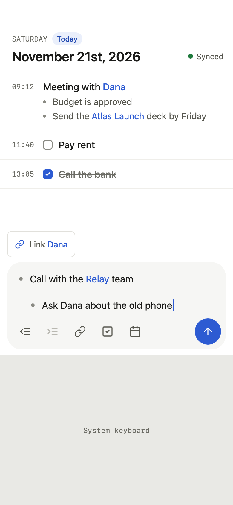
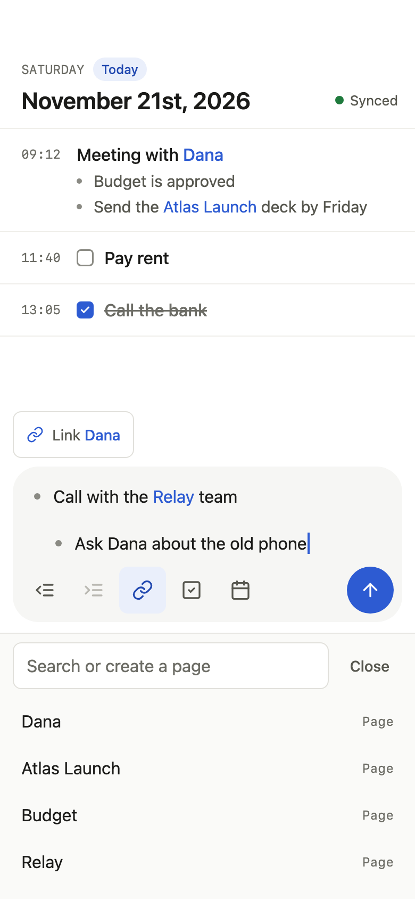
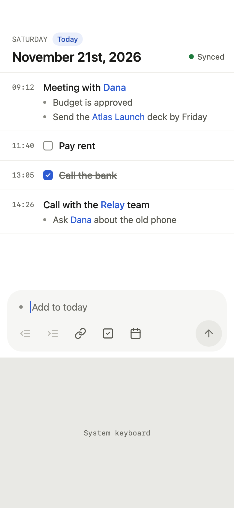

# PRD: Utopia for iPhone — adding blocks by touch

| Field | Value |
|---|---|
| Document version | 0.3, typed date links |
| Date | 2026-11-25 (0.2: 2026-11-21; 0.1: 2026-11-18) |
| Owner | Aditya Daniel |
| Source of behaviour | `~/Developer/utopia/PRD.md` (§2.3, §4, §5, §6, §10, §12, §14), `DESIGN.md`, `docs/sync-modes.md`, `mobile/ios/UtopiaMobile`, `crates/utopia-ffi` at `main` `aa42d2e` |

The existing PRD stays the spec for the data model, the resolver, sync and every `FR-`/`AC-`
id. This document covers the iPhone app only. New ids start with `IO-`.

**What changed in 0.3.** Words in the compose box that name a day now get a date chip like a
page-title chip: a tap links the day the reader saw, and the Send writes its title (§4.6,
AC-4.12, AC-4.13, ADR 0013). The Date control stays.

**What changed in 0.2.** The owner tried four interactive prototypes and chose direction A
in a changed form: the outline is written in the compose box, the phone only adds to
today's note, and the note above the box is a day log, not the desktop outline. §4 is now
the design to build. The place marker, the edit of existing blocks, swipe and long-press
are removed from v1. Ids of removed criteria are not used again.

**Answers from the owner.**

| # | Date | Answer |
|---|---|---|
| K1 | 2026-11-18 | The phone's main job is capture. Reading comes second. Heavy restructuring stays on the Mac. |
| K2 | 2026-11-18 | The desktop outliner is wrong on a phone in four ways: nesting by Tab and Shift+Tab (the worst), typing `[[` and its autocomplete, small targets, too much on screen. |
| K3 | 2026-11-18 | Besides typing in the app, the first release must start a capture from a widget or the lock screen. |
| K4 | 2026-11-18 | It is not a copy of the desktop outliner. The data model is the same as desktop. |
| K5 | 2026-11-20 | Direction A. The outline is written in the compose box, as in a chat app (ChatGPT, Claude). |
| K6 | 2026-11-20 | The phone is append only. Each capture goes to the daily note of that day. This replaces "light edits" in the first K1 answer. |
| K7 | 2026-11-20 | The note above the compose box must not look like the desktop outline. |
| K8 | 2026-11-20 | The action bar has icons only, with no text labels. The compose box is a filled rounded rectangle with the actions inside it. |
| K9 | 2026-11-21 | A to-do can be ticked on the phone. This is the one change to a sent block that the phone makes. |
| K10 | 2026-11-21 | A new line after a to-do line stays a to-do. A day log with no times is acceptable if the core cannot give a creation time. |
| K11 | 2026-11-21 | Each Send starts new top-level blocks at the end of today's note. A capture never goes below an entry sent before. |

## 0. What exists today

Read from the repo. I did not run the shell.

- `mobile/ios/UtopiaMobile` is about 450 lines of SwiftUI: today's page as a flat read-only
  list, a one-line capture field at the bottom, `[[` title suggestions, a page screen with
  Linked References, and a sync sheet (relay URL, graph id, token, passphrase).
- It stops at one level: every capture is a top-level block on today's page.
- It has not run on an iPhone or a simulator (`AGENTS.md`, Known limits).
- The mobile core (`utopia-ffi`) has nine calls. `append_block(page_id, text)` adds one
  block at the top level of a page. `BlockView` has `id`, `text`, `plain` and `depth` only:
  no block kind, no done state, no creation time, no parsed links.
- Two things in the shell break the existing rules and must not carry over:
  - It finds links and tags by parsing block text in Swift (`linkedTitles`). The existing
    PRD §14.4 says the core alone decides what is a link.
  - `[[` suggestions need the user to type `[[` first, which is the hassle named in K2.
- To check: the core's `today()` comment says the day's page is "created (with one empty
  block) on first open". FR-1.2 says a day becomes a page on its first write, never on a
  visit.

## 1. Problem

A thought arrives when the owner is away from the Mac. Today they cannot put it into Utopia
at all, so it goes into another app and is copied later, or is lost.

The desktop way of adding blocks does not move to a phone:

- **Nesting is done with Tab and Shift+Tab.** A phone keyboard has neither.
- **Links are typed as `[[Title]]`.** On a phone keyboard the brackets are two layers down,
  and the autocomplete covers the text.
- **Structure is fixed by moving text.** Small bullets and drag handles are hard to hit with
  a thumb.
- **The screen shows everything.** Sidebars, references and panes are too much for one line.

## 2. Users

- **Primary: the owner, away from the Mac,** one hand on the phone, 5 to 30 seconds to spare.
  They want the thought in today's note, linked, and to see it on the Mac later.
- **Secondary: the same person, reading.** In a meeting or on a train they open a person or
  project page and read what links to it.
- **Not served in v1:** a person who uses only the phone and wants to edit an outline;
  iPad users; Android users.

## 3. Goal and success metrics

**Goal.** A thought goes from the lock screen into today's note, with its links, its place
in a small outline and its to-do state, without one bracket, Tab or drag.

| # | Metric | Target |
|---|---|---|
| G1 | Lock screen or widget tap to first character typed | ≤ 2 s on a warm app, ≤ 4 s cold [ASSUMPTION] |
| G2 | Characters `[`, `]`, `#`, `(` the user must type to make a block with two page links and a tag | 0 |
| G3 | Taps to put a line one level deeper, or one level shallower | 1 |
| G4 | Captures while offline that reach the Mac after the next sync | 100%, no duplicates |
| G5 | Smallest touch target for any action | 44 × 44 points |
| G6 | The owner's own use | 14 days with no capture made in another notes app [ASSUMPTION] |
| G7 | Data safety | After a scripted session on the phone, `utopia doctor` on the synced Mac graph reports zero problems |

## 4. Design: the composer that adds to today

This section is the design to build. Where it and the prototype disagree, this section is
correct.

| Compose | Link picker | After Send |
|---|---|---|
|  |  |  |
| A draft of two lines. "Relay" is an accepted link. The caret is in the second line, so the app offers "Link Dana". | Link puts the page picker in the place of the keyboard. | The draft is the last entry of the day. The box is empty and has the caret. |

The pictures are drawn from the prototype's layout with the system font. The grey area
is where the system keyboard is. The interactive prototype is a private canvas of the
owner (`https://claude.ai/artifact/PrKujPj5EXXNdCkZ8oyb23`, artboard A). It uses IBM Plex,
and a builder agent cannot open it, so everything necessary is written here.

### 4.1 The idea

- The phone **only adds**. It adds to the daily note of the day on which Send is pushed.
  It does not change, move or delete a block that is in the graph. The one exception is
  the tick of a to-do (K9).
- You write a **small outline in the compose box**: one line for each block, with depth.
  One Send adds all of it to the end of today's note, in one write.
- The note above the box is a **day log**: what is in today's note, in time order, for
  reading.
- Nesting is a property of a line in the draft. There is no place marker and no "where
  will the next block go" state.

### 4.2 Words

| Word | Meaning |
|---|---|
| Draft | The lines in the compose box that are not sent. Local to the phone. |
| Line | One row of the draft. It becomes one block. It has text, a depth, a to-do flag and accepted links. |
| Depth | 0 for a top-level line. A line with depth *n* + 1 becomes a child of the nearest line above it with depth *n*. |
| Entry | One top-level block of a daily note with all blocks below it. The day log shows one entry in each row. |
| Active line | The line that has the caret. The action bar acts on it. |

### 4.3 The Today screen

From top to bottom. The screen does not scroll as a whole; only the day log and, when it
is long, the draft scroll.

1. **Header.** The system navigation bar, with the inline large title display mode
   (`.inlineLarge`): the day's title as the title and the weekday as the subtitle. The
   sync status (an 8 pt dot and a short text, 13 pt) and Find are toolbar buttons at the
   trailing edge. Changed by the owner on 2026-11-23: every screen uses the native
   navigation bar and toolbar, and there is no custom header, back or close button.
2. **Day log.** Takes all the height that is left. It scrolls. See §4.4.
3. **Suggestion row.** Shown only when the active line has a suggestion. See §4.6.
4. **Compose box.** See §4.5.
5. **System keyboard, or a picker in its place.** See §4.6.

Spacing: the suggestion row and the compose box sit in an area with 12 pt at each side,
8 pt above and 10 pt below, and 8 pt between them. There is no rule between the day log
and this area.

### 4.4 The day log

- One row for each entry, oldest first, newest last. A 1 pt `line-soft` rule between rows.
  Row padding: 12 pt above and below, 20 pt leading, 16 pt trailing.
- **Time column.** 52 pt wide, label font, 12 pt, `muted`. It shows the time at which the
  entry's top-level block was made, in the device's time format. If the core cannot give
  that time, the column is empty and keeps its width, which is acceptable (K10; the core
  does not expose the time today).
- **First line** (the top-level block): 16/24 pt, medium weight, `ink`, no bullet.
- **Lines below it:** 15/22 pt, regular, `ink-3`, each with a 5 pt round bullet (`bullet`)
  in a 16 pt column. Each level deeper than the first adds 16 pt of indent. 2 pt between
  lines.
- **To-do:** a 16 pt box (4 pt radius, 1.5 pt border in `bullet`) in a 26 pt column in the
  place of the bullet. Done: the box is filled with `link` and has a white check; the text
  is `muted` and struck through. A tap on the box ticks the to-do, and a second tap
  removes the tick (K9). The touch target is 44 × 44 pt around the box, and VoiceOver
  reads "Mark done" or "Mark not done". The tick shows at once and does not wait for sync.
  It works for a to-do in any day of the log and on a page screen.
- **Links, tags and dates** show in `link` colour with no brackets. A tap opens the page
  (IO-7). Which parts are links comes from the core (C1).
- **Blocks the phone cannot make** (headings, quotes, code, numbered blocks, block
  references, embeds, attachments, queries) show as readable text or a labelled
  placeholder, never as raw markup.
- Blocks that arrive by sync show as entries in the same way. The log does not mark
  where a block came from.
- After a Send, the log scrolls to show the new entry. A sync that adds blocks does not
  move the scroll position.
- Apart from the tick of a to-do, a row is not editable. There is no row menu, no swipe
  action and no drag.
- An empty day shows one line of `muted` text in the middle of the log: "Nothing for
  today yet."
- Earlier days: scroll up past the top of today to load the day before, with its own
  header row (weekday and title). They are read-only in the same way. A Send always goes
  to today (AC-2.3).

### 4.5 The compose box

**Shape.** A rounded rectangle filled with `shelf`, with a 24 pt corner radius, no border
and no shadow. It has two parts: the lines, and below them the action bar. On the phone
this radius is a new token; `DESIGN.md` stops at 13.

**Lines.**

- Padding of the lines area: 6 pt above, 10 pt leading, 14 pt trailing.
- Each line has a 26 × 44 pt mark column, then the text. The mark is a 6 pt round bullet
  (`bullet`), or a 16 pt empty to-do box when the line is a to-do.
- Indent: 20 pt for each level of depth, before the mark.
- Text: 16/22 pt, `ink`. A line is at least 44 pt high and wraps; it does not scroll
  sideways. An accepted link shows in `link` colour (§4.6).
- Empty first line: "Add to today" in `muted`. An empty later line: "Next line", or
  "Next to-do" when the line is a to-do.
- The lines area shows about three lines (138 pt), then scrolls inside the box. When a
  line is added, it scrolls to show that line. With the largest text sizes the limit is
  three lines of the current size.
- A draft always has one line or more. The first line always has depth 0.

**Action bar.** Icons only, inside the box, 8 pt from its sides and bottom. Each control
is 44 × 44 pt with a 20 pt icon in `ink-3`, and 2 pt between controls. From the leading
edge:

| Control | Suggested SF Symbol | Does | Not available when |
|---|---|---|---|
| Shallower | `decrease.indent` | Active line and its sub-lines go one level up | Depth is 0 |
| Deeper | `increase.indent` | Active line and its sub-lines go one level down | It is the first line, or it is already one level deeper than the line above it, or it is at depth 11 |
| Link | `link` | Opens the page picker | — |
| To-do | `checkmark.square` | Makes the active line a to-do, or a bullet again | — |
| Date | `calendar` | Opens the day picker | — |
| *(space)* | | | |
| Send | `arrow.up` | Adds the draft to today | All lines are empty |

- A control that is not available shows its icon in `disabled` and does not react.
- A control that is on (To-do for a to-do line; Link or Date while its picker is open)
  has a `link-tint` background with an 8 pt radius and its icon in `link-hover`.
- Send is a 44 pt circle at the trailing edge: `link` fill with a white arrow. When it is
  not available: `selected` fill with a `muted` arrow.
- A tap on Shallower, Deeper, To-do or Send never takes the caret out of the active line
  and never hides the keyboard.
- Each control has a VoiceOver label: "Shallower", "Deeper", "Link a page", "To-do",
  "Add a date", "Add to today".

**Rules of the draft.**

1. *Depth rule.* A line is never more than one level deeper than the line above it. The
   app applies this after each change: a line that breaks the rule moves up until it
   obeys it.
2. *Sub-lines.* The sub-lines of a line are the lines directly below it that are deeper
   than it. Deeper and Shallower move a line together with its sub-lines.
3. *Return* makes a new empty line directly below the active line and puts the caret in
   it. The new line has the depth of the active line; if the line below the active line
   is deeper, it has that depth, so it becomes the first sub-line. The new line is a
   to-do when the active line is a to-do (K10). Return never sends, and a
   line never contains a line break.
4. *Delete at the start of an empty line.* If its depth is more than 0, it goes one level
   shallower. If its depth is 0 and it is not the only line, the line is removed and the
   caret goes to the end of the line above it (or the line below it, if it was the first).
5. *Send.* Empty lines are dropped. The depth rule is applied again. The lines go to the
   core in one call and become the last top-level blocks of today's note with their
   children, in the order written (C2, C3). Then the draft is one empty bullet line at
   depth 0, with the caret in it, and the keyboard stays up.
6. *Depth limit.* A line can be at depth 11 at most, so no block is deeper than level 12
   (FR-2.9).
7. *The draft is kept.* Lines, depths, to-do flags and accepted links are saved on the
   phone after each change and are there after the app is closed, killed or the phone is
   restarted. The draft never syncs (C7).
8. *With a hardware keyboard* (not a v1 goal, but it costs little): Tab and Shift+Tab do
   Deeper and Shallower, and Cmd+Return does Send.

### 4.6 Links, dates and to-dos

**Suggestions.** When the text of the active line contains the title or an alias of an
existing page as a whole word or phrase, in any letter case, a chip shows in the
suggestion row above the box: a link icon and "Link **Title**". The chip is 44 pt high
with an 8 pt radius, a 1 pt `line-strong` border and a `paper` fill. The row scrolls
sideways when there are many chips.

- A tap on the chip accepts the link for that line. The words stay as typed and show in
  `link` colour. The chip goes away. The caret and the keyboard do not move.
- The text never changes unless a chip is tapped (AC-4.4).
- Titles of one or two characters are not suggested [ASSUMPTION].
- If the user later changes the words so that they do not match the title, the link is
  dropped and the text is plain again.
- On Send, each accepted link is written as `[[Title]]` with the page's own spelling of
  the title: `Lunch with dana` becomes `Lunch with [[Dana]]`.
- Which titles match a text comes from the core (C1, C3). The app does not search titles
  with its own rules.

**Date suggestions.** When the words of the active line name a day, the same row offers a
chip "Link **November 26th, 2026**" with that day's title, next to any title chips. The
forms are `today`, `tomorrow`, `yesterday`, `friday`, `next friday`, `in 3 days`,
`2 weeks ago`, `Nov 26`, `26 November`, `November 26th` and `2026-11-26`, in any letter
case and as a whole word or phrase. A month and day with no year mean that day in the
current year (ADR 0013).

- A date chip works as a title chip does: a tap accepts the link for that line, the words
  stay as typed and show in `link` colour, the chip goes away, and the caret and keyboard
  do not move. On Send the words are written as `[[November 26th, 2026]]`, the day's title.
- The day is fixed when the chip is tapped, so the link means the day the reader saw. The
  typed words are stored with the link; it stays while the range still holds those same
  words (in any letter case) and the range sits on word boundaries. It is never dropped by
  time, a launch or a refresh, only when the reader edits those words.
- A bare number (`26`), a bare month name (`may`, `march`), a bare short weekday (`sun`,
  `sat`) and a numeric date (`11/6/26`, §7) are not date chips.
- Which words are a date and which day they mean comes from the core (C1, C3); the app
  never parses a date. The Date control still inserts a day from its picker.

**Link picker.** The Link control puts a panel in the place of the keyboard, with the
same height, a `well` fill and a 1 pt `line` rule above it. The compose box stays
visible above it.

- At the top: a search field (44 pt high, 8 pt radius, placeholder "Search or create a
  page") and a "Close" text button.
- Below: rows 44 pt high with the page title (16 pt) and a note at the trailing edge
  (label font, 12 pt, `muted`): "Page", or "New page".
- With an empty field the list shows recent pages. Typed text filters by title and alias.
- A tap on the search field brings the keyboard back, and the list then sits between the
  compose box and the keyboard. If that is too tight on a small phone, the builder can
  show the picker as a sheet; its content and results stay the same.
- If no page has the typed title, the last row is "Create “typed text”". The page exists
  after Send, not before (AC-4.6).
- A tap on a row inserts the title at the caret of the active line as an accepted link,
  with a space after it, closes the panel and gives the caret back to the line.
- "Close", or a second tap on the Link control, closes the panel with no change.
- Typing `[[` or `#` in a line opens the same picker, and the typed characters are
  removed (AC-4.7).

**Day picker.** The Date control opens a panel in the same place with the rows "Today",
"Tomorrow" and "Pick a date…" (the system date picker). A tap inserts the title of that
day at the caret as an accepted link.

**To-do.** The To-do control changes the active line only. A sent to-do is not done. It
is ticked in the day log (§4.4).

### 4.7 Type, colour and size

- **Font.** The system font for text and the system monospaced font for the label font
  (weekday, times, row notes). This matches the desktop default. All sizes above are for
  the default text size and must follow Dynamic Type.
- **Colour.** The token names of `DESIGN.md` ("Quiet paper"). Light values:

  | Token | Value | Token | Value |
  |---|---|---|---|
  | `paper` | `#FFFFFF` | `ink` | `#1B1B19` |
  | `shelf` | `#F6F6F4` | `ink-3` | `#57574F` |
  | `well` | `#FAFAF8` | `muted` | `#6C6C65` |
  | `selected` | `#E9E9E5` | `bullet` | `#8A8A83` |
  | `line` | `#E8E7E3` | `disabled` | `#B9B8B1` |
  | `line-soft` | `#EFEEEA` | `link` | `#2D5BD2` |
  | `line-strong` | `#E1E0DB` | `link-hover` | `#2249B0` |
  | `success` | `#1F7A3D` | `link-tint` | `#EAEFFB` |

  The dark theme uses the dark values of the same tokens from `DESIGN.md` and follows the
  system appearance. No raw colour in a view.
- **No shadows.** Surfaces differ by fill and by 1 pt rules.
- **Targets.** Each control is 44 × 44 pt or larger (G5).

### 4.8 Directions that were not chosen

- **A with a place marker** (version 0.1): one block for each Send, and Deeper and
  Shallower moved the place of the next block. Replaced, because the depth is easier to
  see in the draft.
- **B. Touch outliner:** the outline is the editing surface, with a toolbar for the
  missing keys. It is the desktop outliner again (K4).
- **C. Capture now, arrange later:** flat cards, then a separate step to nest and link.
  It makes a cleanup task, and links come late or never.
- **D. Drill-in threads:** tap a block to go into it; the composer adds to the block you
  are in. It needs navigation to nest, and it is not append only.

### 4.9 Desktop rules that rely on a keyboard

| Desktop rule | On the phone |
|---|---|
| Enter makes a sibling block | Return makes a new line in the draft. Send adds the draft. |
| Tab and Shift+Tab indent and outdent | Deeper and Shallower, on a line of the draft only. |
| Backspace at the start merges into the previous block | In the draft: on an empty line, see rule 4. No merge of two lines that have text. |
| Cmd+Shift+Up and Down move a block | Not on the phone. |
| `[[`, `#` open autocomplete | Tap-to-link suggestions and the Link control. Typing them opens the picker. |
| `((` inserts a block reference | Not on the phone. Existing ones are shown. |
| Alt+Enter cycles to-do state | The To-do control, on a line of the draft. A tap on the box of a sent to-do ticks it. |
| `/` slash menu | Not on the phone. To-do is the only block type you can make. |
| Cmd+K quick jump, Cmd+Shift+F search | One search field: pages first, then blocks. |
| Shift-click opens beside; panes | One page at a time, with Back. |
| Cmd+Z | Not on the phone. A draft is changed with the keyboard; a tick is removed with a second tap; a sent block is changed on the Mac. |
| Click a bullet to zoom; Cmd+. collapse | Not on the phone. |

## 5. Scope

**In (v1):**

- iPhone, portrait. One graph.
- Today screen: the day log and the compose box (§4). Scroll up for earlier days.
- A draft outline with Return, Deeper, Shallower, To-do, Link, Date and Send.
- Tap-to-link suggestions from existing page titles and aliases.
- Tick a to-do, and remove the tick, in the day log and on a page screen (K9).
- Page picker: recent pages, search by title or alias, create a page.
- Page screen, read-only: outline, properties shown as rows, Linked References. Tap a link
  to open its page.
- Search: page titles and block text.
- Capture from outside the app: a lock screen widget, a home screen widget, and a control
  for Control Center and the Action button. Each opens the Today screen with the keyboard
  up.
- Sync through a relay, with end-to-end encryption, token and passphrase in the Keychain.
- First run: start a new graph, or connect to an existing one by relay URL, graph id, token
  and passphrase.
- Blocks the phone cannot make are still shown (§4.4).

**Out (v1):**

- Any change to a block that is in the graph, apart from the tick of a to-do: edit text,
  delete, move, indent, reorder (K6).
- Adding to a page that is not today's note, or below an entry sent before (K11).
- A line break inside one block. Undo of a Send.
- Share sheet, voice capture, photo or scan capture. The system keyboard's own dictation
  works in the compose box with no work from us.
- Rename, merge, aliases, delete page, trash, templates, extract to page, slash menu.
- Inserting block references and embeds. Making headings, quotes, code or numbered blocks.
- Unlinked References, reference filters, the reference inspector.
- Tasks view, graph view, PDF viewer, plugins, query editing, automation API, MCP.
- Nearby Mac and shared-folder sync. `docs/sync-modes.md` says the mobile core syncs over
  HTTP only.
- iPad layout, landscape, Android.
- Encryption at rest setup on the phone. A graph already encrypted can be unlocked.
- Any AI feature (existing PRD §2.2).

## 6. User stories and acceptance criteria

All checks run on a scratch graph with the pages "Dana", "Atlas Launch", "Budget" and
"Relay".

**IO-1 Capture one line.** As the owner, I type a thought and it is in today's note.
- AC-1.1: Open the app. The first line of the compose box has the caret and the keyboard
  is up. No tap is needed.
- AC-1.2: Type `Call the bank` and tap Send. The block is the last top-level block of
  today's note and the last entry of the day log. The compose box is empty and still has
  the caret.
- AC-1.3: On a day with no page, opening the app creates no page. The first Send creates
  it with exactly the blocks sent (FR-1.2, AC-1.4 of the existing PRD).
- AC-1.4: With only empty lines or lines of spaces, Send is not available and nothing is
  written.
- AC-1.5: Write two lines, the second one level deeper, with one accepted link. Leave the
  app, kill it, reopen. The same lines, depths and link are in the compose box.
- AC-1.6: Return on the keyboard never sends.

**IO-2 Capture from the lock screen or a widget.**
- AC-2.1: Tap the lock screen widget and unlock. The Today screen is open with the caret
  in the compose box and the keyboard up. Time from tap to first character meets G1.
- AC-2.2: The home screen widget, the Control Center control and the Action button do the
  same.
- AC-2.3: If the app was last left on another page or an earlier day, the capture still
  goes to today.
- AC-2.4: With no graph set up, the tap opens first-run setup, and nothing is written.
- AC-2.5: A draft that was not sent is still in the compose box, and the caret is at the
  end of its last line.

**IO-3 Nest without Tab.** *(Rewritten in 0.2. The place-marker criteria of 0.1 are
removed.)*
- AC-3.1: Type `Meeting with Dana`, push Return, tap Deeper, type `Budget is approved`,
  tap Send. Today's note ends with `Meeting with Dana` and one child, `Budget is approved`.
- AC-3.2: In a draft, push Return on a line at depth 1. The new line is at depth 1.
- AC-3.3: Tap Shallower on a line at depth 1 that has two sub-lines at depth 2. The line
  is at depth 0 and its sub-lines are at depth 1.
- AC-3.4: Deeper is not available on the first line, and not on a line that is one level
  deeper than the line above it. Shallower is not available at depth 0.
- AC-3.5: A draft of three lines at depths 0, 1, 2. Empty the middle line and send. The
  note gets two blocks: the first line, and the third line as its child.
- AC-3.6: A draft with two lines at depth 0 makes two entries in the day log, in the
  order written.
- AC-3.7: At depth 11 Deeper is not available (FR-2.9).
- AC-3.8: On an empty line at depth 2, the delete key twice gives depth 0. A third time
  removes the line, and the caret is at the end of the line above it.
- AC-3.9: Send a draft of five lines. It is one write on the phone. After sync, the Mac
  shows the five blocks with the written order and depths, and `utopia doctor` reports
  zero problems.
- AC-3.10: With six lines in the draft, the box shows about three lines and scrolls
  inside; the header, the action bar and Send stay on screen.

**IO-4 Link without brackets.**
- AC-4.1: Type `Lunch with dana`. A chip "Link Dana" shows above the box. Tap it. The
  word shows in the link colour. After Send, the stored text is `Lunch with [[Dana]]`.
- AC-4.2: On the Mac after sync, the block is under Linked References on "Dana".
- AC-4.3: A two-word title ("Atlas Launch") is suggested when both words are typed, and
  one tap links the whole phrase.
- AC-4.4: Suggestions never change the text unless tapped.
- AC-4.5: Tap Link. The picker shows recent pages. Type `atl`, tap "Atlas Launch". The
  title is inserted at the caret of the active line as a link.
- AC-4.6: In the picker, type a title that does not exist and tap Create. The link is
  inserted. The page exists after Send, and not before.
- AC-4.7: Typing `[[` or `#` opens the same picker.
- AC-4.8: Which words are links, and which page each one names, is the same on the phone
  and the Mac for the same text. Check with the shared golden file (existing PRD §10.4
  item 11).
- AC-4.9: The Date control offers Today, Tomorrow and a date picker, and inserts a link to
  that day. On that day's page on the Mac, the block is under "Scheduled for this day".
- AC-4.10: The chips are for the active line only. Move the caret to a line with no
  matching title: the chip row goes away.
- AC-4.11: Accept "Dana", then change the word to `Dan`. The word is plain text again and
  the stored text after Send has no link.
- AC-4.12: With today on November 3rd, type `call Ana tomorrow`. A chip "Link November
  4th, 2026" shows next to any title chips. Tap it: `tomorrow` stays as typed and shows in
  the link colour, and the chip goes away. Send: the stored text is `call Ana [[November
  4th, 2026]]`. On the Mac, the block is under "Scheduled for this day" on November 4th.
- AC-4.13: Accept `friday`, then change the word to `Sat`. The word is plain text again.
  Typing `26` or `may` alone, or `11/6/26`, shows no date chip. A draft with an accepted
  date that is sent after midnight, or a week later, still writes the day the chip was
  tapped for while its words are unchanged; only editing those words drops the link.

**IO-5 To-dos.**
- AC-5.1: Tap To-do, type `Pay rent`, Send. The block is a to-do that is not done, and
  the day log shows it with an empty box.
- AC-5.2: With the caret in a to-do line, Return makes a new to-do line. A tap on To-do
  makes it a bullet line.
- AC-5.3: Tap the box of a sent to-do. It shows as done, struck through, at once. On the
  Mac after sync it is ticked. Tap it again: the tick is removed on both.
- AC-5.4: A to-do that is ticked on the Mac shows as done in the day log after sync.
- AC-5.5: The touch target of the box is at least 44 × 44 points. A tap on the text of
  the to-do does not tick it.
- AC-5.6: A tick is one core command and syncs as the same change a Mac tick makes. The
  text, the place and the children of the block do not change.

**IO-6** *(Removed in 0.2: "Fix a block already written". The phone is append only, K6.
The tick of a to-do is in IO-5.)*

**IO-7 Read a page and its references.**
- AC-7.1: Tap a link in the day log. The page opens with its outline, then Linked
  References grouped by source page with a count. Back returns to the Today screen with
  the draft as it was.
- AC-7.2: Tap a reference. The source page opens with that block in view.
- AC-7.3: Leading `key:: value` blocks show once, as rows above the outline (DESIGN §3.8).
- AC-7.4: A page screen has no compose box.
- AC-7.5: A block type the phone cannot make is shown readable, never as raw markup with
  missing text. A query block shows "Query — open on Mac".

**IO-8 Find.**
- AC-8.1: One search field. Typing `atl` lists matching pages first, then blocks that
  contain the word, each with its page title.
- AC-8.2: With an empty field it lists Today, Yesterday and the last 8 pages opened.
- AC-8.3: A title with no match shows "No page with this title". It does not offer to
  create one; a page is made by a link in a capture.

**IO-9 Sync.**
- AC-9.1: In airplane mode, send three drafts. Each appears at once in the day log. The
  status shows "Offline — 3 changes queued".
- AC-9.2: Turn the network on and open the app. Within 10 s the status shows synced, and
  the Mac shows the blocks, once each [ASSUMPTION: 10 s].
- AC-9.3: A sync round starts when the app opens, after each Send, and when the app
  leaves the screen.
- AC-9.4: A wrong token shows "sign-in required", not "Offline".
- AC-9.5: The phone and the Mac both add a line to today's note offline. After both sync,
  both show both lines.
- AC-9.6: Typing in the compose box never waits for a sync round.

**IO-10 First run.**
- AC-10.1: "Start a new graph" opens the Today screen with the compose box in under 3 taps.
- AC-10.2: "Connect to my graph" asks for relay URL, graph id, token and passphrase. After
  the first sync, the Mac's pages are on the phone.
- AC-10.3: A wrong passphrase is refused with a message and writes nothing to the relay.
- AC-10.4: The token and passphrase fields are secure fields. Neither value is shown again.

## 7. Edge cases

- **Midnight while composing.** A draft started at 23:59 and sent at 00:01 goes to the
  new day, the day of the Send (K6). The header and the day log change to the new day at
  midnight; the draft does not change.
- **Today's note changes by sync while the draft is open.** New entries appear. The
  draft, the caret and the scroll position of the log do not move. A Send still goes to
  the end of the note as it is at that moment.
- **Paste of many lines.** Each pasted line becomes one line of the draft. Leading tabs
  or two-space steps become depth, then the depth rule is applied [ASSUMPTION].
- **A suggestion matches a common word** (a page titled "On"). Titles of one or two
  characters are not suggested. The Link control still finds them.
- **A typed date that is ambiguous** (`11/6/26`). Never linked as a date (existing PRD
  §5.5). A month and day without a year (`Nov 26`) mean that day in the current year, even
  when it has already passed (ADR 0013).
- **A new title that differs from an existing one only by case or spacing.** It links to
  the existing page. No second page is made.
- **Widget tapped while the graph is locked** (encrypted at rest). The unlock screen
  shows first, then the Today screen. No text is typed into the unlock field by mistake.
- **App killed mid-Send.** After reopen, the draft is either fully in the note or fully
  back in the compose box. Never both, never a part.
- **A day with 5,000 blocks.** It opens and scrolls. Only visible rows are drawn.
- **A very long line** (2,000 characters). It wraps; the lines area scrolls.
- **The system keyboard's dictation or autocorrect** changes a word inside an accepted
  link. The link is kept if the words still name it (the title, or the day), otherwise it
  becomes plain text, and the colour shows that.
- **Low Power Mode or no background time.** Sync waits for the next open. The queued
  count is shown.
- **A to-do is ticked on the phone and its text is changed on the Mac, both offline.**
  After sync, both devices show the new text with the tick.
- **Relay speaks a newer protocol.** The app says to update. Captures stay queued.
- **Text size set to the largest accessibility size.** The action bar stays on one row,
  each control at least 44 points; the day log gets less height, never the compose box.
- **VoiceOver.** Each control has a spoken label (§4.5). A line of the draft is read with
  its level, for example "Level 2, to-do, Pay rent". An entry of the day log is read with
  its time.

## 8. Constraints for the builder

These limit the build.

- C1. One implementation of the frozen contract. The core decides what is a link, tag or
  date, which page a title names, and which titles to suggest. The app does no parsing of
  its own (existing PRD §14.4). The present shell's `linkedTitles` breaks this.
- C2. Every write is a core command, through the same path as the desktop editor, so
  references and sync behave the same (rule 13).
- C3. The mobile core needs new calls before this app can be built. That work is in the
  Rust repo (`crates/utopia-ffi`):
  - **Append an outline to today's note**, in one transaction: a list of lines, each with
    text, depth and a to-do flag. `utopia_api::Op::AppendOutline` is the same idea for
    the MCP server and is the place to start; `AGENTS.md` says it writes each line as a
    bullet, so the to-do flag needs work.
  - **Title suggestions for a text**: the page titles and aliases found in a line, with
    the range of each match.
  - **Text with links for a line**: given a line's text and its accepted ranges, the text
    to store (`[[Title]]`).
  - **The parsed parts of a block for display** (plain text, link, tag, date, each with
    its target page), plus the block's kind, its done state and its creation time.
    `BlockView` has none of these today.
  - **Set the done state of a to-do block** (K9), through the same command as the Mac.
  - **Days before today**, **block search**, **recent pages**.
  - Not necessary in v1: add under a parent, indent, outdent, move, delete, undo.
- C4. A capture started from a widget or control writes to the same graph, with one
  writer at a time.
- C5. No blocking work on the main thread. Sync is off the main thread.
- C6. Secrets in the Keychain. No telemetry by default. No model and no call to a model.
- C7. The draft, recents and scroll position are local to the phone and never sync
  (rule 9).
- C8. §4 is the design. Colours and type roles come from `DESIGN.md`; the layout does
  not. A change to §4 goes through the owner.
- C9. SwiftUI in `mobile/ios/UtopiaMobile`. The existing shell is a starting point to
  replace, not to extend as it is (A8).

## 9. Open questions

Decided in 0.2: Q1 (direction: A, as §4), Q3 (a capture always goes to today), Q4 (Return
makes a new line, Send is a control), Q5 (there is no place marker). Decided on
2026-11-21: Q12 (a to-do can be ticked on the phone, K9), Q14 (a new line after a to-do
line stays a to-do), Q15 (a day log with no times is acceptable), Q13 (a capture never
goes below an entry sent before; each Send starts new top-level blocks, K11).

2. **Does the phone hold the whole graph, or only recent days and pages?** The whole graph
   makes search and backlinks complete, and costs storage and first-sync time.
   *Recommendation:* the whole graph.
6. **Tasks on the phone.** A list of open to-dos with their boxes is small and useful
   away from the Mac, and the tick is now in v1 (K9). In v1, or after?
7. **A home screen widget that shows content** (today's open to-dos or last lines), or
   only a control that starts a capture?
8. **Oldest iOS version.** Lock screen widgets, the Control Center control and the Action
   button each need a minimum version and a recent iPhone. Which is the floor?
9. **Distribution.** TestFlight for the owner only, or the App Store? The App Store needs
   a privacy policy and review.
10. **Does the Mac need a matching change?** For example, a mark on blocks that came from
    the phone. *Recommendation:* no.
11. **Order against the Swift and AppKit Mac build** (`~/Developer/utopia-swift/PRD.md`).
    Both need a larger binding layer. Which comes first?

## 10. Assumptions

- A1. The owner already runs, or will run, a relay. Without one the phone and the Mac
  cannot share a graph in v1. [ASSUMPTION]
- A2. iPhone only, portrait only. [ASSUMPTION]
- A3. One graph on the phone. [ASSUMPTION]
- A4. The targets in G1, G6 and AC-9.2 are placeholders. [ASSUMPTION]
- A5. Share sheet, voice and photo capture come after v1 because the owner chose only the
  widget and lock screen. [ASSUMPTION]
- A6. A new line takes the to-do state of the line above it. Decided by the owner (K10);
  this replaces the 0.1 assumption that To-do turns off after one block.
- A7. There is no Undo on the phone. A wrong capture is corrected on the Mac, and a
  wrong tick is removed with a second tap. [ASSUMPTION]
- A8. The existing shell is a starting point to replace, not to extend as is. [ASSUMPTION]
- A9. Attachments made on the Mac show as a name and type on the phone; images show a
  preview once downloaded. [ASSUMPTION]
- A10. The reading parts (page screen, search, earlier days) stay in v1. K6 is about
  writing. [ASSUMPTION]
- A11. The system font is used, as on the desktop by default; the prototype used IBM
  Plex. [ASSUMPTION]

## 11. What I checked, and what I did not

- Read: `mobile/ios/UtopiaMobile` (all three Swift files), the public surface of
  `crates/utopia-ffi/src/lib.rs` (again on 2026-11-21: its calls and `BlockView`), and
  earlier in this work the full `PRD.md`, `AGENTS.md`, `DESIGN.md`, `README.md`,
  `docs/redesign-ideas.md` and the summary of `docs/sync-modes.md`.
- The pictures in §4 are a static drawing of the prototype's layout, made with headless
  Chrome at 390 × 844 points. They are not from an iPhone, a simulator or SwiftUI.
- Not done: I did not build or run the shell or the core. I did not test the interactive
  prototype; the owner used it. I did not check which iOS version each widget and control
  type needs. I did not read `Op::AppendOutline` beyond its name and the notes in
  `AGENTS.md`. I did not check `today()` against FR-1.2 beyond its comment.
