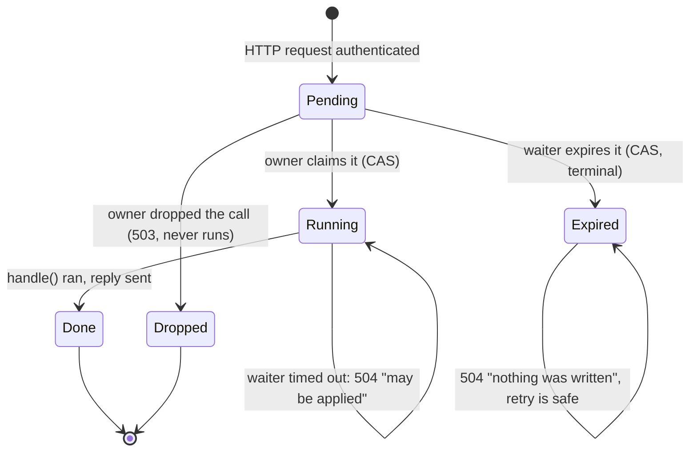

# Automation API call inbox: queued, answered, timed out but still executed

## Status

Explicit now: one `CallState` per call (`Pending` → `Running` → `Done`, or `Pending` →
`Expired`), shared between the HTTP task and the store's owner through an atomic
`CallSlot` (`crates/utopia-api/src/lib.rs:403`, `:436`). Both guards out of `Pending` are
compare-and-swaps, so exactly one side wins; the queue is bounded by `Limits`
(`:368`, `:607`). The owner's `ApiCall::run` (`:493`) checks the state, the reply channel and
the deadline before it touches the store, and every answer that is not a result says whether
the store changed (module docs, `:34`).

Fixed (the three issues this file listed):

1. **Timed-out calls no longer execute** — `run` refuses a call whose reply receiver is gone,
   whose deadline passed, or whose slot the waiter already expired (`:493`); the waiter marks
   it expired on timeout (`:745`) and only reports "it may be applied" when the owner had
   already claimed it. Tests: `a_call_whose_client_left_never_runs` (`:902`),
   `a_call_past_its_deadline_never_runs` (`:915`),
   `ac_4_1_a_timed_out_capture_is_not_written_when_the_owner_gets_to_it`
   (`crates/utopia-api/tests/http.rs:210`).
2. **The queue is bounded** — `mpsc::sync_channel(Limits::queue)` (`:607`) with `try_send`
   (`:703`): a call that does not fit is refused with 429 and never runs. Test:
   `ac_4_1_a_stalled_owner_refuses_calls_instead_of_queueing_them_all`
   (`crates/utopia-api/tests/http.rs:287`).
3. **"Graph is closed" means one thing** — the queue being gone and the owner dropping a
   queued call both answer 503 "the app is not running; nothing was written" through one
   function (`:739`), and a 504 says whether the write happened. Test:
   `ac_4_1_a_call_dropped_before_it_ran_answers_not_running`
   (`crates/utopia-api/tests/http.rs:358`).

Left, deliberately:

- A 504 is still not a *proof* that nothing was written in one case: if the owner claimed the
  call just before the wait ended, the write runs after the client gave up. The answer then
  says "it may be applied" instead of claiming nothing happened (`:756`); closing that window
  would need the store to accept a cancellation token for an operation that has already
  started, which is beyond the inbox.
- The queue bound is a refusal, not back-pressure: a client that floods a wedged owner gets
  429 rather than waiting. Blocking the HTTP task until there is room would make the client
  time out without learning whether its call was even queued, which is the ambiguity this
  file is about.

## What it controls

How an HTTP request to the loopback API (P2, §4.1) becomes a store operation on the UI thread
and how the reply gets back. `crates/utopia-api/src/lib.rs`.

## Where the state lives

| Piece | Location | Notes |
|---|---|---|
| Per-call state | `CallState`/`CallSlot` (`:403`, `:436`) | one atomic, shared by the waiter (via `Arc`) and the owner |
| Deadline | `ApiCall.deadline` (`:473`), set from `Limits::wait` (`:375`) | `Instant::now() + wait` at enqueue |
| Queue | `mpsc::sync_channel(Limits::queue)` (`:607`) of `ApiCall` (`:470`) | drained by the owner via `try_recv`/`recv_timeout` (`:525`, `:529`) |
| Per-request wait | `tokio::time::timeout(ctx.wait, …)` (`:715`) | 504 at `:745` |
| Server lifecycle | `ApiServer { shutdown, thread }` (`:516-523`), consumed only in `Drop` (`:562-570`) | – |
| Auth | loopback/Origin/token checks (`:669-694`) | stateless |

## States

Per call: **Pending** → **Running** → **Done** (executed, answer sent) · **Pending** →
**Expired** (the waiter gave up; the operation never runs) · **Pending** dropped by the owner
(app shutting down; never runs).

## Events and transitions

- request → token check → `ApiCall::new` → `try_send` into the queue (429 if full, 503 if the
  queue is gone) → await the reply up to `Limits::wait`.
- owner loop → `ApiCall::run`: `Pending --claim--> Running`, `handle(store, op)`, `Done`, send;
  refused if the reply receiver is closed, or past the deadline, or `claim` loses the race — in
  which case `expire` is set and a still-waiting caller gets a 504 "nothing was written".
- waiter timeout → `expired` (`:745`): take a reply that arrived at the same instant, else
  `Pending --expire--> Expired` and answer "nothing was written", or, when the owner had
  already claimed it, "it may be applied".

## Impossible or unhandled combinations (evidence)

1. ~~**Timed-out calls still execute.**~~ Fixed: the slot makes `TimedOut` terminal, there is
   an age check (`deadline`) and the reply channel is checked for a gone client (`:493`).
2. ~~**Unbounded queue.**~~ Fixed: `Limits::queue` + `try_send` → 429 (`:607`, `:703`).
3. ~~**"Graph is closed" has two meanings.**~~ Fixed: one `not_running()` answer (`:739`) for
   both detection points; the status table in the module docs (`:34`) says what each failure
   means for the store.

## Diagram



## The explicit type

```rust
enum CallState { Pending, Running, Done, Expired }   // lib.rs:403
struct CallSlot(AtomicU8);                            // lib.rs:436
// claim(): Pending→Running, expire(): Pending→Expired, done(): Running→Done
```

`ApiCall { op, deadline: Instant, state: Arc<CallSlot>, reply }` (`:470`); `Limits { queue,
wait }` (`:368`) is the only knob, and `serve_with` (`:594`) exposes it so tests can drive a
150 ms wait instead of sleeping 30 s.
