# App root: startup state, side tasks, Settings window handle, quit paths

## Status

The machine is explicit: `RootState::{Onboarding, Locked, Ready(Ready), Failed(String)}`
(`main.rs:165`), with the side tasks inside `Ready` (`main.rs:186`), the run decided once by
`RunMode` (`main.rs:213`), the open graph held at app level by `Running` (`main.rs:201`), and
the Settings window as `SettingsWindow::{Closed, Open(handle)}` (`main.rs:681`). All six
listed combinations are dealt with:

1. **Fixed** — a `UTOPIA_SHOT_SCRIPT` that does not parse is returned from `RunMode::from_env`
   (`main.rs:223`) before a window exists, and `run_app` exits with the parse error
   (`main.rs:818`). A scripted run can no longer look like a normal launch that nothing drives
   or quits. Tests: `a_malformed_shot_script_is_an_error`,
   `one_mode_is_parsed_for_the_whole_run` (`main.rs` tests).
2. **Fixed** — one quit path: `quit_app` (`main.rs:803`) finishes the edited block
   (`Root::end_edit :300` → `Workspace::finish_edit`, `workspace.rs:1527`) and then calls
   `AppState::flush_for_quit` (`app_state.rs:97`), which reports a writer failure instead of
   swallowing it. Every route reaches it: Cmd+Q and the Quit menu item from any window
   (`main.rs:832`; the per-workspace `Quit` handler is gone, so the action bubbles to the app),
   and the last window closing (`main.rs:866`). The app-level `on_app_quit` backstop
   (`main.rs:836`) covers a quit the app is never asked about (a logout, the system terminating
   it); `Running` keeps the store alive after its window has closed, so that flush is still
   possible. Tests: `ac_1_1_the_last_keystroke_survives_a_quit` (`main.rs`),
   `a_failed_quit_flush_is_reported` (`app_state.rs`).
3. **Fixed by construction** — `_hotkey`/`_discovery`/`_lan`/`_inbox` live in `Ready`
   (`main.rs:186`), and the inbox task is not an `Option` (it exists whenever a graph is open).
   Dropping `Ready` drops the tasks, so "Ready but discovery still running" is a field, and no
   side task can outlive its graph.
4. **Fixed by construction** — there is no placeholder state: `Root::new` (`main.rs:253`)
   computes the first state from `Root::onboarding` (`main.rs:306`) or `Root::load_graph`
   (`main.rs:387`) before the `Root` value exists. `Failed` only ever holds a real open error.
5. **Fixed** — `SettingsWindow::forget_if_closed` (`main.rs:690`) runs from the app's
   window-closed observer (`main.rs:866`), so a closed Settings window leaves `Closed`, not a
   stale handle. Test: `closing_the_settings_window_forgets_its_handle` (`main.rs`).
6. **Fixed** — `SettingsView::new` observes its own window appearance and sets the theme
   global, like the main window does (`settings.rs:200`), so Settings keeps following the
   system appearance after the main window closes. Not covered by a test: GPUI's test platform
   always reports `Light` and cannot simulate an appearance change (`platform/test/window.rs`),
   so this one is only verified by reading the code.

Two places where this differs from the sketch below, deliberately:

- `Locked { attempts: u32 }` was **not** added. A wrong passphrase already re-shows the error
  and there is no lockout to model, so a counter would be dead state; the bad states the
  document lists do not include one.
- `Mode` is spelled `RunMode`: `Mode` already means something else in `page_view` and the
  palettes, and the run mode is read once for the whole process rather than switched.
- Issue 1's fix is a hard error, not a fallback to `Interactive`. The only thing that sets a
  shot script is an unattended run; silently ignoring it would leave that run hanging at a
  window with no step to quit it.

## What it controls

The desktop binary's lifecycle (`crates/utopia-app/src/main.rs`): choosing a graph, the
onboarding/unlock/ready/failed screens, the side tasks that only exist in the Ready state,
the single Settings window, and how the app quits.

## Where the state lives

| Piece | Location | Notes |
|---|---|---|
| Root state | `main.rs:165` `RootState::{Onboarding, Locked, Ready(Ready), Failed(String)}` | the first state is computed before `Root` exists (`:253`); `Failed` only from a failed `Store::open` |
| Side tasks | `main.rs:186` `Ready { ws, _hotkey, _discovery, _lan, _inbox }` | built by `load_graph` (`:387`) only on the Ready path; dropped with `Ready` |
| Run mode | `main.rs:213` `RunMode::{Interactive, Scripted(Vec<Step>), Probe}` | read once in `run_app` (`:818`), carried by `Root`; a parse failure is an `Err` |
| Open graph | `main.rs:201` `Running { root: Option<WeakEntity<Root>>, app: Entity<AppState> }` | strong `app` keeps the store alive after the window; `root` is `None` once it has gone |
| Probe | `RunMode::Probe` (`main.rs:213`), `run_probe` called from `load_graph :423` | – |
| Hotkey latch | `hotkey.rs:10` `FIRED: AtomicBool`, polled every 150 ms (`main.rs:435`) | presses within one poll coalesce |
| Settings window | `main.rs:681` `SettingsWindow::{Closed, Open(WindowHandle<SettingsView>)}`; `open_settings` deferred (`:710`) | closed by the window-closed observer (`:866`) |
| Theme | global set for the main window (`main.rs:260`, `:858`) and by `SettingsView::new` (`settings.rs:200`) | every window follows its own appearance |
| Quit | `main.rs:803` `quit_app` from the app-level `Quit` handler (`:832`) and the last-window close (`:866`); `AppState::flush_for_quit` (`app_state.rs:97`); `on_app_quit` backstop (`main.rs:836`) | one flush, reported, never swallowed |

## States

**Onboarding** / **Locked** (wrong passphrase → `Locked` again with the error) / **Ready**
(+ the side tasks it owns) / **Failed** (terminal, no retry UI). There is no placeholder
state; `Root::new` starts in whichever of these the graph and run mode decide.

## Events and transitions

- `Root::new` → `Root::onboarding` or `Root::load_graph` (`main.rs:253`); the shot script is
  spawned from `RunMode::Scripted` (`Root::start_script`, `:288`).
- Ready → start sync (LAN serve / LAN discover / config, `:454-514`), API + link inbox, hotkey
  or probe — all owned by `Ready`.
- Cmd+, → `open_settings` (deferred) → raise `SettingsWindow::Open`, else open one.
- Cmd+Q (any window) / the Quit menu item / the last window closing → `quit_app` → `cx.quit()`;
  the app-level `on_app_quit` backstop flushes again if the OS asked without the app hearing.

## The combinations that were impossible or unhandled

1. **Script fails to parse → no script, no hotkey, no quit.** The script was parsed in
   `Root::new`, the failure only logged, and `open_graph_with` still saw `UTOPIA_SHOT_SCRIPT`
   set and skipped the hotkey. Now the parse happens once, before the window, and a failure
   ends the run with the error on stderr (`main.rs:223`, `main.rs:818`).
2. **Three quit paths with different behaviour.** `Workspace::quit` ran `sync_index`, Cmd+Q
   with Settings focused and closing the last window did not. The per-workspace handler and
   `AppState::install_quit_hook` are gone; the one `quit_app` owns `editor.end`/`finish_edit`,
   `sync_index`, the report and the compact, and `Running` lets it reach the store after the
   window has closed.
3. **Side tasks lived outside the enum**, as four `Root` fields that no transition cleared.
   They are `Ready`'s fields now.
4. **`Failed("")` was a representable nonsense value.** There is no placeholder to observe.
5. **The Settings window handle went stale silently.** `SettingsWindow` is `Closed | Open`,
   and the app's window-closed observer asks the handle whether it is still alive.
6. **Theme froze for Settings when the main window closed first.** Settings observes its own
   window appearance now, like the main window.

## Diagram

```mermaid
stateDiagram-v2
    [*] --> Onboarding : no graph
    [*] --> Locked : graph encrypted
    [*] --> Ready : graph opened (side tasks in Ready)
    [*] --> Failed : open error (terminal)
    Locked --> Locked : wrong passphrase
    Locked --> Ready : passphrase ok
    Onboarding --> Ready : name chosen
    Ready --> [*] : quit_app (Cmd+Q anywhere, menu, last window closed)
    note right of Ready : side tasks are Ready's fields; a malformed UTOPIA_SHOT_SCRIPT fails before any window
```



## The explicit type

```rust
enum RootState { Onboarding { … }, Locked { … }, Ready(Ready), Failed(String) }
struct Ready { ws: Entity<Workspace>, _hotkey: Option<Task<()>>, _discovery: Option<Task<()>>,
               _lan: Option<LanRelay>, _inbox: Task<()> }
struct Running { root: Option<WeakEntity<Root>>, app: Entity<AppState> }
enum RunMode { Interactive, Scripted(Vec<shot::Step>), Probe }
enum SettingsWindow { Closed, Open(WindowHandle<SettingsView>) }
```
