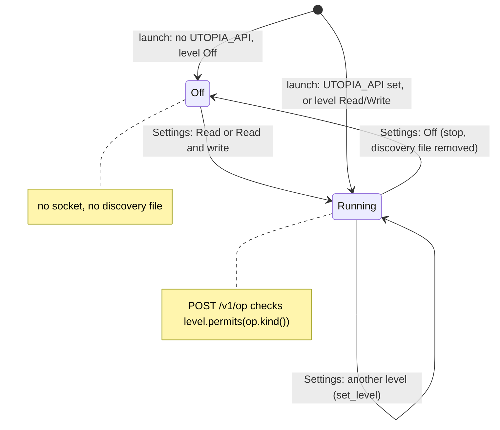
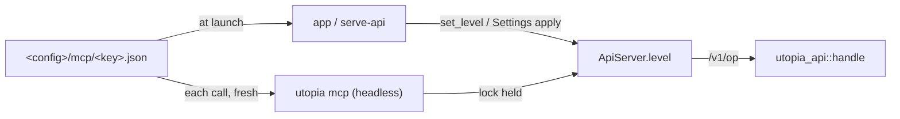

# Assistant access: the level, and the life of the loopback API

## Status

Half explicit, half spread over copies of one fact. The level has a type (`Level`, three
values) and an on-disk form (`Access`, `access.rs:84`), and the decision a Settings change
makes is a value (`assistants::Action`, `assistants.rs:37`). What has no type is *where the
level is read from*: the file, the running server's atomic, the view, the coordinator and
`UTOPIA_API` each hold a copy (table below). The API's own life is one `Option` in an `Rc`
(`api_launch::ApiSlot`, `api_launch.rs:22`) that the inbox loop reads every 30 ms.

Three things are dealt with deliberately:

1. **A change applies with no restart (MC-12).** Settings saves the file and then starts,
   stops or re-levels the server in the same effect; the inbox reads the slot each tick, so
   a server that starts later is still drained (`mc_12_the_inbox_sees_a_server_started_after_load`).
2. **Off with no `UTOPIA_API` means no socket and no file.** The launch rule is
   `api_launch::plan`, written once and used by start-up and by every apply
   (`mc_1_the_api_starts_for_utopia_api_or_an_access_level`).
3. **Stopping never blocks the UI (rule 10).** `ApiSlot::stop` cancels queued calls, sets the
   level Off and drops the server on the background executor, so the join that waits for a
   request in flight runs off the thread that would drain it
   (`mc_12_turning_access_off_does_not_wait_for_a_queued_call`).

## What it controls

How much an assistant may do with one graph (PRD §13.8 MC-1, MC-2, MC-5; design §2.4, §5)
and whether the loopback API listens for it at all. Files:
`crates/utopia-api/src/access.rs`, `crates/utopia-app/src/api_launch.rs`,
`crates/utopia-app/src/assistants.rs`, `crates/utopia-api/src/lib.rs` (`/v1/op`).

## Where the state lives

| Copy | Location | It is the truth for |
|---|---|---|
| The file | `<config>/mcp/<graph_key>.json`, `{"version":1,"access":"off"\|"read"\|"write","when_closed":false}` (`access.rs:102`, `:112`, `:154`) | `utopia mcp`'s headless call (read fresh for each call) and the next launch of the app or `serve-api` |
| The server's level | `ApiServer.level: Arc<AtomicU8>` (`lib.rs:603`, `:623`, `:629`) | `POST /v1/op` on the running server; every other REST route ignores it |
| The setting a change starts from | `Coordinator.confirmed: Access` (`assistants.rs:65`) | what the controls go back to when a save fails |
| The requested setting | `AssistantsSetup.access` (`utopia-ui/src/assistants.rs`) | what the tab draws; optimistic, so it can be ahead of `confirmed` for one effect cycle |
| `UTOPIA_API` | `Coordinator.env_api`, read once at install (`assistants.rs:68`, `:81`) | whether a socket exists that no level asked for; it never sets the level |
| The API itself | `ApiSlot(Rc<RefCell<Option<ApiServer>>>)` (`api_launch.rs:22`) | whether anything listens, and the discovery file that names it |
| The `--read-only` cap | `Options.read_only` (`utopia-mcp/src/protocol.rs:69`) | one `utopia mcp` process: it lowers `tools/call` and removes the write tools from `tools/list`; the file never changes |

## States

**The level**, per graph: `Off` (nothing is read or written) · `Read` (read ops only) ·
`Write` (every op), each with `when_closed` false or true. `Level::permits(OpKind)`
(`access.rs:38`) is the one classification, through `Op::kind()`; a refusal is the 403 text
from `Level::refusal` (`access.rs:65`), which names Settings → Assistants and says that
nothing happened.

**The API**, per graph: **Off** (slot `None`, no socket) · **Running at L** (slot `Some`,
serving `/v1/op` at `L`) · **Stopping** (slot already `None`, server thread still joining,
requests refused at Off and never queued). Starting appears only inside an apply; nothing
outside a launch or an apply creates a server.

## Events and transitions

- App start: `api_launch::start` → `plan(UTOPIA_API, Access::load(file))` → `None` (Off, no
  `UTOPIA_API`) or a `Launch { addr, level }` → server, discovery file, `set_level(level)`.
- Settings → Assistants, any control: `Coordinator::apply` saves the file first (atomic),
  then `action(env_api, running, access)` decides:
  - `Nothing` — Off and no `UTOPIA_API`, no server: do nothing.
  - `Start { addr, level }` — no server and one is wanted: `serve`, then `replace`.
  - `SetLevel(level)` — a server runs and stays (including Off under `UTOPIA_API`): one
    atomic store; ops already queued were checked under the level they arrived at.
  - `Stop` — a server runs and none is wanted: `ApiSlot::stop` (calls cancelled, level Off,
    join on the background executor) and the graph's discovery file removed, so a client does
    not dial a dead address.
- A save that fails: the file is untouched, the socket is untouched, and the controls
  return to `confirmed` so the same click can retry
  (`mc_12_a_failed_save_puts_the_confirmed_level_back`).
- A start that fails after the save: the setting stands, the tab says the bridge could not
  start, and the bridge line reads off.
- Any `utopia mcp` tool call: `Access::load` again (`backend.rs:108` step 1 and `Router` step
  1), so a change in Settings reaches the next call without restarting the client; Off
  refuses before the lock and before any connection (MC-1).

## Impossible or unhandled combinations (evidence)

1. **Off with no `UTOPIA_API` while a server runs** is not reachable through Settings:
   `action` answers `Stop` (`assistants.rs:40`). It *is* the state after a crash and before
   the next launch, which is why Settings also removes the discovery file it can see.
2. **`when_closed` never starts or stops the socket.** It is read only by the headless path
   (`backend.rs:108` step 3) and by `Action::Nothing`/`Start` not at all; both launch tests
   assert it (`mc_1_the_api_starts_for_utopia_api_or_an_access_level`).
3. **Two copies of the level disagree after a save.** `serve-api` reads the file once at
   start (`cli::serve_api`), so a change made in the app while it runs leaves its `/v1/op` at
   the old level until it restarts. This is deliberate (a process's level is fixed while it
   runs) but it means the file alone does not answer "what may an assistant do right now".
4. **A queued op is checked at arrival, not at execution.** Turning access off does not
   reverse a call the app already claimed; it does drop the ones it has not
   (`docs/state-machines/api-call-inbox.md`).
5. **`--read-only` cannot be raised by the file**, and the file cannot be raised by a
   flag or an environment variable (MC-1): `UTOPIA_API` opens the socket at the file's
   level, never above it.
6. **A bad access file is Off with a notice.** Missing is Off and silent; malformed, an
   unknown version, an unknown `access` value or an unknown key is Off with a text
   (`deny_unknown_fields`, `access.rs:93`) that the app logs and the tab shows.
7. **`confirmed` vs the view.** The view holds the requested value by the time the
   coordinator sees the request, so the coordinator cannot read "what was in force" back
   from it; hence its own `confirmed` field.

## Diagram





## The explicit type

```rust
enum Level { Off, Read, Write }                 // access.rs:25
struct Access { level: Level, when_closed: bool }   // access.rs:84, the file's content
enum Action { Nothing, Start { addr, level }, SetLevel(Level), Stop }  // assistants.rs:22
// The API's own state is still Option<ApiServer> inside an Rc; an enum
// `enum Bridge { Off, Running(ApiServer), Stopping }` would name the third state the
// `stop` path has today (slot empty, thread joining).
```
