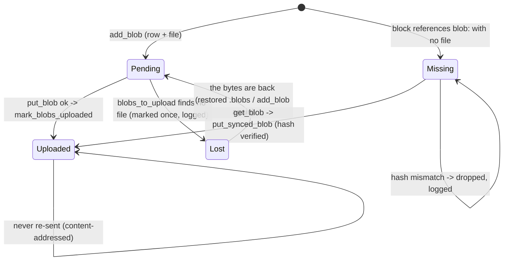

# Attachment blob state: row × file × uploaded × referenced

## Status

Fixed on `fix/attachment-blob-state` (schema v9). Line numbers below are from the
`state-machines` branch at `main f5da7d1`; the code added here is referenced by name.

- **The row's half of the machine is one type.** `utopia_store::BlobState`
  (`crates/utopia-store/src/attach.rs`) is `Pending`, `Uploaded` or `Lost { noticed_at }`,
  stored in `attachment.state` + `attachment.lost_at` (v9) with a table CHECK that makes
  `lost` without a time, and a time without `lost`, unrepresentable. The v9 migration
  rebuilds the table and backfills `uploaded = 1` to `Uploaded`, so a v8 graph opens with
  the same queue it had. `add_blob` records pending (an already-uploaded row stays
  uploaded, and a re-attached file revives a lost one), `put_synced_blob` records uploaded.
- **Issue 1 fixed.** `blobs_to_upload` no longer puts `LIMIT` in the SQL. It reads the
  hashes and states of every row that still owes bytes, checks each file, marks a pending
  row without one `Lost` (logged once) and only then takes up to `limit` live rows, so a
  dead row can never occupy a slot again. A lost row whose bytes come back (a restored
  `.blobs` directory) is revived to pending on the next round. The "row without file"
  entry paths the doc names — a graph moved without its `.blobs`, a `backup()` copy — now
  cost one round instead of every later upload.
- **Issue 2 is left as designed.** Unreferenced but unuploaded rows still upload: it only
  costs bandwidth, and filtering by reference would tie the upload queue to index freshness
  (debounced mode commits block text after an idle delay), so an attach-then-sync could
  skip a blob for a round for no correctness gain. Not fixed deliberately.
- **Issue 3 is not drift.** A re-attached file keeps the row's first name and mime; the
  displayed name comes from the block markup, which carries its own. Unchanged.
- **Found on the way, not in the list:** the v8 block stamped the *newest* schema version
  rather than 8, so a v7 file upgrading after v9 existed would have claimed v9 without the
  new column. It now stamps 8 (the v7 block already did this), and v9 stamps 9.

## What it controls

Whether an attachment (rule 12: content-addressed, verified) is on disk, has been uploaded,
is still referenced by a live block, and therefore what sync uploads or fetches each round.
`crates/utopia-store/src/attach.rs`, consumed by `crates/utopia-sync/src/lib.rs:324-338`.

## Where the state lives

| Piece | Location | Set | Cleared |
|---|---|---|---|
| Uploaded flag (now `state` + `lost_at`, v9) | `attachment.uploaded 0/1` at `f5da7d1`; `attachment.state` today (`schema.rs` V9) | `record` (`attach.rs:111-119` then) / `record(a, BlobState::…)` now; `mark_blobs_uploaded :240-248` | never (`Uploaded` is sticky) |
| File present | `blob_path → exists()` (`attach.rs:46-52`) or `mem_blobs` (`lib.rs:124`, `attach.rs:92`) | `add_blob`, `put_synced_blob :177-185` (after hash check `:166-170`) | external deletion; `backup()` never copies blobs (`lib.rs:575-596`) |
| Referenced | `instr(text, 'blob:')` over live blocks (`attach.rs:189-201`) | block text | block text |
| To upload | `blobs_to_upload(limit)` (`:220-237`) | – | – |
| Missing | `missing_blobs()` (`:212-218`): referenced but no file; ignores the `attachment` table | – | – |

## States

**Local, unuploaded** (row, file, 0) · **Local, uploaded** (1) · **Missing** (referenced, no
file) · **Row without file** (file deleted, `.blobs` dir not moved with the graph, or a
restored `backup()` copy).

## Events and transitions

- drop/attach → `add_blob` → Local, unuploaded.
- sync round → `blobs_to_upload(BLOBS_PER_ROUND)` → `put_blob` → `mark_blobs_uploaded`.
- sync round → `missing_blobs()` truncated to 8 → `get_blob` → `put_synced_blob` (verified).

## Impossible or unhandled combinations (evidence)

1. **Upload starvation.** `blobs_to_upload` applies `LIMIT ?1` in SQL (`:223-225`,
   `ORDER BY created_at, hash`) *before* checking the file exists, then silently skips rows
   whose bytes are missing (`:232-236`) without marking them. If the oldest `limit` rows with
   `uploaded = 0` have no file, the function returns an empty list on every round and newer
   attachments never upload. Entry into that state: open a graph whose `.blobs` directory
   was not copied alongside, or restore a `backup()` file (`lib.rs:575-596` copies only the
   DB) somewhere without the old blob dir.
2. **Unuploaded but unreferenced** rows are uploaded anyway (`blobs_to_upload` ignores
   references; `missing_blobs` ignores the table). Harmless bandwidth.
3. **Row name/mime frozen.** `add_blob` on conflict updates only `uploaded` (`:115`), so a
   re-attached file keeps its first name forever. Documented behaviour, not drift.

## Diagram

As it is now (the row's state; file existence is the separate fact it is checked against):



An `Uploaded` row whose local file is gone stays `Uploaded`: the relay has the bytes, and a
block that still references them is `Missing`, so `missing_blobs`/`get_blob` brings them back
(through `put_synced_blob`) without the upload queue ever waiting on them.

At `f5da7d1` the diagram was a self-loop on `RowNoFile` (`selected by LIMIT, skipped, never
marked`), which is the starvation issue 1 describes and the reason for the `Lost` state.

## Would an explicit state type help?

It did, and it is there: `BlobState` in `attach.rs` (see Status) — `Pending`, `Uploaded`,
`Lost { noticed_at }` in two CHECKed columns, with `blobs_to_upload` filtering on the state
*and* the file before applying its limit. The sketch below is what was proposed and is very
close to what landed; the difference is that the revive transition (`Lost` → `Pending` when
the bytes return) was not in the sketch and is needed, or a restored `.blobs` directory
would leave those blobs unsent forever.

```rust
enum BlobState { Pending, Uploaded, Lost { noticed_at: i64 } }
```
