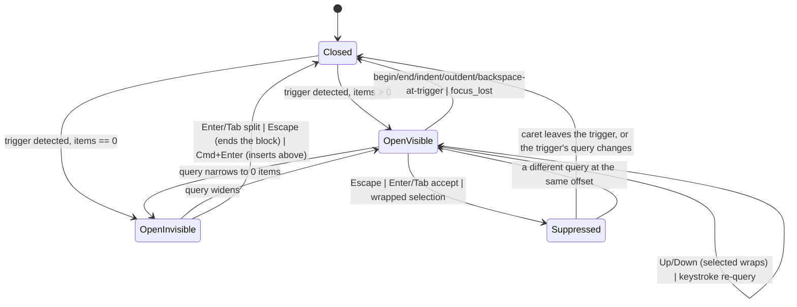
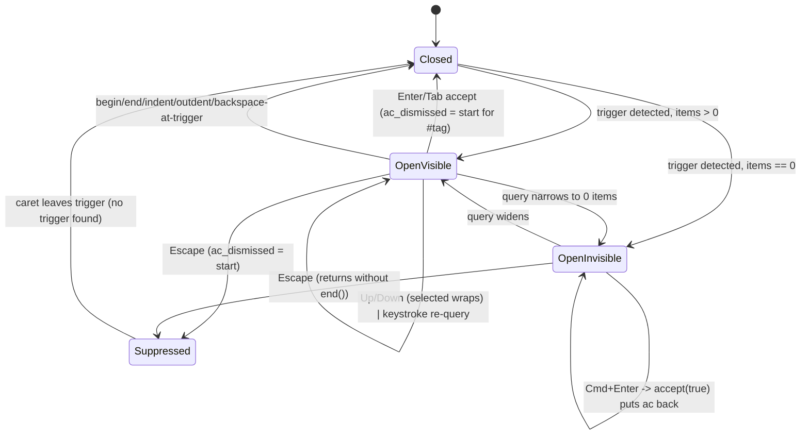

# Block editor autocomplete menu (`[[`, `#`, `((`, `/`)

## Status

The menu is one explicit value now. `Autocomplete` (`editor.rs:137`) is
`Closed | Suppressed { trigger_start, query } | Open(AutocompleteMenu)`, where
`AutocompleteMenu` (`:153`) owns the trigger kind, the frozen `start..caret` query range, the
items and the highlight. `Autocomplete::captures_keys()` (`:167`) is the single question the
renderer, the key context and every key handler ask — "does the menu own the keyboard?" — so
"a trigger exists" and "there is something to take" can no longer be answered differently by
different handlers. The state is private and read through `BlockEditor::autocomplete()`
(`:432`), like the session machine hides its target.

| Issue | State | Failing-first test, then fix |
|---|---|---|
| 1 Two definitions of "open" | **fixed** | `fr_2_17_escape_leaves_a_menu_with_nothing_to_show`, `fr_2_17_cmd_enter_is_not_swallowed_by_an_empty_menu` (`crates/utopia-ui/tests/workspace.rs`). `escape` (`:1652`) and `insert_above` (`:1325`) now ask `captures_keys()` like `newline`, `accept_completion`, `vertical`, `render_autocomplete` and the key context, so a menu that found nothing (`/xyz`, `#zzz`, `((zzz`) no longer eats the first Escape and Cmd+Enter starts a block above instead of creating a page from the query. |
| 2 `accept` uses the live caret against a frozen `start` | **fixed** | `fr_2_17_accept_replaces_the_query_the_menu_was_opened_for`. `AutocompleteMenu.caret` records the caret the items were computed for and `accept` (`:1114`) replaces `start..caret` plus an already typed closer, so Shift+Left (which puts the caret at the selection start) can no longer leave the tail of the query behind (`[[Alp` → `[[Alpha]]p]]`). The frozen range brings one new obligation the old live caret did not have: the menu must be re-read whenever the buffer is rewritten under it. Three tests pin it — `fr_2_17_a_menu_does_not_outlive_the_text_it_was_opened_for` (`sync_from_store` re-derives on an undo, remote edit or plugin write; `accept` refuses a range that is not in the text at all), `fr_2_17_a_commit_that_normalizes_the_text_moves_the_menu_with_it` (the idle commit's NFC normalization shortens `cafe` + U+0301 to `café`, `commit_block` refreshes) and `fr_2_17_an_expanded_relative_date_moves_the_open_menu_with_it` (the idle commit expands `[[tomorrow]]` elsewhere in the block, `expand_relative_dates` refreshes). |
| 3 Menu can open during IME composition | **fixed** | `ac_13_5_mouse_down_does_not_open_a_menu_mid_composition`. `mouse_down` (`:1699`) returns early while `field.composing()`, and `refresh_autocomplete` (`:1004`) refuses to run then, so no menu ever describes provisional glyphs (§13.5). |
| 4 `ac_dismissed` is a raw byte offset | **fixed** | `fr_2_17_a_dismissed_trigger_follows_its_query`. `Suppressed` keeps the dismissed trigger's `query` as well, and `refresh_autocomplete` stays shut only while the offset *and* the query match, so one edit (a paste, an undo) that puts a different trigger on the same offset opens its menu. |

What was deliberately not done:

- **The menu still lives beside the session**, not inside `Editing`, as
  `block-editor-session.md` decided. Every path that ends a session (`begin` on a vanished
  block, `end`, `detach`, `focus_lost`) assigns `Autocomplete::Closed`, so the two cannot
  drift; moving it into `Editing` is a change to the session machine.
- **Cmd+Enter on a *visible* slash menu** still creates a page out of the slash query
  (`/hea` + Cmd+Enter → a page "hea"). That predates this machine and issues 1 and 2 do not
  cover it; a future pass should make `accept(create = true)` refuse a `Slash` menu, since
  "create page from query" (FR-2.17) only means something for `[[`/`#[[`/`#`.
- **Selection gestures still do not re-derive the menu** (`select_left/right/up/down`,
  `select_all`, `mouse_move` only `notify`). Issue 2 froze the replaced range, so they can no
  longer corrupt an accept, and re-querying the store on every drag would churn it for a menu
  the user is not choosing from.

Two shots captured from the app for the visible parts
(`docs/verification/block-editor-autocomplete/`): `accept-frozen-query.png` (Shift+Left then
Enter in a `[[` menu leaves `Met [[Alpha]]`, not `Met [[Alpha]]p]]`) and
`cmd-enter-empty-menu.png` (Cmd+Enter over `/zzz`, whose menu has nothing to offer, starts a
block above it instead of creating a page "zzz").

The line numbers and tables below describe the pre-fix code (`main f5da7d1`); the states they
list still hold, in the shapes named above.

## What it controls

Whether a completion menu is open, which trigger kind, its items and highlighted row, and
whether Enter / Tab / Up / Down / Escape / Cmd+Enter are captured by the menu instead of
acting on the block (`crates/utopia-ui/src/editor.rs`).

## Where the state lives

| Piece | Location | Set | Cleared |
|---|---|---|---|
| Menu | `editor.rs:216` `ac: Option<Autocomplete>`; struct at `:131-138` `{ kind, start, query, items, selected }` | `refresh_autocomplete` `:734-740` (`Some` whenever a trigger is detected, even with zero items); `accept` `:756` (put back) | `begin :307`, `end :323`, `sync_from_store :358`, `typed_bracket :509`, `refresh_autocomplete :653`, `accept :753/777/785`, `indent :931`, `outdent :936`, `backspace :943`, `escape :1222` |
| Suppressed trigger | `editor.rs:217` `ac_dismissed: Option<usize>` (byte offset of the trigger start) | `typed_bracket :510`, `accept :783`, `escape :1223` | `begin :308`, `refresh_autocomplete :654` (only when no trigger is found) |
| Highlight | `Autocomplete.selected` | `:733` (clamped), `vertical :1073-1077` (wraps) | – |
| Key context | `AUTOCOMPLETE_CONTEXT` at `:1397-1398`, applied when items non-empty | – | – |

Not read outside this file (grep for `.ac` in `page_view.rs`/`workspace.rs` is empty).

## States

- **Closed**: `ac = None`, `ac_dismissed = None`.
- **Open, visible**: `ac = Some`, `items` non-empty.
- **Open, invisible**: `ac = Some`, `items` empty — rendered as nothing
  (`render_autocomplete :1296-1298`), but *present* for some handlers.
- **Suppressed**: `ac = None`, `ac_dismissed = Some(start)`; the same trigger will not reopen.

## Events and transitions

- keystroke / `after_edit` → `refresh_autocomplete` (`:650-740`): detect trigger at caret;
  no trigger → `ac = None`, `ac_dismissed = None`; trigger at the dismissed offset → stay
  closed; else query the store and set `Some`.
- `Up`/`Down` → `vertical` (`:1071-1077`) when items non-empty.
- `Enter` → `newline` (`:890`) accepts when items non-empty; `Tab` → `accept_completion`
  (`:909`) same guard.
- `Cmd+Enter` → `insert_above` (`:917-919`) accepts when `ac.is_some()`.
- `Escape` → `escape` (`:1221-1227`): if `ac.is_some()` → dismiss and **return**; else `end()`.
- `accept` (`:745-790`): may create a page (`:760-772`), then replaces
  `ac.start..cursor + skip` with the completion using the **current** caret (`:773, :781`).
- `mouse_down` (`:1278`) calls `refresh_autocomplete` unconditionally.

## Impossible or unhandled combinations (evidence, pre-fix)

1. **Two definitions of "open".** Render, `newline`, `accept_completion`, `vertical` and the
   key context all use `is_some_and(|a| !a.items.is_empty())` (`:890, :909, :1071, :1296-1298,
   :1397`), but `escape` (`:1222`) and `insert_above` (`:917`) use bare `is_some()`.
   `refresh_autocomplete` yields `Some` with empty items for `#zzz` (the Tag kind gets no
   Create row, `:722`), `((zzz` with no hits, or `/xyz`. Path: type `/xyz`, press Escape →
   `:1222` takes `ac`, sets `ac_dismissed`, returns without `end()`; the user must press
   Escape twice to leave a block whose menu was never drawn. Cmd+Enter in the same state
   calls `accept(true)`, which puts `ac` back and returns (`:755-758`), silently swallowing
   `InsertAbove`.
2. **`ac.start`/`query` are frozen; `accept` uses the live caret.** Selection-moving actions
   (`select_left/right/up/down/select_all` `:1007-1024, :1094-1105`, `mouse_move` `:1282-1288`)
   only `cx.notify()`, never `refresh_autocomplete`. With `[[Alp|` open, Shift+Left moves
   `cursor()` to the selection start (`field.rs:55-61`), Enter → `newline :890` sees items →
   `accept` replaces `ac.start..8` instead of `..9`, leaving a stray `p` after the link.
3. **Menu can open during IME composition.** `after_edit` refuses to refresh while `marked`
   (`:516-518`), but `mouse_down :1278` does not check `marked`.
4. **`ac_dismissed` is a raw byte offset**, cleared only when *no* trigger exists (`:654`). If
   edits before the trigger shift a different trigger onto the same offset, it stays
   suppressed. No routine path found that hits this — uncertain, minor.

## Diagram (current states and transitions)



## Diagram (pre-fix)



## The explicit state that was built

The sketch above was sound and is what now exists (`editor.rs:130-196`), with two additions the
code needed:

```rust
pub enum Autocomplete {
    Closed,
    /// Keyed by the query too: a raw offset is not a trigger's identity (issue 4).
    Suppressed { trigger_start: usize, query: String },
    /// `items` may be empty; only a non-empty menu captures a key, which is what
    /// `captures_keys` answers for every handler.
    Open(AutocompleteMenu),
}
pub struct AutocompleteMenu {
    pub kind: AcKind,
    pub start: usize,
    pub query: String,
    pub items: Vec<AcItem>,
    pub selected: usize,
    /// The caret the items were computed for: `accept` replaces `start..caret` (issue 2).
    pub caret: usize,
}
impl Autocomplete {
    pub fn captures_keys(&self) -> bool {
        matches!(self, Autocomplete::Open(menu) if !menu.items.is_empty())
    }
}
```
