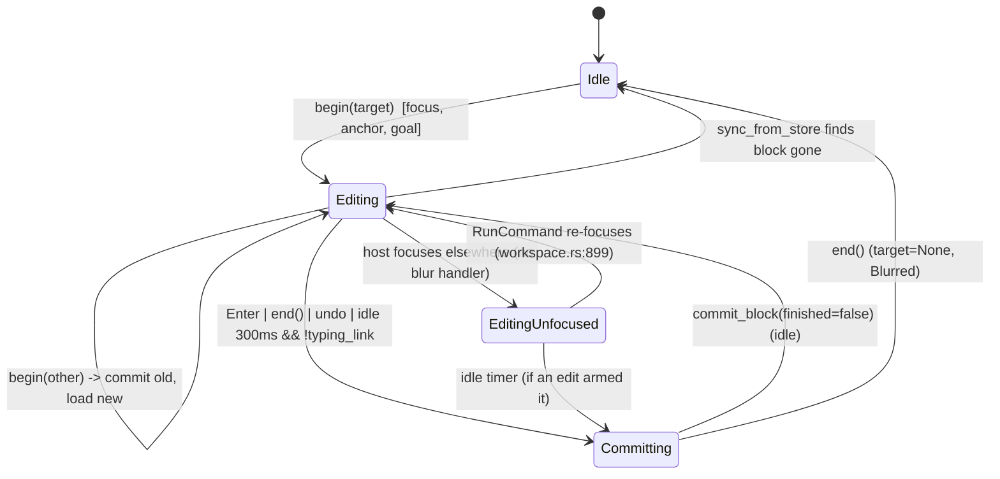

# Block editor session: editing target, focus, idle commit vs explicit commit

## Status

The session is one explicit value now. `EditorSession` (`editor.rs:249`) is
`Idle | Editing(Editing)`, and `Editing` (`editor.rs:255`) owns the target, its CRDT
`anchor`, the `pending` idle-commit task, the input method's queued `deferred` request and
`pending_sync` together. None of them can exist without a target, the host reads the target
through `BlockEditor::target()` (`editor.rs:371`), and ending a session is one assignment
that drops all five. The tables and line numbers below describe the pre-fix code
(`main f5da7d1`); the states they list still hold, in the shapes named here.

| Issue | State | Test, then fix |
|---|---|---|
| 1 "commit on blur" does not exist | **fixed** | `ac_3_2_blurring_the_editor_commits_the_block`; `focus_lost` (`editor.rs:750`) commits at once and drops the autocomplete menu, so the idle commit's `typing_link` wait can no longer leave an abandoned `[[tomorrow]]` unexpanded after a click into another pane. |
| 2 `anchor` outlives `target` | **fixed, unrepresentable** | `Editing.anchor`; `end` (`editor.rs:446`), `detach` (`:510`) and `begin`'s vanished-block branch replace the session, so the two cannot part. No failing-first test: the only reader was behind the `target.is_some()` guard, so a stale anchor had no observable effect. A commit that rewrites the text under the caret now re-anchors too (`expand_relative_dates`, `editor.rs:941`; `ac_3_2_a_commit_reanchors_the_caret_it_moved`), so the anchor follows the caret and not only its block. |
| 3 `run_plugin` replaces text without re-anchoring or refreshing the menu | **fixed** | `p2_a_plugin_rewrite_reanchors_the_editor`; both replacement paths now end in `settle` (`editor.rs:565-594`), which persists, moves the anchor and re-reads the trigger. |
| 4 `idle` survives the `sync_from_store` `None` branch | **fixed, unrepresentable** | the task is `Editing.pending`, and `detach` replaces the whole session. No failing-first test: the old guard order made the surviving task a no-op, so nothing observable changed. |
| 5 `edits` and `idle` encode one fact twice | **fixed** | the `edits` counter is gone; replacing `pending` (`editor.rs:833`) cancels the previous task, which is that same fact. |
| 6 `commit_block` ignores IME `marked` | **fixed by the IME machine** (`block-editor-ime-composition.md`) | `commit_block` and `begin` defer while composing; `focus_lost` takes the marked text as committed first (`accept_composition`). |

What was deliberately not done:

- **A blur does not end the edit**, so the doc's "Editing, unfocused" state still exists —
  now as `Editing` with the keyboard elsewhere, after a commit, and the sketch's
  `on_blur → end` was not followed. `quick_jump_runs_editor_commands` (QJ-5: an editor
  command picked in the palette acts on the block being edited) needs the target to survive
  the palette taking focus, and the IME machine needs a focus move to keep the edit open
  (`ac_13_5_focus_out_without_end_keeps_the_composed_text`). What the unhandled state was
  missing was the *commit*, not the target: the block now commits on blur, the idle task is
  dropped and nothing runs while the caret is away. Ending the edit there would require the
  palette to reopen the session before dispatching an editor command, which is a change to
  this machine's host and to QJ's behaviour, not to this machine.
- **The autocomplete menu (`ac`, one `Autocomplete` value) stays beside the session**, not
  inside `Editing`: it is the autocomplete machine's state
  (`block-editor-autocomplete.md`) and is cleared wherever the session ends.

## What it controls

Which block owns the caret (`§6.2`, `§13.5`), whether keystrokes persist to the store,
and *when* the block is committed (`Store::commit_block`: NFC-normalise, extract refs,
rewrite relative dates). The module doc says "committed on blur, Enter or 300 ms idle"
(`crates/utopia-ui/src/editor.rs:1-4`); the code implements the latter two plus a set of
host-driven explicit `end()` calls.

## Where the state lives

| Piece | Location | Set | Cleared |
|---|---|---|---|
| Which block | `editor.rs:215` `target: Option<EditTarget>` | `begin` `:306` | `end` `:322` (`take`), `sync_from_store` `:357` when the block vanished |
| Keyboard focus | `editor.rs:214` `focus: FocusHandle` | `begin` `:314` | never by the editor itself |
| CRDT caret anchor | `editor.rs:219` `anchor: Option<DocCursor>` | `anchor_caret` `:371` | `:367` only when `target` is already `None` |
| Idle-commit timer | `editor.rs:220` `idle: Option<Task<()>>` | `persist` `:541` | `commit_block` `:584` |
| Edit generation | `editor.rs:221` `edits: u64` | `persist` `:539` | never (monotonic) |
| "typing a link" | derived: `typing_link()` `:567-572` | – | – |

Consumers outside the file: `target` is read at `page_view.rs:1486, 1678, 1705` and
`workspace.rs:261, 899, 931`; `is_editing` at `page_view.rs:902, 2217`; `end()` is called
from ~15 host sites (e.g. `page_view.rs:363, 390, 777, 816`, `workspace.rs:780, 942, 965`).

## States

- **Idle**: `target = None`.
- **Editing, focused**: `target = Some`, focus held, maybe `idle = Some`.
- **Editing, unfocused**: `target = Some`, focus moved elsewhere without `end()`.
- **Editing, link in progress**: `idle` loop re-arms every 300 ms while `typing_link()`.
- **Committing**: inside `commit_block` (`:581-608`).

## Events and transitions

- `begin(target)` (`:288-316`): if the target differs → `commit()` the old block, load the
  new text, set `target`, clear `ac`/`ac_dismissed`, set `goal`, focus. Same target → just
  `move_to`.
- keystroke → `after_edit` → `persist` (`:524-558`): writes `set_block_text` (store applies
  at once, debounced on disk; see `store-commit-pipeline.md`), bumps `edits`, replaces
  `idle` with a new 300 ms loop. The loop: if `edits` moved, stop; if `typing_link()`, sleep
  again; else `commit_block(false)`.
- `Enter` → `newline` `:895` → `commit()`; `end()` `:320-328` → `commit()`, `target =
  None`, `ac = None`, emit `Blurred`; `history` (undo) `:1239` → `commit()`.
- `sync_from_store` (`:330-363`): store changed; returns early while IME `marked`
  (`:332`); `None` text → drop target, emit `Blurred`.

Guards: `commit_block` is a no-op when `target` is `None` (`:583`); the idle commit passes
`finished = false`, which skips expanding relative dates inside the link the caret is in
(`:614-636`).

## Impossible or unhandled combinations (evidence)

1. **"Commit on blur" does not exist.** `grep -rn 'on_blur\|focus_out\|FocusOut'
   crates/utopia-ui/src` returns nothing. Focus can leave the editor without `end()`:
   `line_input.rs:253 window.focus(&self.focus)` (click into a `LineInput`), `workspace.rs:949`
   and `:996` focus the workspace. In that state rows still render the source editor
   (`page_view.rs:2217 is_editing`), `FieldElement` paints no caret (`field.rs:547`), and
   `workspace.rs:899-901` re-focuses the editor on `RunCommand` because `target.is_some()`.
   The block commits only if an edit arms the 300 ms timer; a block edited, then abandoned by
   a click into the search box, keeps `target = Some` until some host calls `end()`. Relative
   dates typed just before (e.g. `[[tomorrow]]`) stay unexpanded until then because the idle
   commit is `finished = false`.
2. **`anchor` outlives `target`.** `end()` (`:320-328`) does not clear `anchor`; `anchor_caret`
   only clears it when `target` is already `None` (`:365-369`). Harmless today: the only
   reader (`:345`) is behind the `target.is_some()` guard at `:331`, and `begin` re-anchors
   (`:313`). It is an Option pair that must move together and does not.
3. **`run_plugin` (`:420-423`) calls `field.set_text` without `anchor_caret` or
   `refresh_autocomplete`**, so `anchor` points at the pre-replacement caret and `ac` is stale
   until the next keystroke.
4. **`idle` survives the `sync_from_store` `None` branch** (`:355-361` drops `target` but not
   `idle`). The task ticks, `commit_block` returns at `:583`, loop breaks. Safe by guard
   order, not by design.
5. **`edits` and `idle` encode one fact twice.** Replacing `self.idle` already cancels the old
   task; the `edits` generation check (`:547`) is a second guard for the same cancellation.
6. **`commit_block` ignores IME `marked`** (`:582-608`); see `block-editor-ime-composition.md`.

## Diagram



## Would an explicit state type help?

Yes, moderately. The target/anchor/idle trio should be one struct so they are created and
dropped together, and the "finished" flag should be part of the commit reason.

```rust
enum EditorSession {
    Idle,
    Editing {
        target: EditTarget,
        anchor: Option<DocCursor>,
        pending: Option<IdleCommit>,   // { task, edits_seen }
    },
}

enum CommitReason { Idle, Enter, Blur, Navigate, Undo }
// commit_block(reason): expand relative dates unless reason == Idle && typing_link()
```

A real blur handler (`on_blur` on the focus handle → `commit(CommitReason::Blur)`) would
make the module doc true and remove the EditingUnfocused state.
