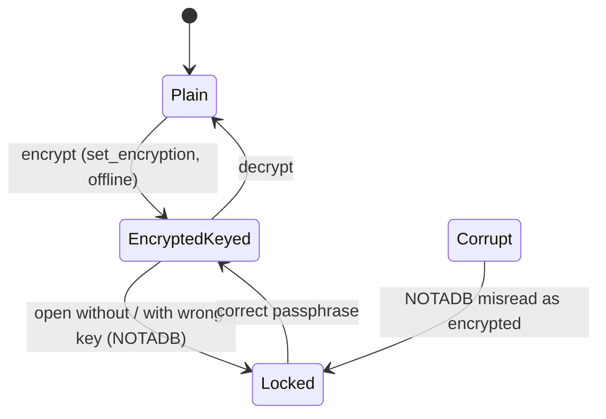

# Encryption at rest: key present / absent / wrong, and the schema version chain

## Status

Fixed on `fix/encryption-at-rest-state`. Line numbers below are from the
`state-machines` branch at `main f5da7d1`; the code added here is referenced by name.

- **The file's state is one type.** `utopia_store::FileKind`
  (`crates/utopia-store/src/crypt.rs:22`) is `Plain`, `Encrypted` or `Corrupt`, and
  `file_kind`/`is_encrypted` classify by SQLite's 16-byte header. `open_keyed`
  (`crypt.rs:152`) maps `SQLITE_NOTADB` through the same type, so the header — not the
  error code alone — decides whether the graph is locked or damaged.
- **Issue 1 fixed.** A plain graph whose header survives but whose pages do not opens as
  `StoreError::Corrupt` and `is_encrypted` is false: the app shows "Could not open …"
  instead of an unlock screen no passphrase can satisfy. Test:
  `ac_15_6_a_damaged_plain_graph_is_not_a_lock` (`crates/utopia-store/tests/p2.rs`);
  shot: `docs/verification/encryption-at-rest-state/damaged-graph.png`.
  Limit: a file whose header was destroyed cannot be told apart from SQLCipher
  ciphertext without a key; it still reads as `Encrypted` (the only reading a passphrase
  can resolve).
- **Issue 2 fixed.** An open `Store` holds a shared `FileLock` on a sidecar
  (`<graph>.lock`, appended to the whole path) for its lifetime, and `set_encryption` takes the exclusive side
  or returns `StoreError::Busy` (`crypt.rs:81-149`, `:194`; `lib.rs:205`, `:222`). The
  lock is not on the database file because macOS implements `flock` with `fcntl`, which
  collides with SQLite's own locks; the sidecar is intentionally left behind (removing it
  while a process waits would let another lock a fresh inode). Test:
  `ac_15_6_encrypting_refuses_while_the_graph_is_open`.
- **Issue 3 was already fixed; verified, no change.** `backup()` still uses `VACUUM INTO`,
  but SQLCipher carries the key into the copy. The existing
  `encryption_at_rest_round_trip` asserts the backup `is_encrypted` and opens with the
  same passphrase.
- **Issue 4 fixed.** `migrate` refuses `user_version > SCHEMA_VERSION` with
  `StoreError::SchemaTooNew { found, supported }` (`schema.rs:285-296`), and the v9 block
  stamps the literal `9`, not the newest constant (`schema.rs:360`), so a constant bump
  without a migration cannot make an old file claim the new schema. Tests:
  `ac_14_4_a_graph_from_a_newer_build_is_refused` and
  `ac_14_4_a_new_graph_is_stamped_with_the_builds_schema_version`.
- **Not adopted from the sketch: `Store` carrying the key.** `open_with_key` already
  passes the one key it receives to both the reader and `Persister::spawn`, so the two
  connections cannot be spawned with different keys today. Keeping a copy for the store's
  lifetime would only hold the secret in memory longer; no listed bug depends on it.

The sections below describe the machine as it was when this doc was written; line numbers
there are historical.

## What it controls

Whether the two SQLite connections (read + writer) can open the graph file (SQLCipher on
macOS), what the app shows (unlock screen vs graph), and the one-way migration chain the
file has been through. `crates/utopia-store/src/crypt.rs`, `schema.rs`, `lib.rs`.

## Where the state lives

| Piece | Location | Notes |
|---|---|---|
| Key for the read conn | `lib.rs:148` `crypt::open_keyed(path, key)` | key is **not** stored on `Store` |
| Key for the writer conn | `writer.rs:238` `open_keyed(path, key)` | passed again by `open_with_key` (`lib.rs:150`) |
| Is-encrypted probe | `crypt.rs:26-34`, `:45-48` `is_encrypted` equates `SQLITE_NOTADB` with "encrypted" | – |
| Error | `StoreError::Encrypted` (`lib.rs:72-74`) | – |
| Schema version | `PRAGMA user_version` 0..7, `SCHEMA_VERSION = 7` (`schema.rs:11`); linear `if version < n` chain (`:231-281`) run on both connections (`lib.rs:160`, `writer.rs:240`) | `set_encryption` copies it manually into the re-keyed file (`crypt.rs:60, :68-69`) |
| App side | `RootState::Locked` (`crates/utopia-app/src/main.rs:165-180`); wrong passphrase → `lock()` again (`:308-311`) | – |

## States

**Plain** · **Encrypted + key** · **Encrypted, no/wrong key** (`StoreError::Encrypted`) ·
**Not a database** (reported as encrypted).

## Events and transitions

- open → `open_keyed`; `NOTADB` → `Encrypted` error → unlock screen.
- `encrypt`/`decrypt` CLI → `set_encryption` (`crypt.rs:50-77`): export to a new file, copy
  `user_version`, rename over the original.

## Impossible or unhandled combinations (evidence)

1. **A corrupt plain file reads as encrypted** (`crypt.rs:30-32, :45-48`), so the UI would
   prompt for a passphrase that cannot help. Uncertain whether callers distinguish.
2. **`set_encryption` assumes no open process** (doc at `crypt.rs:50-53`) but has no lock or
   check; running it while a `Store` holds two connections races the rename at `:75`.
3. **`backup()` is `VACUUM INTO`** (`lib.rs:581-582`) with no key handling; whether the copy of
   a SQLCipher DB carries the same key is SQLCipher behaviour not verified here — uncertain.
4. **No guard for `user_version > SCHEMA_VERSION`**: a file from a newer build opens silently
   in an older one (`schema.rs:231-281`). The last branch writes `SCHEMA_VERSION` rather than
   the literal (`:277`), so bumping the constant without adding a branch stamps the new
   number and skips the migration. Rule 14, not 1-5.

## Diagram

## Would an explicit state type help?

A tiny `enum FileKind { Plain, Encrypted, Corrupt }` from a header sniff (SQLite files start
with `SQLite format 3\0`; SQLCipher files do not) would separate (1) from a real lock, and
`Store` could carry `key: Option<Zeroizing<String>>` so the writer connection cannot be
spawned with a different key than the reader.
