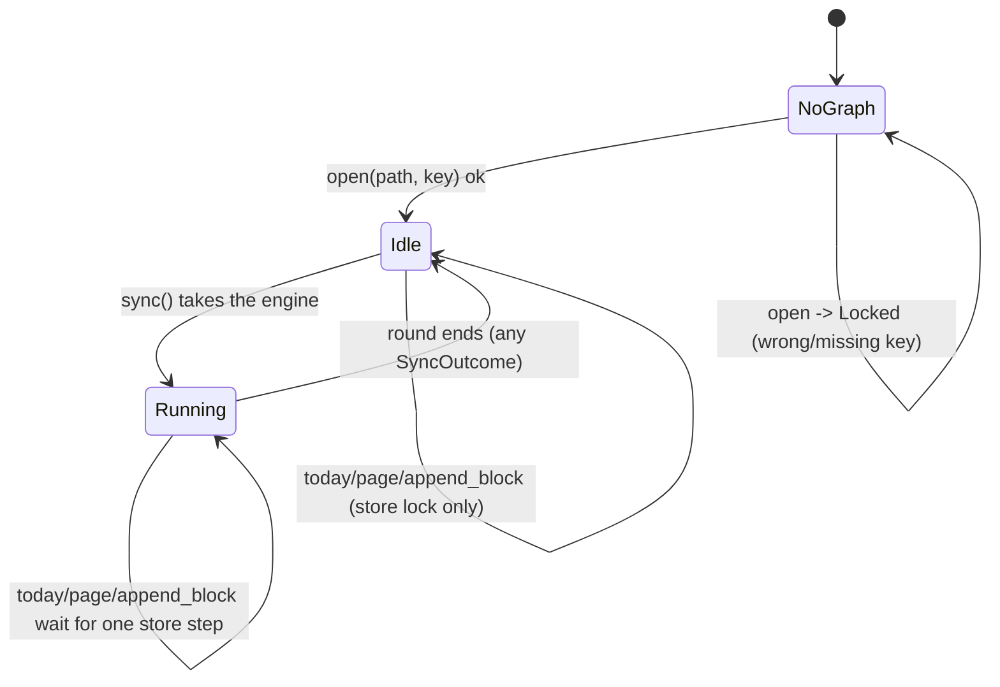

# FFI mobile core: graph handle, sync round around the store lock

## Status

The sync round is one explicit state, `SyncSlot` (`Idle(engine)` ⇄ `Running`), and all four
issues below are fixed:

1. **Fixed** — the network half no longer runs under the store mutex. The round is driven
   through `utopia_sync::sync_round` (`sync/lib.rs:823`, the same loop `sync_once` runs, so
   the two cannot drift on when a round stops) with `prepare`/`apply` under the lock and
   `exchange` outside it (`ffi/lib.rs:198`). `today`, `page` and `append_block` keep working
   while the relay is slow. Test: `ac_14_3_a_slow_relay_does_not_block_other_calls`, plus the
   unit test `a_round_does_not_hold_the_store_lock_on_the_wire`.
2. **Fixed** — the graph holds its engine, and a round takes it out of `Idle` for its whole
   length (it is not needed on the wire). A second `sync` while one runs answers
   `SyncOutcome::Busy` (`ffi/lib.rs:173, :198`) instead of queueing a full round behind the
   first; the Swift shell also refuses the tap while `syncing` (`GraphModel.swift:93`). Test:
   `ac_12_6_a_second_tap_during_a_round_is_busy` and `a_second_round_while_one_runs_is_busy`.
3. **Fixed** — `Graph::sync` returns `SyncOutcome` (`ffi/lib.rs:105`), one variant per answer
   the shell shows: `Synced`, `Partial`, `Offline`, `LocalError`, `NeedsAuth`,
   `Unsupported { version }`, `Busy`. It is built from the desktop's `SyncStatus`
   (`sync/lib.rs:321`), so mobile and desktop cannot drift; only the relay's version is read
   from the `SyncError`. `SyncSummary` is unchanged and rides along. Test:
   `ac_12_6_a_refusal_is_not_offline` and `a_refusal_is_not_offline`.
4. **Fixed** — the queued compaction snapshots live in the engine, and the engine lives on the
   graph, so the next `sync` call uploads them instead of losing them. Test:
   `a_queued_snapshot_rides_the_next_round`. A snapshot is bound to the relay that measured
   the head it covers (`QueuedSnapshot::space`): `exchange` drops one whose space is not the
   destination's, so retaining the engine across a relay-url or graph-id change cannot
   truncate another relay's log past updates this device never imported (rule 5). Tests:
   `a_snapshot_queued_for_one_relay_is_not_uploaded_to_another` and
   `ac_12_6_a_snapshot_measured_on_another_relay_is_not_uploaded`. Left as before: the queue
   is only flushed by a sync call, so quitting the app loses it — harmless, because the
   manifest asks for the same snapshot again on the next round.
5. **Fixed** (consequence of 1, found in review) — with the store unlocked during the
   exchange, a capture can be queued after `prepare` gathered nothing and before the round
   stops, so the round could answer `Synced` with the capture never sent. `sync_round` now
   asks the store for queued updates (`StoreStep::Queued`) before it calls a round quiet, and
   pushes them in the same round. Tests:
   `an_edit_made_during_the_exchange_is_pushed_before_the_round_reports_synced` and
   `ac_12_3_a_round_picks_up_an_edit_queued_while_it_was_on_the_wire`. Attachments are still
   bounded per round and retried by the next `prepare`; the mobile surface has none (§14.3).

Left unhandled, deliberately: the round is still synchronous from Swift's side
(`Task.detached` keeps it off the main actor) and is not cancellable — a cancelled Swift task
leaves the round running until the transport's own timeout. And the FFI holds no credentials,
so `NeedsAuth` is a message for the user, not an in-app re-auth flow (§12.6); that matches the
desktop (`SyncPhase::Refused`).

## What it controls

The UniFFI surface for the mobile shell (`§14`): opening a graph, reading/writing blocks,
and running a sync round. `crates/utopia-ffi/src/lib.rs`, with the Swift side in
`mobile/ios/UtopiaMobile/GraphModel.swift`.

## Where the state lives

| Piece | Location | Notes |
|---|---|---|
| Graph | `ffi/lib.rs:146-150` `Graph { store: Mutex<Store>, sync: Mutex<SyncSlot> }` | the engine is on the graph, never built per call |
| Round state | `ffi/lib.rs:137` `SyncSlot::{Idle(SyncEngine), Running}` | also "is a round running"; the store lock says nothing about it any more |
| Locked vs open | not a state: `Graph::open` either succeeds or returns `FfiError::Locked` (`ffi/lib.rs:21, :248`) | – |
| Swift mirror | `GraphModel.swift:9-15, :92-131` `graph: Graph?`, `syncing: Bool`, `lastSync: String` | the shell's `syncing` only decides whether the button is enabled |
| Round answer | `ffi/lib.rs:105` `SyncOutcome` (from `SyncStatus`) | one variant per thing the shell shows |
| Snapshot queue | `sync/lib.rs` `QueuedSnapshot` (`SyncEngine::pending_snapshots`) | tagged with the space that measured its head; only uploaded there |
| Setup errors | a transport that cannot be built → `FfiError::Sync { msg }` (`ffi/lib.rs:48`) | a round's own failures are the outcome, not an error |

## States

**No graph** → **Idle(engine)** → **Running** (a round owns the engine; the store mutex is
held only while `prepare`/`apply` run).

## Events and transitions

- `open(path, key)` → Idle or `Locked` (and `SyncEngine::new`, which records this device's
  `client_id`, so opening needs no later engine build).
- `sync(url, token, passphrase)` (`ffi/lib.rs:392`): build the transport (no store), then
  `take_engine`: `Idle → Running`, or `Busy` when already `Running`. The round runs
  `prepare` (lock) → `exchange` (no lock) → `apply` (lock), up to six times; a pass only
  ends the round when it moved nothing *and* the store has nothing left to send
  (`Queued`), then `put_engine`: `Running → Idle` on every path, success or failure.
- Every other FFI call takes only the store lock, so it waits for one store step and never
  for the network.

## What was wrong (evidence at `main f5da7d1`)

1. **The whole network round ran under the store mutex.** `sync_once` performs up to 6
   iterations of manifest/push/pull (`sync/lib.rs:396-410`) with 30 s HTTP timeouts
   (`http.rs:66`) while `with` held the lock (`:88-93`, `:289-297`). Every other FFI call
   (`today`, `page`, `append_block`) blocked until it ended. The desktop deliberately avoids
   this (`sync_runner.rs:1-3`, `workspace.rs:528-532`).
2. **Two taps, two rounds.** Swift's `sync()` guarded on `graph != nil` and a non-empty
   `relayURL`, not on `syncing` (`swift:89-90`), so a second tap queued a second full round
   behind the mutex.
3. **401 and protocol mismatch were indistinguishable from network loss** on mobile (`:276`,
   `swift:110`); PRD §12.6's "halt sync, prompt re-auth" could not be represented.
4. **`pending_snapshots` died with the per-call client.** They were flushed within the call
   unless the 6-iteration cap or a failed page stopped the round (`sync/lib.rs:396`), and
   the next call built a new engine, so the queue was lost (see
   `sync-compaction-snapshots.md`).

## Diagram

