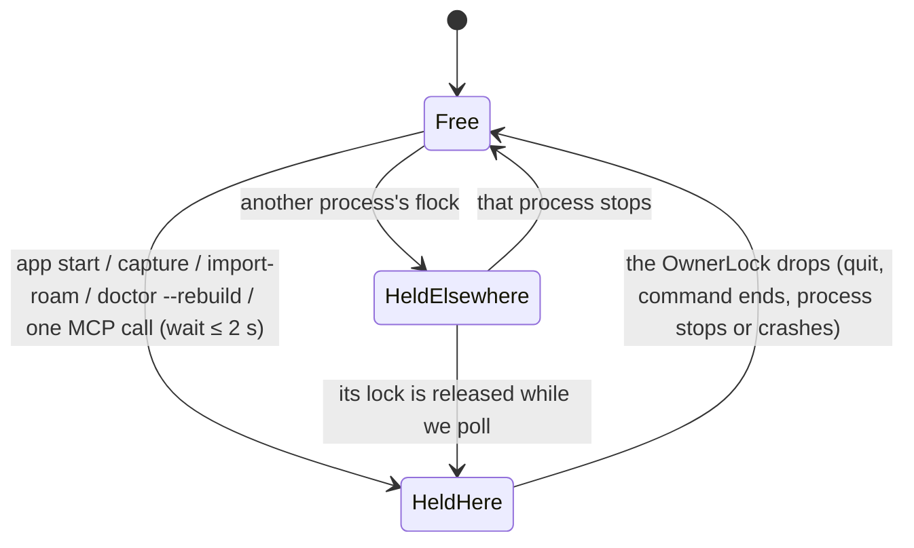

# One owner for each graph: free, held here, held elsewhere

## Status

Implicit: the state is the `flock` a live process holds on the `<graph>.owner` sidecar.
There is no enum that names it, and each holder keeps the lock in a plain
`Option<OwnerLock>` field — `RootState::Locked.owner` (`main.rs:182`),
`Running._owner` (`main.rs:217`), `cli::Owned._owner` (`cli.rs:65`), and a local binding in
`capture`, `import-roam`, `doctor --rebuild` and `Direct::call_with`. The three states are
dealt with:

1. **Free** — no live process holds the sidecar. The *file* still exists, which is why
   "the sidecar exists" is not the test: the app and every write command try the `flock`
   (`OwnerLock::try_acquire`, `owner.rs:64`) instead (`owner.rs` module doc).
2. **Held here** — exactly one `OwnerLock` lives in this process for that graph. `flock`
   belongs to the open file description, so a second `try_acquire` in the same process
   fails against its own lock; the app passes the lock it already has through the unlock
   screen (`main.rs:375`, `:383`) rather than taking it twice.
3. **Held elsewhere** — the app, `serve-api`, a short write command or one headless MCP
   call owns the graph. `capture` forwards its text to the owner (`cli.rs:270-282`), and
   `utopia mcp` sends the op to the owner's API (`backend.rs` `Router`, step 3).

Readers do not take it: `doctor` without `--rebuild`, `export` and `Store::open` share
SQLite's own locks and never write projections. Encryption (`encrypt`/`decrypt`) keeps its
own `FileLock` on the database file (`crypt.rs`), so it is a different machine.

## What it controls

Which process may write a graph, and what a second one does instead (PRD §13.8 MC-4,
`docs/mcp-design.md` §2.2, decision D2 A). Files: `crates/utopia-store/src/owner.rs`,
`crates/utopia-app/src/cli.rs`, `crates/utopia-app/src/main.rs`.

## Where the state lives

| Piece | Location | Notes |
|---|---|---|
| The lock | `OwnerLock` (`owner.rs:41` `sidecar`, `:64` `try_acquire`, `:96` `acquire_within`) | exclusive `flock` on `<canonical graph>.owner`; the kernel releases it when the process stops, also on a crash; the file stays on disk on purpose |
| Sidecar name | `OwnerLock::sidecar` (`owner.rs:41`) | `.owner` **appended** to the canonical path (`x.utopia-owner` → `x.utopia-owner.owner`), so every spelling and a symlink name one sidecar; the parent is canonicalized when the graph does not exist yet (`import-roam`) |
| The app's hold | `Running._owner` (`main.rs:217`, set at `:528`) | held from `load_graph` to the end of the process; declared **after** `app` so the store drops first |
| The unlock screen | `RootState::Locked { owner }` (`main.rs:182`, `:383`) | `Some` until an attempt takes it out (`main.rs:375`); `None` only during that attempt |
| The app's attempt | `load_graph` (`main.rs:413-431`) | `OwnerLock::acquire_within(&path, cli::OWNER_WAIT)` before `Store::open_with_key`; `Ok(None)` → `RootState::Failed(cli::ALREADY_OPEN)` and no store |
| The wait | `cli::OWNER_WAIT` = 2 s (`cli.rs:49`) | because a headless MCP call holds the lock for one tool call |
| Short write commands | `cli::take_owner`/`cli::open_owned` (`cli.rs:52`, `:70`) | `capture`, `import-roam`, `doctor --rebuild`, `serve-api` (for its whole life) |
| `capture`'s order | `cli::capture` (`cli.rs:270`) | try the lock with no wait → held: send to the owner → only if nothing was sent, wait 2 s |
| One MCP call | `Direct::call_with` (`backend.rs:108`) | `try_acquire` with no wait; `None` is `OwnedElsewhere`, which the router turns into a call to the owner's API |
| The last retry | `Router::RETRY` = 2 s (`backend.rs:255`) | when the owner has no API (a short CLI write holds the lock), step 4 waits for the lock once more |

## States

Per graph, machine-wide: **Free** · **Held here** (one `OwnerLock` in this process) ·
**Held elsewhere** (some other process). Within the app, Free is never a state of
`RootState::Ready`: the app either holds the lock or shows `Failed`/`Locked`.

## Events and transitions

- App start on a graph: Free → **Held here**, after up to 2 s of polling every 50 ms
  (`owner.rs:15`). Held elsewhere after the wait → `Failed(ALREADY_OPEN)`, no store opened,
  nothing written.
- Encrypted graph: the same lock is kept while the passphrase is asked for; a second
  attempt reuses it rather than reacquiring (a self-lock would fail).
- Quit: `Running` drops → `app` (the store, with its flush) drops → the `OwnerLock` drops →
  the kernel releases the `flock`. `on_app_quit` covers a quit the app never heard about.
- `capture` → Free: written here. Held elsewhere: `POST /v1/capture` through
  `<config>/api/<graph_key>.json`; `Sent::NotDelivered` (no file, nothing listening, token
  refused — nothing was sent) → `take_owner` (2 s) → else `ALREADY_OPEN`. Any other failure
  stops with the owner's text, so a capture is never written twice (D10 A).
- `utopia mcp` → `Direct` takes the lock for one call and gives it back; if it is held, the
  op goes to the owner's `POST /v1/op`; if that answers `NoOwnerApi`, the router waits up to
  2 s for the lock and then answers `OWNER_NO_API` (`backend.rs:40`).
- A process that stops, including one that crashes, leaves **Free**: the kernel drops its
  `flock`. Nothing has to clean up.

## The combinations that were impossible or unhandled before

1. **Two processes on one graph.** `Store::open` takes only a shared lock
   (`utopia-store/src/lib.rs`), so a second app, `serve-api`, `capture` or `import-roam`
   started and wrote projections from its own in-memory shards (design §9). Now the second
   one forwards or stops. Tests: `mc_4_capture_stops_while_another_process_owns_the_graph`,
   `mc_4_import_roam_and_doctor_rebuild_stop_while_owned`,
   `mc_4_capture_goes_to_the_owner_through_its_api` (`crates/utopia-app/tests/owner_lock.rs`).
2. **The sidecar's existence read as the state.** It would say "owned" forever after the
   first run. The lock is the truth; the file is not removed, because deleting it while
   another process waits would let a third lock a fresh inode next to the waiter
   (`owner.rs:20-26`).
3. **A second acquire in the same process.** `flock` is per open file description, so the
   unlock screen cannot re-open its own graph; it carries `Option<OwnerLock>` through the
   retry (`main.rs:178-183`).
4. **A stale lock after a crash.** Not possible: the kernel owns the lock. Test:
   `mc_4_a_killed_owner_leaves_no_lock` (a killed `capture` leaves the graph writable).
5. **The lock released before the store.** `Running` declares `app` before `_owner`, so the
   store closes (and flushes) first. Reordering the two fields would let another process
   take the graph while this one's store is still open.
6. **Elsewhere than macOS.** `try_acquire` returns `Some` on other platforms
   (`owner.rs:90`): there is no lock at all. Encryption at rest and the MCP bridge are
   macOS-first, and this follows them; it is a silent no-op, not a partial one.

## Diagram



## The explicit type

```rust
enum Owner { Free, HeldHere(OwnerLock), HeldElsewhere }   // what a caller wants to know
```

The holders stay plain fields, because the lock must travel with the thing it protects
(`Running` with the store, `Locked` with the passphrase attempt). What is missing is one
place that answers "who owns this graph" for a caller that is not a holder — today every
caller spells it as `try_acquire` → `None` → forward, which is the same rule written in
`cli::capture` and in `utopia_mcp`'s `Router`.
