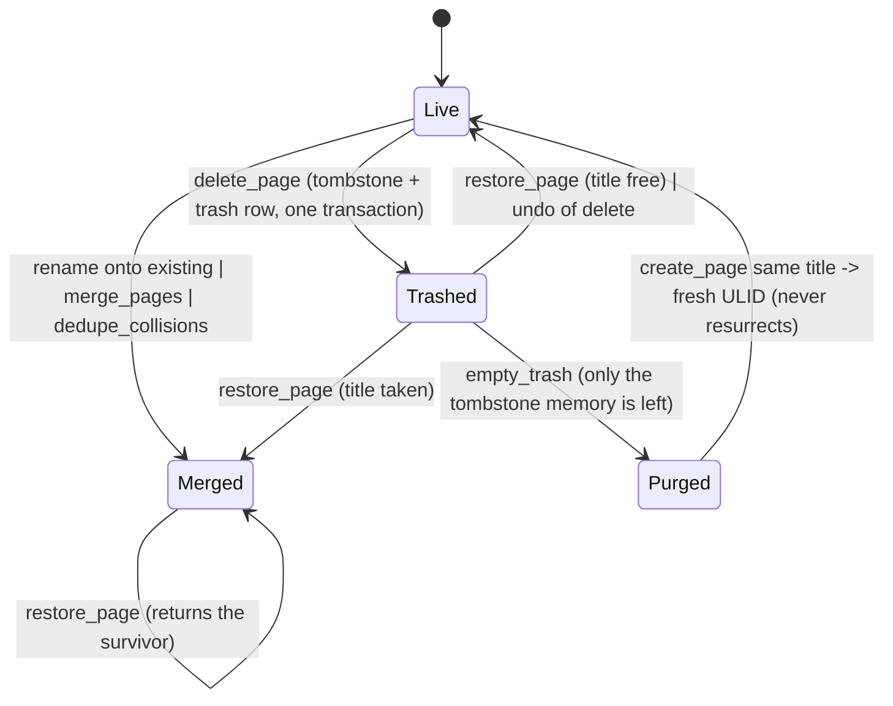

# Page lifecycle: live, trashed, merged, hard-deleted

## Status

Fixed on `fix/page-lifecycle-trash` (schema v8). Line numbers below are from the
`state-machines` branch at `main f5da7d1`; the code added here is referenced by name.

- **The machine is one type.** `utopia_store::PageFate` (`crates/utopia-store/src/pages.rs`)
  has the four states — `Live`, `Trashed { at }`, `Merged { into, at }`, `Purged { at }` — and
  is the only reader of the CRDT tombstone pair (`PageFate::of`) plus the local `tombstone`
  row (`Store::page_fate`). `delete_page`, `restore_page`, `dedupe_collisions` and
  `reconcile_merged` switch on it instead of testing `deleted_at`/`merged_into` by hand.
- **Issues 1 and 2 fixed** (one commit, one fix). The trash row is no longer a second write.
  `PageJob.trash` (`writer.rs`) carries a `TrashOp` and `write_job` applies it inside the
  shard's transaction. `Store::own_trash` (seeded from the table at open) records which pages
  this device owns a row for — a page another device tombstoned still gets none — so every
  later job for the page keeps the row in step with its fate: `Trashed` writes it,
  `Live`/`Merged` drops it. Undo of a delete takes the row with it, and a failed write can no
  longer tombstone a page without one. `doctor` reports the surviving bad state as
  "local: trash row for a page that is not trashed", and the v8 migration drops rows an
  older graph left behind.
- **Issue 3 fixed.** The `tombstone` table (v8) remembers every id that was ever projected
  tombstoned; `empty_trash` never deletes it and `id_taken` consults it, so Empty Trash no
  longer makes the deterministic uuidv5 reissuable (rule 4). It is local bookkeeping, not a
  projection: `rebuild_index` does not drop it, because a purged page has no shard to
  rebuild it from. The migration backfills from the graph's tombstoned pages, so the
  guarantee starts at the upgrade: an id purged *before* v8 has no record and behaves as
  before.
- **Issue 4 is not a bug, and the other fixes cover it.** `empty_trash` still keeps `outbox`
  rows (by design: they are the record of unsent local ops) and `sync_state` cursors, and a
  draft can never be in the trash at all — a draft has no `page` row, and only a listed
  trashed page is purged. The stale-cursor worry disappears with issue 3: the id is never
  reissued, so a `cursor:<id>` left behind can never apply to a different page.
  What Empty Trash still does not do: a relay that keeps the page's log hands it back on the
  next pull, so a purged page can return as an *invisible* tombstone (a shard, no trash row,
  so `list_trash` does not offer it for purging again). Hard delete is local (rule 5); this
  is the sync engine's behaviour and is unchanged here.
- **Found while doing it, not in the list: restore on a `Merged` page.** It used to clear
  both tombstone fields and return a live page whose every block had `moved_to` the survivor
  — a page with nothing to draw. Restore now returns the survivor, following the chain of
  merges to its end (A onto B, then B onto C: the blocks are in C), and leaves the merge
  tombstone alone (rule 8). Tests: `ac_4_6_restoring_a_merged_page_returns_the_survivor`,
  `ac_4_6_restoring_a_page_merged_twice_returns_the_final_survivor`.

## What it controls

Title/date uniqueness, what Delete/Restore/Empty Trash do, when a page id may be reused
(rule 4: "if the computed uuidv5 is tombstoned, issue a fresh ULID — never resurrect"), and
rename-onto-existing merges (rule 8). `crates/utopia-store/src/pages.rs`.

## Where the state lives

| Piece | Location | Set | Cleared |
|---|---|---|---|
| Tombstone (CRDT) | `PageMeta.deleted_at: Option<i64>` (`crates/utopia-core/src/command.rs:83-86`) | `delete_page :476-483`, `plan_merge :449-453` | `restore_page :510-518` |
| Merge pointer (CRDT) | `PageMeta.merged_into: Option<PageId>` | `plan_merge :449-453` | `restore_page :510-518` |
| Trash row (SQLite, local) | `trash` table; written by `write_job` from `PageJob.trash` | the tombstone's commit | the commit that makes the page live or merged, `empty_trash :558` |
| Row ownership (memory) | `Store::own_trash` (`HashSet<PageId>`) | `delete_page`, seeded from `trash` at open | `empty_trash` |
| Tombstone memory (SQLite, local) | `tombstone` table (`id`, `deleted_at`) | `project_page_row` for any tombstoned page | never |
| Projection | `page.deleted_at` column (`project.rs:321-338`); `PageKeys.live` flip (`project.rs:63, :246`) | writer | writer |
| Shard existence | `page_doc` row; `page_exists` (`lib.rs:468-478`) also true for any loaded doc | first commit | `empty_trash :557` (FK cascade) |
| Id reuse guard | `id_taken` (`pages.rs:34-41`) = alias ‖ in-memory shard ‖ `page_doc` ‖ `page` row ‖ `tombstone` row | – | – |
| State as a whole | `utopia_store::PageFate` / `Store::page_fate` | derived, never stored | – |

Readers: `header.deleted` at `page_view.rs:943`; `page_exists` at `sync/lib.rs:380`.

## States

**Live** (`deleted_at = None`) · **Trashed** (`deleted_at = Some`, `merged_into = None`,
trash row) · **Merged** (`deleted_at = Some`, `merged_into = Some`, no trash row) ·
**Purged** (no rows, no shard, `tombstone` row only).

## Events and transitions

- `delete_page` (`:466-490`): refuses a page that is not live (`PageFate`); records that this
  device owns the page's trash row, then tombstones through `execute` — the row rides that
  commit.
- `restore_page` (`:493-525`): a live page is returned as-is (and loses a stale row); a
  merged page returns its survivor and keeps the tombstone; if the title/date is taken the
  page merges instead; else both fields are cleared and the row goes with them.
- `merge_pages` / `rename_page` / `dedupe_collisions` → Merged in one transaction and one
  undo group (`:449-453`, rule 8).
- `empty_trash` (`:542-565`): deletes `ref`, `block`, `page_update`, `page` (cascades
  `page_doc`, `alias`), `trash`; evicts `docs` and the row ownership. It never touches
  `tombstone`.
- `reconcile_merged` (`:704-733`): re-homes orphans when the fate is `Merged`.

## Impossible or unhandled combinations (evidence)

1. **Trash row with a live page after undo.** The trash row was written outside the undo
   group (`:485-488`); Cmd+Z re-applies the inverse `SetPageMeta` (`lib.rs:775-797`) and left
   the row. **Fixed**: the row is part of every job for the page, so undo drops it.
2. **Tombstone and trash row were two transactions.** The tombstone went through the writer;
   the row was autocommitted on the read connection (`:485`). If the writer job failed (see
   `store-commit-pipeline.md`), the page was live with a trash row — or, worse, tombstoned by
   a commit whose row write then failed, which no list or restore could find. **Fixed**: one
   transaction (`PageJob.trash`); the failed write leaves the page live and the repair writes
   both.
3. **Empty Trash erased the memory rule 4 depends on.** After `empty_trash`, both legs of
   `id_taken` were gone (`:557` deletes the `page` row; `page_doc` cascades; `docs` evicted),
   so `create_page("Foo")` yielded `PageId::for_title_key` again (`:59-62`), and a peer that
   still held the tombstoned uuidv5 shard imported the new page's ops into it. **Fixed**: the
   `tombstone` table keeps the id reserved across the purge and across `rebuild_index`.
4. **`empty_trash` does not clear `drafts`, outbox or `sync_state`** (`:550-563`). Not a bug:
   outbox retention is by design, a draft cannot be in the trash (it has no `page` row), and a
   stale cursor can no longer attach to a different page now that the id is never reissued.

## Diagram



## The explicit type

```rust
enum PageFate { Live, Trashed { at: i64 }, Merged { into: PageId, at: i64 }, Purged { at: i64 } }
```

`PageFate::of(&PageState)` reads the CRDT pair and can never return `Purged`; `Store::page_fate`
falls back to the `tombstone` row for an id whose shard is gone. The trash row and the memory
are derived from it, never a second opinion: `trash_op` maps a fate to the writer's `TrashOp`,
and `id_taken` reads the memory rather than believing that "no page row" means "never used".
