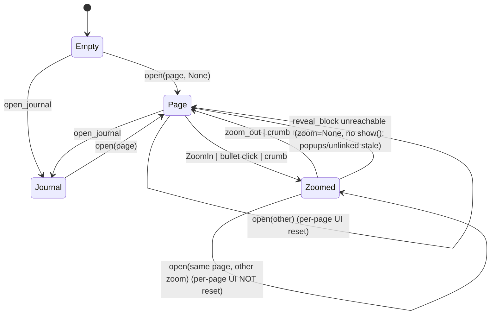

# Page view mode: page / zoomed subtree / Daily Notes feed

## Status

The three flags are now one type: `PageView` holds `mode: Mode` (`page_view.rs:315`, field at
`:554`), with `Empty`, `Page { page }`, `Zoomed { page, root }` and
`Journal { today, journal }`. `page()`/`zoom()`/`is_journal()`/`journal_days()` read through
it, so a feed always names today's page and a zoom always names its page; a feed with no page
is unrepresentable (issue 5, pinned by the unit test `a_mode_always_names_the_page_it_draws`).
Every transition goes through `set_mode` (`:979`), which replaces `show`: it resets the
per-page UI when the page changes (every opening of the feed counts as a page change; zooming
within one page keeps that page's state), closes the rename input and the date calendar
whenever the page or the zoom changes, always closes the menus, drops `refs_key`, refreshes
the unlinked count and rebuilds once.

- **Issue 1 — fixed.** `reveal_block` (`:1086`) ends with `set_mode(Mode::Page { .. })` instead
  of writing `zoom = None`; the unlinked count, `refs_key` and the popups are those of a whole
  page again. Test: `fr_3_9_leaving_a_zoom_to_reveal_a_block_counts_unlinked_mentions`
  (`crates/utopia-ui/tests/workspace.rs`).
- **Issue 2 — fixed.** The reset policy the doc sketched closes `rename` on a zoom change, so
  an input opened on the page no longer survives into a zoomed header. Test:
  `fr_2_7_zooming_within_a_page_closes_the_rename_input`.
- **Issue 3 — fixed.** The same policy closes `show_calendar`, so the date calendar opened
  from a zoomed or daily title does not stay open over the page header you return to. Test:
  `fr_1_4_leaving_a_zoom_closes_the_date_calendar`.
- **Issue 4 — not a bug; the doc's evidence is wrong.** The feed path does assign the header it
  builds (`self.header = header` after the store read), and the feed draws `Item::DayHeader`
  rows, never `Item::Header`, so `header.draft` stays unobservable on either path. Nothing
  changed here.
- **Issue 5 — fixed by construction.** `Mode::Journal` carries `today`, and `rebuild_rows`
  matches on the mode, so the old `debug_assert!("a feed without a page")` branch is gone
  rather than dead.
- **Left as is:** `PageReplaced` retargets the mode's page (`Mode::retarget`) instead of
  rewriting a field; that keeps the draft-daily retargeting behaviour of the old `_page_sub`.
  The feed's own `pages` list is still recomputed on the next rebuild, as before.

The state tables and line references below describe the code at `main f5da7d1`, before this
type existed; they are kept as the evidence the fix was made against.

## What it controls

What a `PageView` (`crates/utopia-ui/src/page_view.rs`) renders and which sections exist:
a page outline, a zoomed subtree with breadcrumbs, or the Daily Notes feed. Also which
per-page UI gets reset on navigation.

## Where the state lives

| Piece | Location | Set | Cleared |
|---|---|---|---|
| Page | `page_view.rs:290` `page: Option<PageId>` | `show :600` | `open_journal :538` (transient) |
| Zoom root | `page_view.rs:291` `zoom: Option<BlockId>` | `show :601` | `reveal_block :701` (bypasses `show`) |
| Feed | `page_view.rs:337` `journal: Option<Journal>` | `open_journal :531-537` | `open :523` |
| Header facts | `page_view.rs:298` `header: Header { missing, deleted, draft, kind, .. }` | rebuilt wholesale `:1020` / `:1158` | – |
| Per-page UI reset | `show :599-626` (keyed on `changed_page`): `query`, `filter_titles`, `rename`, `show_calendar`, `unlinked`, `alias_input`, `filter`, `expanded_groups`, `expanded_children`, `page_menu`, `controls_menu`, `refs_key`, then `refresh_unlinked` | | |

Read elsewhere: `page`/`zoom` at `workspace.rs:342, 620, 625, 632, 664, 785, 957, 985, 1100,
1306, 1534, 1556, 1637, 1674, 1766, 2534`; `is_journal` at `workspace.rs:1637, 1674, 1766, 1877`.

## States

| State | `page` | `zoom` | `journal` |
|---|---|---|---|
| Empty | `None` | `None` | `None` (ctor `:472/:503`; `rebuild :919-922` empties items) |
| Page | `Some` | `None` | `None` |
| Zoomed | `Some` | `Some` | `None` |
| Journal | `Some(today)` | `None` | `Some` |
| Transient | `None` | – | `Some` (inside `open_journal :538-539` until `show`) |

The invariant "journal ⇒ zoom = None" is implicit: `open_journal` passes `None` (`:539`),
`rebuild_journal` ignores `zoom` (`:1131`), `focus_first :646` and `MergeBackward :1534-1538`
rely on it.

## Events and transitions

- `open(page, zoom)` `:522` → clears `journal`, `show`.
- `open_journal(today)` `:530` → `journal = Some`, `show(today, None)`.
- `show` `:598-631` → resets per-page UI only when the page changed, sets `page`/`zoom`,
  `refresh_unlinked`, `rebuild`.
- `zoom_out :1795-1809`, breadcrumbs `:2641-2668`, bullet click `:2304-2317`, `ZoomIn :1609-1622`
  → `show` with a new zoom.
- `reveal_block :677-707` → may set `zoom = None` directly (`:700-702`) when the block is not
  reachable under the current zoom.

## Impossible or unhandled combinations (evidence)

1. **`reveal_block` leaves zoom without `show()`.** `:700-702` does `self.zoom = None;
   self.dirty = true;`. Only `show` resets `page_menu`, `controls_menu`, `refs_key` and runs
   `refresh_unlinked` (`:622-626`). `refresh_unlinked` had been skipped while zoomed
   (`:1071-1074`), so the next rebuild draws the Unlinked header (`:1035-1049`) with
   `count: None` until the next `IndexUpdated`. `refs_key` self-heals because `zoom` is part
   of the key (`:932`). Callers: `workspace.rs:834, 2523`.
2. **Per-page resets are keyed on `page` only** (`:599`). Zooming within a page keeps an open
   `rename` input (`:2681-2688` still draws it) although `start_rename :1985` refuses to start
   one while zoomed; `finish_rename :2020` then renames the page. Not wrong, but the UI and
   the rule disagree.
3. **`show_calendar` leaks across zoom levels.** `start_rename` toggles it when daily or zoomed
   (`:1985-1991`); zooming out of a non-daily page leaves it `true` (cleared only at `:606`
   page change or `pick_date :2046`), so the calendar stays open over a normal header
   (rendered unconditionally at `:2781`).
4. **`header.draft` is computed only on the page path** (`:945`); the journal path builds a
   `Header` with `draft = false` (`:1107-1111`) but never pushes it, so unobservable.
5. **`journal = Some` with `page = None`** is representable and would skip `rebuild_journal`
   (`:919-922`), leaving `loading` set. Only in the transient window at `:538-539`.

## Diagram



## Would an explicit state type help?

Yes, a `Mode` enum makes the journal/zoom exclusivity and the reset policy explicit.

```rust
enum Mode {
    Empty,
    Page { page: PageId },
    Zoomed { page: PageId, root: BlockId },
    Journal { today: PageId, feed: Feed },
}
impl PageView {
    fn set_mode(&mut self, next: Mode, cx: &mut Context<Self>) {
        let page_changed = self.mode.page() != next.page();
        let zoom_changed = self.mode.zoom() != next.zoom();
        if page_changed { self.reset_page_ui(); }
        if page_changed || zoom_changed { self.reset_popups(); self.refs_key = None; }
        self.mode = next;
        self.refresh_unlinked(cx);
        self.rebuild(cx);
    }
}
```

`reveal_block` would call `set_mode(Mode::Page { .. })` instead of poking `zoom`.
