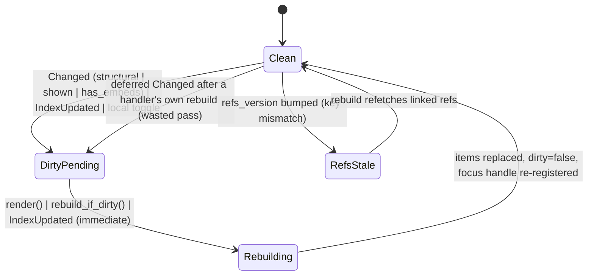

# Page view rebuild cycle: dirty flag, version keys, caches, editor row focus

## Status (branch `fix/page-view-rebuild-cycle`)

What is explicit now (`crates/utopia-ui/src/page_view.rs`):

- `PageView.cycle: RebuildCycle` replaces `dirty: bool`. It holds an `Invalidation` reason
  set (`rows`, `refs`, `unlinked`, `prefs`) and the `AppState::version` the rows were built
  from. Every old `dirty = true` site names what it invalidated; `rebuild()` clears the
  whole set in one place, after every early-return path. A separate monotone
  `gen`/`built_gen` pair as sketched below is not needed: `pending` empty *is* "built", and
  the store version is what tells a handler's own deferred `Changed` apart from a newer one.
- `PageView.interest: Interest::{ThisPage, AllPages}` replaces `has_embeds()`. It is
  recomputed from the rows after every build and reset to `ThisPage` when the page changes.
- `PageView.focused_rows` records how many list rows carry the editor's focus handle.
- `AppState::Changed.version` carries the version of the change, so a subscriber can tell
  whether it already built that state.
- `sync_preferences` is the one place the two appearance mirrors
  (`ref_children_limit`, `attribute_blocks`) are resynced; `rebuild` calls it itself.
- Debug counters `rebuilds` and `frame_rebuilds` (beside the existing reference-children
  counters) let the acceptance tests assert how many passes ran and that they ran outside
  `render` (rule 10).

Listed issues:

1. **Fixed.** `Changed` is delivered after the update, so a handler's own rebuild was
   followed by a second pass in the frame. `RebuildCycle::store_changed` compares
   `Changed.version` with the version the rows were built from and drops the event when it
   is already built. Test: `a_handler_rebuild_is_not_repeated_by_its_own_change`.
2. **Fixed.** `Interest` replaces `has_embeds()`; `open_embeds` is cleared on a page change
   (and a `PageReplaced` retarget); and when the interest is `AllPages` a relevant change
   rebuilds in the change handler, so `run_query` never runs inside `render`. Tests:
   `a_query_block_answers_other_pages_changes_outside_the_frame`,
   `leaving_a_page_drops_its_open_transclusions`.
3. **Fixed.** `rebuild` resyncs both appearance mirrors through `sync_preferences`, so an
   index-triggered or observer-triggered pass builds with the preference in force instead
   of leaving the next frame to correct it. Test: `an_appearance_change_rebuilds_in_the_observer`.
4. **Fixed, but latent.** `EditorEvent::Blurred` now re-splices the rows from the editor's
   current target, so the list stops holding the focus handle of a row that is drawn as
   text. It is latent because `end()` always commits, and the commit's structural change
   emits `IndexUpdated`, whose handler already rebuilt in the same effect flush; the fix
   removes the reliance on that coincidence (and on the workspace's re-focus). Test:
   `ending_an_edit_drops_the_rows_focus_registration` (passes before the fix for the reason
   above; it asserts the invariant, not the removed extra frame).
5. **Already fixed before this branch** by the block-editor-session work (fix 10):
   `BlockEditor::begin` sets `EditorSession::Idle`, emits `Blurred` and returns when the
   target block is not in the shard (`editor.rs`), so `target` cannot silently keep the old
   block. Nothing changed here.
6. **Fixed structurally.** `render_item` arms `in_render` around the lazy item build (the
   list calls it after `render` returns) and restores the previous value, so a future
   instrumented store read in an item is counted as a frame read. No failing-first test:
   there is no instrumented read on that path today, so the bug was latent.
7. **Not changed; the doc's reading is wrong.** `under_heading` is a boolean about the
   *block*: it is read from the block's old index and applied to the same block's index
   re-read after the rebuild, so no other row can receive the sticky-heading offset. The
   measurement stays before the rebuild because that is the layout the user clicked in, and
   a splice leaves the list with no measured rows to re-measure. A rebuild between the two
   is rare (most callers rebuild in their own handler first) and the conservative scroll is
   at worst one heading's worth of motion. Clarified in the comment at `edit`.

Everything below is the original analysis; line numbers refer to `main f5da7d1`.

## What it controls

When `PageView.items` is recomputed from the store, which queries run, whether a frame does
database work (rule 10), and which list row carries the editor's focus handle so the
edited block keeps receiving keystrokes when scrolled out of view (AGENTS.md "Keep that when
touching the list"). `crates/utopia-ui/src/page_view.rs`.

## Where the state lives

| Piece | Location | Set | Cleared |
|---|---|---|---|
| Needs rebuild | `page_view.rs:348` `dirty: bool` | 20+ sites (`:434, :439, :463, :627, :702, :704, :874, :1084, :1267, :1277, :1769, :1791, :2039, :2083, …`) | only `rebuild :913` |
| Refs fetched for | `:300` `refs_key: Option<(PageId, Option<BlockId>, u64)>` | `:1017` | `:462, :624, :2994, :3031, :3235` |
| Ref children cache | `:324-325` `ref_children_cache`, `ref_children_cache_key: Option<(u64, usize)>` | `:1395/:1411` | `:1357-1360` |
| Preference mirrors | `:310` `ref_children_limit`; `:347` `attribute_blocks` | `:453, :914`; `:871-875, :1266` | – |
| Unlinked cache | `:333` `unlinked: Option<(u64, Vec<Mention>)>` | `:1083` | `:607, :2923, :2941` |
| Journal refs cache | `:227-228` `Journal.refs`, `refs_version` | `:1232-1233` | taken `:1093-1096` |
| Debug read counters | `:313-320` `in_render`, `ref_children_queries`, `ref_children_frame_queries` | `:4220-4222`, `:1385-1393`, `:1401-1409` | – |
| Editor row focus | `splice_items :893-910` registers the editor handle on the row where `editor.is_editing(host, page, block)` (`:902`) | `replace_items :886`, `edit :802` | – |
| Index version | `app_state.rs:35` `refs_version` | `index_updated :134` | – |

## States

- **Clean**: `dirty = false`, `refs_key == (page, zoom, refs_version)`, caches keyed to
  `refs_version`.
- **Dirty-pending**: `dirty = true`; the rebuild runs at the next `render` (`:4221`) or the
  next `rebuild_if_dirty` caller (`:716, :761, :1495`).
- **Refs-stale** / **children-cache-stale** / **unlinked-stale**: a key mismatch, each
  healed independently inside `rebuild`.

## Events and transitions

- `Changed` subscription (`:427-437`): `dirty` if `structural || pages.is_empty() || shown ||
  has_embeds()`.
- `IndexUpdated` (`:438-447`): `dirty`, `refresh_unlinked`, immediate `rebuild`.
- Appearance observer (`:450-457`): `ref_children` change → immediate `rebuild`.
- `rebuild` (`:912-1059`): clears `dirty`, refreshes refs if `need_refs` (`:932`), builds
  items, `replace_items` → `splice_items`.
- `rebuild_if_dirty` (`:871-880`): also resyncs `attribute_blocks` (`:871-875`); plain
  `rebuild` does not.

## Impossible or unhandled combinations (evidence)

1. **Handler rebuild + deferred `Changed` ⇒ second rebuild.** `focus_first :647-663`,
   `start_day :1286-1295`, `InsertTemplate :1650-1666`, `apply_plan :1712-1718` call
   `app.changed(..)` then `self.rebuild(cx)` (which sets `dirty = false`, `:913`). The
   `Changed` subscription is delivered after the update and sets `dirty = true` again
   (`:434`), so `render :4221` rebuilds once more with the same data. `dirty` no longer
   means "items are stale". Uncertain only about gpui's exact emit timing; either order
   wastes one rebuild.
2. **A query block makes the view interested in every change.** `has_embeds()` (`:513-519`)
   is true when `items` contains any `QueryHeader` or `open_embeds` is non-empty, and
   `open_embeds` is never cleared on page change (toggle at `:1862-1866`, not in the reset
   list `:602-621`). Every `Changed` from any page (`:433`) then dirties this view, and the
   next frame's `rebuild` runs `run_query` (`:4133`) inside `render`, contradicting the
   file's own comment at `:1036-1040`.
3. **`rebuild` does not resync `attribute_blocks`** (`:912-914` resyncs only
   `ref_children_limit`; the mirror is synced at `:871-875` in `rebuild_if_dirty`). An
   `IndexUpdated` rebuild (`:445`) or the appearance observer (`:450-457`) can build rows
   with the old preference; the next frame's `rebuild_if_dirty` notices and rebuilds again.
4. **Editor target and row focus registration move at different times.** `editor.end()`
   clears `target` (`editor.rs:322`) and emits `Blurred`, which `PageView` ignores (`:1671`)
   and which does not set `dirty`. The list still registers the editor's handle on the old
   row (set by `splice_items :893-910`) while `render_row :2217` already draws it as text,
   until the next rebuild. Most `end()` sites are followed by a rebuild; `ExtractRequested
   :1643` and `open_reference :363` only emit events and rely on the workspace to re-open.
   The workspace re-focuses at `workspace.rs:261-263`, so no keystrokes are lost today.
5. **`begin` can keep the previous target silently.** `editor.rs:296-304`: when the block is
   not in the shard, `commit` has run but `target` stays the old block and focus is not
   taken; `edit :801-817` then scrolls to the new block as if it were the target. Reachable
   only if a drawn row's block vanished between `rebuild_if_dirty :761` and `begin` —
   uncertain whether that can happen.
6. **`in_render` brackets only `rebuild_if_dirty`** (`:4220-4222`), not the list item
   closures (`:4233-4247`); the debug counter would miss a future store read in `render_item`.
7. **`edit()` computes `under_heading` on stale items.** `:758-761` uses `row_index` before
   `rebuild_if_dirty`; the decision is applied to the post-rebuild index at `:805-808`. The
   comment calls this deliberate; if the rebuild inserts rows above (older batch loaded) the
   wrong row gets the sticky-heading offset. Uncertain frequency.

## Diagram



## Would an explicit state type help?

Partly. The useful change is to replace the boolean with a *reason set* and a single
"generation" the caches key on, so a handler can mark what it already rebuilt.

```rust
#[derive(Default)]
struct Invalidation { rows: bool, refs: bool, unlinked: bool, prefs: bool }
struct PageView { gen: u64, built_gen: u64, pending: Invalidation, .. }
// Changed/IndexUpdated: self.pending |= ...; self.gen += 1;
// rebuild(): if built_gen == gen { return } ... built_gen = gen;
```

`has_embeds()` should become an explicit `interest: Interest::{ThisPage, AllPages}` set when
a query block or embed is actually present and cleared on page change.
