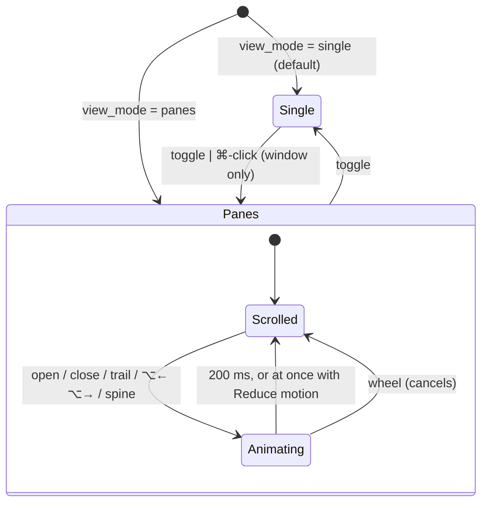

# Pane stack: entries, mode, focus, sideways scroll

## What it controls

The main column's list of open pages (DESIGN.md §4.3, §4.4; PRD §9.2.1 SP-1…SP-9): which
entries exist, whether they show side by side (Panes) or only the last one (Single), which
entry has focus, and how far the pane row is scrolled. `crates/utopia-ui/src/workspace.rs`
holds it; the transitions are pure functions in `crates/utopia-ui/src/pane_stack.rs`.

## Where the state lives

| Piece | Location | Notes |
|---|---|---|
| Entries | `Workspace::stack: Vec<Entity<PageView>>` | `stack[0]` is always the feed. An entry's page and zoom are read from its view (`entries()`), never stored twice. |
| Mode | `Workspace::mode` | Starts from `settings.json` `view_mode`. A ⌘-click in Single switches the window only; the toggle writes the setting. |
| Focus | `Workspace::focused`, `key_focus` | Always the last entry in Single. `key_focus` draws the ring after ⌥←/⌥→. |
| Scroll | `scroll_x`, `scroll_anim` | Clamped every frame to `Geometry::max_scroll`. |
| Saved copy | `local_state` `pane_stack` | Written by `stack_changed` when the entries differ from `stack_seen`, or when the last write failed (`stack_unsaved`). |
| Per view | `PageView::{in_pane, active, next_link}` | Set by `stack_changed` / `sync_next_links`, never in a frame. |
| Subscriptions | `Workspace::stack_subs` | One pair per entry after the first; dropped with the view by `apply_plan`. |

## Events and transitions

Every change is a `pane_stack::Plan` (keep these old entries, then push one) applied by
`Workspace::apply_plan`:

- Link click in a stack view → `PageViewEvent::Open { click, sidebar, replace }` →
  `open_from(Origin::Pane(i), click)` → `pane_stack::open`.
- A click in the sidebars or search results → `open_clicked(modifiers)`: Shift alone goes
  to the right sidebar, otherwise `open_from(Origin::Outside, click_of(modifiers))`, so a
  ⌘-click there peeks in Single mode like a ⌘-click on a link.
- Quick jump, `utopia://` → `open()` → `open_from(Origin::Outside, Plain)`.
- × / ⌘W → `close`; Back → `back`; "Close other panes" → `close_others`; trail → `trail`;
  "Daily Notes" → `reset` (`open_journal`); toggle → `set_mode`.
- A rename that merges the shown page (`replace: true`) retargets the same view in place.
- A view's own zoom or a promoted draft day changes an entry without a plan;
  `on_view_changed` notices through `stack_seen`. Either way `entry_changed` runs
  `pane_stack::dedupe`: if the entry now equals another one, the other copy goes and the
  changed entry, the one in use, keeps its caret, scroll and focus.
- Focus without a list change (a press in a pane, a spine, ⌥←/⌥→) → `set_focus`. It and
  `apply_plan` both call `release_pane` on the pane focus leaves and `follow_focus`
  (window title, graph panel origin) on the one it reaches.

## Invariants

1. `stack` is never empty and `stack[0]` shows the feed: a zoom from the feed opens a new
   entry rather than zooming the feed in place.
2. An edit hosted by a view that leaves the stack, or by the pane focus leaves, ends first,
   and a text field there (rename, alias, reference filter) gives the keyboard back
   (`release_pane`; AGENTS.md: a focused element that is not drawn swallows every key).
3. The pane holding the edit or a focused text field (`PageView::holds_focus`) is always
   drawn, even as a spine or off screen.
4. Each pane `occlude()`s the panes it covers; gpui otherwise hands one click to every
   hitbox under the pointer (found when a spine click scrolled to pane 0).
5. In Single mode only the last entry is active; the others mark themselves stale and
   rebuild on `set_active(true)`.
6. No two entries are equal (`pane_stack::dedupe` after any change without a click).
7. A pane is never wider than the scroller (`Geometry::fit`): with both sidebars open in a
   small window it shrinks below 560 px so its close button stays in reach.

## Diagram

