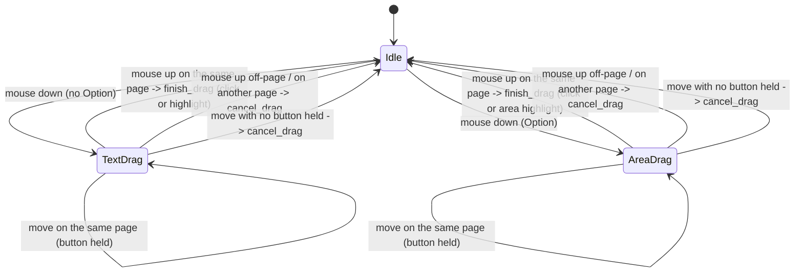

# PDF viewer highlight drag: text selection vs area, click vs drag

## Status

The drag is one explicit state, `Gesture::{Idle, Drag(Drag)}` (`pdf_view.rs:52`), and all
three combinations the machine listed are dealt with:

1. **Fixed** — a release that no page claims (the gutter, the header, outside the window)
   cancels the drag instead of leaving its rectangle on screen. A view-level mouse-up
   (`pdf_view.rs:565`) cancels whatever the page handlers did not finish, and a view-level
   move with no button held (`:571`) catches the release that happened outside the window,
   where no hovered element sees the up at all. Test:
   `p2_pdf_highlight_release_off_page_cancels_the_drag` (`workspace.rs`).
2. **Fixed** — the page is part of the drag (`Drag::page`, `pdf_view.rs:41`); the page's up
   handler passes its index to `finish_drag` (`:400`), which cancels when it is not the page
   the drag started on (`:272`, `:276-279`) rather than clamping another page's coordinates
   into a highlight that runs to the edge. Test:
   `p2_pdf_highlight_release_on_another_page_writes_nothing` (`workspace.rs`).
3. **Fixed by construction** — the Option-drag mode is no longer a field that outlives a
   drag: `DragBody::{Text { preview }, Area}` (`pdf_view.rs:31`) *is* the mode, and the text
   preview lives inside the text variant, so neither a stale mode nor a preview without a
   drag can be represented.

Left as it was, deliberately: a drag whose release lands outside the *window* keeps its
rectangle until the pointer next moves inside the viewer (or the viewer is closed). GPUI only
dispatches an element's mouse listeners while that element is hovered, so nothing in the view
can see the up; the first move back in with no button held clears it, before a click can
finish the old drag. A cross-page text selection is still not supported (a drag that leaves
its page is a cancel, not a multi-page quote); the PRD's PDF entry (Appendix A) asks for
highlights, not spanning selections.

## What it controls

Creating a highlight in the PDF viewer (P2, macOS): dragging selects text lines, Option-drag
selects an area, a tiny drag is a click. `crates/utopia-ui/src/pdf_view.rs`.

## Where the state lives

| Piece | Location | Set | Cleared |
|---|---|---|---|
| Gesture | `pdf_view.rs:73` `gesture: Gesture` | mouse down `:388` → `begin_drag :316` | `finish_drag` `:273` (`take`), `cancel_drag :307` |
| Drag page | `:41` `Drag::page` | `begin_drag` from the page div that got the down | with the gesture |
| Kind | `:31` `DragBody::{Text, Area}` | `begin_drag` from the Option key at the down | with the gesture |
| Preview rects | `:32` `DragBody::Text::preview` | `move_drag :332`, `:398` | with the gesture (every exit drops it) |
| Page bounds | `:74` `page_bounds` | the page canvas during paint | never (per page, refreshed each frame) |

Read elsewhere: `pdf_view()` in `crates/utopia-app/src/main.rs:112, 122`; `dragging()` and
`page_bounds()` are the test readers.

## States

**Idle** (`Gesture::Idle`) / **Text drag** (`DragBody::Text`, preview live) / **Area drag**
(`DragBody::Area`) / **Click** (both ends closer than `0.01 × 0.005` of the page,
`finish_drag :289-293`).

## Events and transitions

- mouse down on a page div (`:388`) → `begin_drag`: `Idle → Drag`, `page` = that page,
  `mode` = Option.
- mouse move on a page with the left button held (`:395`) → `move_drag`: updates the end of
  the drag when it belongs to that page; a text drag re-asks PDFKit for the line rectangles.
- mouse up **on the page the drag started on** (`:400`) → `finish_drag`: clamp to 0..1, click
  vs highlight, store as a quote block.
- mouse up **anywhere else in the viewer** (view-level `:565`) → `cancel_drag`: no block is
  written.
- mouse up **on another page** (that page's `:400`) → `finish_drag` sees the mismatch and
  cancels (`:276-279`).
- mouse move **with no button held** (view-level `:571`) → `cancel_drag`, which is how a
  release outside the window is noticed.

## Diagram



## The explicit type

```rust
enum DragBody { Text { preview: Vec<[f32; 4]> }, Area }
struct Drag { page: usize, start: Point<Pixels>, cur: Point<Pixels>, body: DragBody }
enum Gesture { Idle, Drag(Drag) }
```

The sketch this doc started from had `mode: DragMode` next to `preview: Vec<…>` in the view.
Folding them into `DragBody` (and the preview into the text variant) removes the two
remaining combinations as well: an area drag cannot carry text-selection rectangles, and a
preview cannot outlive its drag. The page sits in the drag, so no handler has to remember it
separately.
