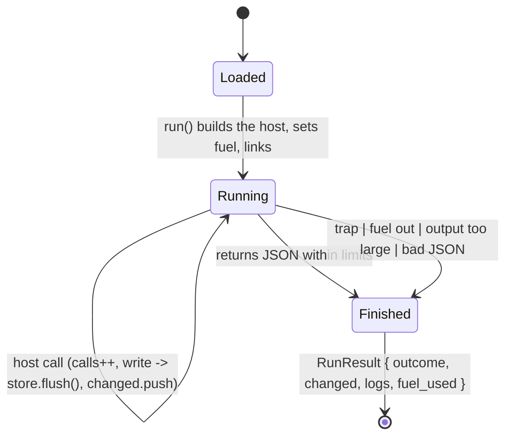

# Plugin run: fuel, host-call counter, changed pages

## Status

Made explicit on `fix/plugin-run-lifecycle`: one run result type, one permission oracle, and a
fuel reading that does not invent a number.

- **`RunResult` is the state.** `Plugin::run` returns
  `RunResult { outcome, changed, logs, fuel_used }` (`crates/utopia-plugin/src/lib.rs:117`),
  always — there is no longer a `Result<RunOutput>` arm on which host state can be dropped.
  `RunOutput` is only what the plugin asked the editor to do (`insert`, `replace`, `message`,
  `raw`). `run` is `:288`, its instantiate/call half `execute` `:328`, the host imports `link`
  `:398`.
- **Issue 1, fixed (writes committed, UI never told).** The trap, fuel-exhaustion,
  output-too-large and output-not-JSON paths all return the host state now, and
  `BlockEditor::run_plugin` (`crates/utopia-ui/src/editor.rs:455`) announces `changed` and
  refreshes the edited block from the store on **both** result arms. Tests:
  `a_run_that_fails_still_reports_the_pages_it_wrote`
  (`crates/utopia-plugin/tests/sandbox.rs:261`; fails on `main` before the fix because the
  result has no field for the pages, and the reproduction showed the capture committed while
  `run` answered `Err`) and
  `p2_a_failed_plugin_run_announces_the_pages_it_wrote`
  (`crates/utopia-ui/tests/workspace.rs:5855`; fails on `main` at runtime: the capture landed
  and the trap was reported, but no `Changed` event reached the views).
- **Issue 2, fixed (parallel permission list).** `Op::writes()` is gone. `Op::kind()`
  (`crates/utopia-api/src/lib.rs:134`) is the one classification, the plugin's permission check
  reads it, and the match is exhaustive, so a new `Op` variant does not compile until it is
  classified. `ops_classify_reads_and_writes_consistently`
  (`crates/utopia-api/src/lib.rs:963`) runs every op through `handle` and checks that a
  `Write` names a page and a `Read` names none. **Residual:** a *wrong* classification still
  compiles — the test, not the compiler, is what catches one, and it has to be extended
  whenever an op is added.
- **Issue 3, fixed (fuel reported as fully spent when unknown).** `fuel_used(Option<u64>)`
  (`crates/utopia-plugin/src/lib.rs:393`) reports 0 for an unreadable counter instead of the
  whole budget, with the unit test `unknown_fuel_is_not_a_whole_budget` (`:451`). The engine
  cannot fail today (`Config::consume_fuel(true)` is always set), so the test pins the mapping,
  not a live failure; there is no way to reach the branch from outside.

Left alone, deliberately:

- **`handle`'s own error path still drops pages.** A write op that commits and then fails
  inside `utopia_api::handle` returns `Err(ApiError)`, and [`Outcome`] only exists on the `Ok`
  side, so even the new `RunResult` cannot name those pages. Fixing it means carrying changed
  pages on `ApiError`, which changes the HTTP answer shape in the file the API-call-inbox
  machine owns; a separate change.
- **A `start` function can write before `utopia_run`.** Handled by construction now: the whole
  instantiate-and-call sequence is `execute`, whose failure travels in the same `RunResult`.
  The only `not_started` exits are before any host call.

## What it controls

One execution of a WASM plugin command (P2): instantiation, fuel and host-call limits,
permissioned store access, and what the UI learns afterwards (inserted text, message, pages
changed). `crates/utopia-plugin/src/lib.rs`.

## Where the state lives

| Piece | Location | Notes |
|---|---|---|
| Host state | `plugin/lib.rs:154` `Host { calls, limits, changed, logs, store: *mut Store }` | per run |
| Fuel | set at `:305`; `fuel_used(wstore.get_fuel().ok())` `:315`, helper `:393` | 0 = unknown, never "all spent" |
| Host calls | `calls` incremented `:212`, cap `:213-215` (over-cap returns error JSON; execution continues until fuel ends) | – |
| Permissions | `can_read`/`can_write` (`:69-75`, read ⊂ write at `:70`) against `Op::kind()` (`utopia-api/src/lib.rs:134`) | one classification, exhaustive |
| Pages changed | `host.changed` pushed at `:238` when a write op runs | returned on **both** paths (`:315-322`) |

## States

**Loaded** (validated) → **Running** (instance alive) → **Finished(RunResult)**, where the
outcome inside is `Ok(RunOutput)` or `Err(PluginError)` and the host state — `changed`, `logs`,
`fuel_used` — is present either way. Only the pre-flight failures (unknown command id, fuel
metering off, a linker import that cannot be registered) exit without a `RunResult` body worth
having, and they happen before any host call, so nothing can have been written.

## Events and transitions

- `run` (`:288-323`): check the command id, build `Host`, set fuel, `link`, then `execute`.
  `execute` (`:328`) instantiates, allocates, calls, unpacks, size-checks and parses; then
  `run` reads the fuel and takes `host` back out. Both halves of the last step happen in one
  place, so no early return can skip them.
- host write call → `utopia_api::handle` → `store.flush()` (`api/lib.rs:317, :335, :379`) —
  **committed inside the call**; `host.changed.extend(o.changed)` (`:238`).
- `run_plugin` (`editor.rs:455`): reports `changed` (`:471-474`), then the outcome's
  `message` or `last_error`, then applies `replace` / a stored-text refresh / `insert`
  (`:486-508`).

## Issues the doc listed (evidence at `main f5da7d1`)

1. **Writes committed, UI never told.** A write host call flushed the store and recorded the
   page in `host.changed`; a module that then trapped, exhausted fuel, returned too much
   output or non-JSON output made `run` return `Err` and the pages were dropped. **Fixed** —
   see Status.
2. **`Op::writes()` was a parallel list.** Every mutating `handle` arm was listed by hand, so a
   new write op could run with read permission. **Fixed** — `Op::kind()` is exhaustive and the
   plugin reads it.
3. **`fuel_used` reported full consumption** if `get_fuel` erred. **Fixed** — it reports 0
   (unknown).

## Diagram



## The explicit type

```rust
pub struct RunOutput { pub insert: Option<String>, pub replace: Option<String>,
                       pub message: Option<String>, pub raw: Value }

pub struct RunResult {
    pub outcome: Result<RunOutput, PluginError>,
    /// Pages its host writes committed, on the failure path too (rule 13).
    pub changed: Vec<PageId>,
    pub logs: Vec<String>,
    /// 0 when the engine could not report; never "the whole budget".
    pub fuel_used: u64,
}
```
