# Realtime WebSocket listener: connect, back off, stop

## Status

The desktop keeps its listener in `utopia_ui::sync_runner::LiveUpdates`, held by the
`Workspace` (`crates/utopia-ui/src/workspace.rs`): one `Option<Box<dyn LiveSocket>>`
(the real `utopia_sync::realtime::Listener`, or a stand-in in tests), opened when a relay
target exists. How long it stays open is Settings → Sync **Live updates**
(`crates/utopia-ui/src/appearance.rs`, `RealtimeMode`): `always` (the default) never closes
it; `while_active` opens it on a window activation, a keystroke in any window of the app
or a local edit, and closes it on deactivation or after `LIVE_IDLE` with none of those
(2 minutes). The keystrokes come from one app-wide `intercept_keystrokes` hook installed by
the workspace: with `always` it is one load and a branch (`LiveWatch::Off`), with the socket
open it records the time in `LiveClock`, and only with the socket closed does it call the
workspace to reopen it, which it refuses while no window of the app has the keyboard. The
countdown is one gpui timer that, on firing, compares `LiveClock` with `LIVE_IDLE` and either
closes the socket or sleeps for what is left, so activity never spawns a task; the clock is
the executor's, so a test drives it with `advance_clock`. Pointer input is not counted:
gpui 0.2.2 has no app-level mouse hook, only per-frame element listeners. A socket that closes is joined on the background
executor; there is never a second one. The headless daemon (`utopia sync --continuous`)
still keeps `SyncRunner::realtime` in `crates/utopia-sync/src/runner.rs` and always
listens, since it has no user activity to follow.

Activation is app-wide, not window-wide: Settings is a window of the same app, and gpui
reports activation per window with no app-level event, so every window reports to the
workspace that owns the socket (`sync_runner::report_presence`, from a task so the platform
has settled all of them) and a global weak handle names that workspace. "The app is in the
background" therefore means no window of ours has the keyboard, and a `while_active`
socket closes after the idle timeout *and* when the user leaves from Settings, reopening
when Settings comes back to the front without an edit.

Before that setting, the desktop's listener was held by the shared round
`utopia_sync::runner::SyncRunner`, started for a relay target, cancelled and joined when
the runner was stopped or replaced. Its `nudge` still wakes both the desktop loop and the
daemon. The paragraph below describes that earlier ownership; references to
`sync_runner.rs` line numbers in this document are historical, and the listener lifecycle
(backoff, cancellation, the 10 s handshake deadline) is described below and unchanged.

In-app setup replaces the desktop's detached blocking listener with
`utopia_sync::realtime::Listener`, owned by `SyncRunner`. A oneshot cancellation signal
races the entire async reconnect future, including connect/handshake, quiet socket reads
and backoff. `Workspace::stop_sync` removes the poll task immediately and hands the listener
to the setup coordinator, which signals and joins it on the background executor before
starting the replacement. The listener starts only after the runner was created successfully.
Dropping a runner also signals its listener, including workspace teardown.

This fixes findings 1–4 below: successful connection resets backoff to 2 s; 401/403 retry at
60 s instead of giving up forever; failed engine construction cannot orphan a listener;
and a quiet or stalled connection no longer prevents cancellation. Connect/handshake has a
10 s deadline. The blocking `listen` helper stays public for the relay's own end-to-end test
(`crates/utopia-syncd/tests/http.rs`); the desktop no longer uses it. Jitter and server-side
event-map retention (5–6) are unchanged.

Regression tests: `ac_12_3_stop_cancels_a_quiet_socket_and_replacement_has_one_listener`
and `ac_12_3_stop_cancels_a_stalled_handshake`, plus, for the activity policy,
`live_updates_follow_the_mode_and_keep_one_socket` and the workspace scripts
`always_keeps_the_realtime_socket_open`, `while_active_closes_and_reopens_the_realtime_socket_with_focus`,
`while_active_closes_the_realtime_socket_after_two_quiet_minutes`,
`while_active_closes_the_socket_when_the_app_leaves_from_settings`,
`while_active_reopens_the_socket_from_the_settings_window_alone`,
`while_active_keystrokes_without_an_edit_keep_the_socket_open`,
`while_active_a_keystroke_reopens_the_socket_after_the_quiet_minutes`,
`while_active_keystrokes_in_settings_keep_the_socket_open`,
`while_active_a_keystroke_with_no_window_active_does_not_reopen` and
`always_ignores_keystrokes`.

## What it controls

The background thread that keeps a WebSocket to the relay's `/events` endpoint and raises
`nudge` so the poll loop syncs immediately (PRD `§12.3` "Realtime").
`crates/utopia-ui/src/sync_runner.rs:101-123` and `crates/utopia-sync/src/realtime.rs`.

## Where the state lives

| Piece | Location | Set | Cleared |
|---|---|---|---|
| Backoff | `sync_runner.rs:110` `backoff: Duration` (local) | init 2 s; `:120` `(backoff * 2).min(SLOW)` | **never reset** |
| Thread alive | result of `std::thread::Builder::spawn` discarded (`:107`); no handle, no stop flag | – | `return` on `Unauthorized` (`:116-118`) |
| Connected | inside `listen` (`realtime.rs:32-71`): blocks on `socket.read()` | `connect` ok | `Message::Close` → `Ok(())`; read error → `Err(Transport)` |
| Nudge | `Arc<AtomicBool>` set at `:113` | – | consumed by the poll loop |
| Server side | `syncd/lib.rs:425` `Events = HashMap<String, broadcast::Sender>` | created on demand `:437-439` | never removed |

## States

**Connecting** → **Connected** → **Sleeping(backoff)** → Connecting … or **Given up**
(thread returned).

## Events and transitions

- notice received → `nudge = true`, keep listening (`:113-114`, closure always returns true).
- socket closed or read error → sleep `backoff`, double it, reconnect (`:119-121`).
- 401/403 on connect → `Unauthorized` → thread exits for good (`:116-118`).

## Impossible or unhandled combinations (evidence)

1. **Backoff only grows.** The only writes are `:110` and `:120`. After five disconnects over
   a session — even hours apart, each following a healthy connection — every reconnect waits
   60 s. A graceful server `Close` (`realtime.rs:67` → `Ok`) is treated the same as a failure.
2. **401 is terminal here but not for polling.** The poll loop maps `Unauthorized` to
   `NeedsAuth` and keeps retrying at `SLOW` (`SyncPhase::Refused` in
   `sync-runner-round.md`: one retry a minute, no fast polling), so a relay that starts
   accepting the token again is picked up by polling — while this thread never restarts
   (`spawn_realtime` is called only from `workspace.rs:421`). The fix belongs here: a restart
   path for the thread, or the read timeout (issue 4) that would let it be stopped and
   started, not a change to polling.
3. **Orphan thread when the engine fails.** `spawn_realtime` runs at `workspace.rs:421`
   before `enable_sync_with` at `:428`; if the latter returns false (`:474-479`) the thread
   loops forever setting a `nudge` nobody reads.
4. **No read timeout / ping.** `socket.read()` (`realtime.rs:54`) has no timeout; a half-open
   TCP connection could block the thread indefinitely. Uncertain (OS keepalive).
5. **No jitter**; thundering herd on relay restart (PRD §12.6 asks for jitter on 5xx).
6. **Server-side event map grows without bound**: any authenticated caller creates one entry
   per distinct valid id via `GET /events` or a push (`syncd:437-439`); `forward :542-555`
   only notices a dead client when `send` fails because the socket is never read.

## Diagram

```mermaid
stateDiagram-v2
    [*] --> Connecting
    Connecting --> Connected : ws connect ok
    Connecting --> GivenUp : 401/403 (thread returns; polling continues)
    Connecting --> Sleeping : connect error
    Connected --> Connected : notice -> nudge = true
    Connected --> Sleeping : Close | read error
    Sleeping --> Connecting : after backoff (then backoff = min(2x, 60s), never reset)
```



## Would an explicit state type help?

Yes, a small one with a reset on success and a restart path:

```rust
enum Realtime { Connecting { attempt: u32 }, Connected { since: Instant }, Sleeping { until: Instant, attempt: u32 }, Halted(SyncError) }
// Connected -> Sleeping: attempt = 0 if the connection lasted > 30 s; sleep = 2s << attempt, capped, with jitter
// Halted is visible to the runner, which can restart the thread when the token changes
```
