# Realtime WebSocket listener: connect, back off, stop

## Status

In-app setup replaces the desktop's detached blocking listener with
`utopia_sync::realtime::Listener`, owned by `SyncRunner`. A oneshot cancellation signal
races the entire async reconnect future, including connect/handshake, quiet socket reads
and backoff. `Workspace::stop_sync` removes the poll task immediately and hands the listener
to the setup coordinator, which signals and joins it on the background executor before
starting the replacement. The listener starts only after the runner was created successfully.
Dropping a runner also signals its listener, including workspace teardown.

This fixes findings 1–4 below: successful connection resets backoff to 2 s; 401/403 retry at
60 s instead of giving up forever; failed engine construction cannot orphan a listener;
and a quiet or stalled connection no longer prevents cancellation. Connect/handshake has a
10 s deadline. The blocking `listen` helper stays public for the relay's own end-to-end test
(`crates/utopia-syncd/tests/http.rs`); the desktop no longer uses it. Jitter and server-side
event-map retention (5–6) are unchanged. `Workspace::enable_sync` (the test path that builds
its own transport) drops the previous listener without joining it; the signal still ends the
thread, only the join is skipped.

Regression tests: `ac_12_3_stop_cancels_a_quiet_socket_and_replacement_has_one_listener`
and `ac_12_3_stop_cancels_a_stalled_handshake`. The sections below describe the original
implementation and motivate the change; their line numbers are historical.

## What it controls

The background thread that keeps a WebSocket to the relay's `/events` endpoint and raises
`nudge` so the poll loop syncs immediately (PRD `§12.3` "Realtime").
`crates/utopia-ui/src/sync_runner.rs:101-123` and `crates/utopia-sync/src/realtime.rs`.

## Where the state lives

| Piece | Location | Set | Cleared |
|---|---|---|---|
| Backoff | `sync_runner.rs:110` `backoff: Duration` (local) | init 2 s; `:120` `(backoff * 2).min(SLOW)` | **never reset** |
| Thread alive | result of `std::thread::Builder::spawn` discarded (`:107`); no handle, no stop flag | – | `return` on `Unauthorized` (`:116-118`) |
| Connected | inside `listen` (`realtime.rs:32-71`): blocks on `socket.read()` | `connect` ok | `Message::Close` → `Ok(())`; read error → `Err(Transport)` |
| Nudge | `Arc<AtomicBool>` set at `:113` | – | consumed by the poll loop |
| Server side | `syncd/lib.rs:425` `Events = HashMap<String, broadcast::Sender>` | created on demand `:437-439` | never removed |

## States

**Connecting** → **Connected** → **Sleeping(backoff)** → Connecting … or **Given up**
(thread returned).

## Events and transitions

- notice received → `nudge = true`, keep listening (`:113-114`, closure always returns true).
- socket closed or read error → sleep `backoff`, double it, reconnect (`:119-121`).
- 401/403 on connect → `Unauthorized` → thread exits for good (`:116-118`).

## Impossible or unhandled combinations (evidence)

1. **Backoff only grows.** The only writes are `:110` and `:120`. After five disconnects over
   a session — even hours apart, each following a healthy connection — every reconnect waits
   60 s. A graceful server `Close` (`realtime.rs:67` → `Ok`) is treated the same as a failure.
2. **401 is terminal here but not for polling.** The poll loop maps `Unauthorized` to
   `NeedsAuth` and keeps retrying at `SLOW` (`SyncPhase::Refused` in
   `sync-runner-round.md`: one retry a minute, no fast polling), so a relay that starts
   accepting the token again is picked up by polling — while this thread never restarts
   (`spawn_realtime` is called only from `workspace.rs:421`). The fix belongs here: a restart
   path for the thread, or the read timeout (issue 4) that would let it be stopped and
   started, not a change to polling.
3. **Orphan thread when the engine fails.** `spawn_realtime` runs at `workspace.rs:421`
   before `enable_sync_with` at `:428`; if the latter returns false (`:474-479`) the thread
   loops forever setting a `nudge` nobody reads.
4. **No read timeout / ping.** `socket.read()` (`realtime.rs:54`) has no timeout; a half-open
   TCP connection could block the thread indefinitely. Uncertain (OS keepalive).
5. **No jitter**; thundering herd on relay restart (PRD §12.6 asks for jitter on 5xx).
6. **Server-side event map grows without bound**: any authenticated caller creates one entry
   per distinct valid id via `GET /events` or a push (`syncd:437-439`); `forward :542-555`
   only notices a dead client when `send` fails because the socket is never read.

## Diagram

```mermaid
stateDiagram-v2
    [*] --> Connecting
    Connecting --> Connected : ws connect ok
    Connecting --> GivenUp : 401/403 (thread returns; polling continues)
    Connecting --> Sleeping : connect error
    Connected --> Connected : notice -> nudge = true
    Connected --> Sleeping : Close | read error
    Sleeping --> Connecting : after backoff (then backoff = min(2x, 60s), never reset)
```



## Would an explicit state type help?

Yes, a small one with a reset on success and a restart path:

```rust
enum Realtime { Connecting { attempt: u32 }, Connected { since: Instant }, Sleeping { until: Instant, attempt: u32 }, Halted(SyncError) }
// Connected -> Sleeping: attempt = 0 if the connection lasted > 30 s; sleep = 2s << attempt, capped, with jitter
// Halted is visible to the runner, which can restart the thread when the token changes
```
