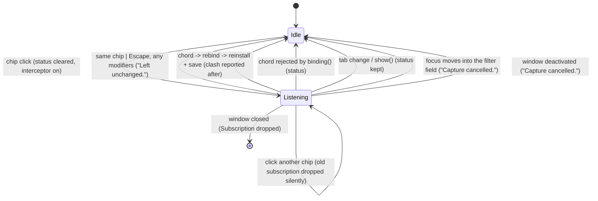

# Settings: keybinding capture

## Status

The machine is one explicit type. `Capture` (`crates/utopia-ui/src/settings.rs:140`) is either
`Idle` or `Listening { action, _interceptor }`, so "an action is waiting and an interceptor is
installed" is a single value that cannot be half true, and a recorded keystroke is classified
into `Captured::{Cancel, Chord}` (`:166`) before anything is written.

Fixed, each with a test that failed first (`crates/utopia-ui/tests/settings.rs`):

- **Issue 1, `window` is write-only dead state** — the field is gone rather than moved into the
  enum. The handle the interceptor compares against (`:351`) is the one its own closure captured;
  the focus and activation observers are registered on this view's window, so a copy on the view
  would again be state nothing reads.
- **Issue 2, capture survives focus loss** — three listeners end it: the filter field taking
  focus (`:284`), the window's own focus handle losing focus (`:287`), and the window losing
  activation (`:290`, Cmd+Tab or a click in the main window). All three go through
  `capture_left_the_window` (`:334`) and say "Capture cancelled." so the chip going back to the
  keys in force does not look like the recording was applied.
  Tests: `clicking_into_the_filter_ends_the_capture`, `leaving_the_window_ends_the_capture`.
- **Issue 3, `escape` with a modifier bound the action** — every Escape is `Captured::Cancel`
  (`:180`), whatever modifiers are held. Test: `escape_cancels_capture_with_modifiers_too`.
- **Issue 4, one `status` slot for five flows** — the startup warnings have a slot and a line of
  their own (`warning :197`, drawn as `settings-warning :832`), next to the failed-keymap-write
  state that was already separate (`save_error :206`). Test:
  `a_startup_warning_outlives_a_rebind`. The doc's sketch wanted
  `Option<(StatusSource, SharedString)>`; that only labels the single slot, it does not stop one
  flow overwriting another. What matters is that a *condition about the disk* (this file is not
  what is in force) never competes with a *result of an action*, and separate slots are what buys
  that. The remaining writers of `status` are all "the last thing you did in this window"
  (capture result `:339,:383,:392`, rebind `:420`, resets `:436,:449,:455`, appearance and pins
  `:593`-`:675`), where one line is the honest model: only the newest one is news.
- **Issue 5, two meanings of Escape** — unreachable now. Focusing the filter field ends the
  recording (issue 2's listener), so a capture can no longer coexist with focus in the field; the
  same test types into the field after the cancel and checks that Escape clears it again.

Left as found:

- **Issue 6, the interceptor cancels itself from inside its callback** is not a defect: gpui
  dispatches interceptors through a clone of the subscriber set
  (`gpui 0.2.2 window.rs:1524`, `clone().retain(..)`), so dropping the `Subscription` during the
  callback is safe. With the enum, the subscription lives in the same value as the action, so
  cancelling drops exactly one thing.
- A capture still survives a click on a non-focusable part of the window (a category header, the
  empty pane): the key list keeps the keyboard, nothing took focus from it, and Escape still
  cancels. That is the intended reading of "the keyboard is still here".

## What it controls

Whether the next keystroke in the Settings window is swallowed by a gpui keystroke
interceptor and recorded as the binding for one action (`§9.1`, AGENTS.md "Settings and
keybindings"), and what the status line says afterwards. `crates/utopia-ui/src/settings.rs`.

## Where the state lives

| Piece | Location | Set | Cleared |
|---|---|---|---|
| Capture (action + interceptor) | `:192` `capture: Capture` (`Listening { .. }` `:146`) | `start_capture :344` | `cancel_capture :328`, `capture_left_the_window :334`, one keystroke `:371` |
| Startup warning | `:197` `warning` | `new :302` | never |
| Status line | `:201` `status` | the action sites listed under issue 4 | `start_capture :350` |
| Failed keymap write | `:206` `save_error` | `apply :462` | a later write that succeeds |
| Overrides | `overrides: Overrides` | load `:231`; rebind `:400`; reset `:433,:453` | – |
| Live keymap | gpui bindings via `reinstall` (`actions.rs`) | – | – |
| File | `keymap.json` via `overrides.save` | – | – |

Tests drive it directly (`tests/settings.rs` `start_capture`, `capturing()`) and via clicks on
`settings-chip-GoToday`.

## States

**Idle** (`Capture::Idle`) and **Listening(d)** (`Capture::Listening { action: d, .. }`). There
is no "recorded, awaiting confirm" state: a chord is consumed and bound in one step
(`:371-398`); the clash question is answered after the write (`:400-431`).

## Events and transitions

| Event | Handler | Result |
|---|---|---|
| Click chip, Idle | `:1232` → `start_capture :344` | Listening(d), `status = None`, interceptor installed |
| Click the same chip, Listening | `:1227-1231` | Idle, "Left unchanged." |
| Click another chip, Listening | `:1232` | Listening(d2); the old `Subscription` is dropped by the assignment at `:363`; no status for the abandoned one |
| Keystroke in another window | interceptor `:355` | ignored, not swallowed; still Listening |
| Modifier-only key | `:375` | swallowed, still Listening (gpui 0.2.2 synthesises lone modifiers on `ModifiersChanged`, which interceptors never see — the guard is for a path gpui does not take; uncertain for other layouts) |
| `escape`, no modifiers | `Captured::from :180` | Idle, "Left unchanged.", nothing written |
| `escape` with modifiers | `Captured::from :180` | **Cancel**, same as above |
| other chord | `rebind :400` → `apply :462` | reinstall, save, clash computed after the fact |
| chord `binding()` rejects | `:391` | Idle, "… cannot be used as a shortcut." |
| Focus moves into the filter field | `on_focus :284` | Idle, "Capture cancelled." |
| Focus leaves the window's own handle | `on_focus_out :287` | Idle, "Capture cancelled." |
| Window deactivated (Cmd+Tab, click elsewhere) | `observe_window_activation :290` | Idle, "Capture cancelled." |
| Tab click / `show()` | `:315,:321` → `cancel_capture` | Idle, **status untouched** |
| Settings window closed | view dropped with the window → `Subscription` dropped | Idle by destruction; `SettingsWindow` global keeps a stale handle until the next Cmd+, (`main.rs`) |

One caveat worth knowing when testing this by hand: gpui reports focus changes only while the
window is active (it blanks the focus path for an inactive window), which is why the
deactivation observer is the other half of the pair rather than a duplicate of it. A scripted
`UTOPIA_SHOT_SCRIPT` run floats its windows without activating them, so focus events do not fire
there; `docs/verification/settings-key-capture/README.md` says which shots that costs.

Capture uses a gpui keystroke *interceptor* rather than a key-down handler on purpose:
interceptors run before the keymap is consulted, so stopping propagation at `:363` means the keys
being recorded cannot also fire their own action — rebinding onto Cmd+Q cannot quit the app.

## Diagram



## The explicit type

```rust
enum Capture {
    Idle,
    Listening { action: &'static ActionDoc, _interceptor: Subscription },
}
enum Captured { Cancel, Chord(Keystroke) }   // Escape (any modifiers) => Cancel
```

`Capture::action()` is the one reader; `capturing()` in the public surface returns
`Option<&'static ActionDoc>` from it, so the tests and the chip renderer keep their entry points.
The window handle the sketch put in `Listening` was dropped: see issue 1 in **Status**.

The warning/status/save-error split is described under issue 4.
