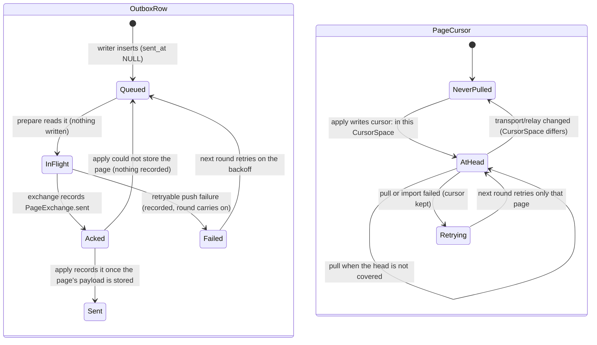

# Sync engine: outbox lifecycle and the per-page pull cursor

## Status

In-app setup update (§12.7): cursor isolation alone did not publish content already
acknowledged by a previous destination. `Store::prepare_sync_destination` now queues a
full CRDT update for every persisted shard, including imported/tombstoned pages, when the
selected destination identity changes. It also makes previously uploaded attachments
pending for the new destination. These bookkeeping changes and the destination identity
commit in one `BEGIN IMMEDIATE` transaction, after flushing pending store writes.

These are ordinary updates, not truncating relay snapshots. Cursor/revision tags remain
intact; compaction still requires a cursor measured in the current relay's space.

The destination is recorded as `Destination { origin, instance }`
(`crates/utopia-store/src/sync_destination.rs`): `origin` is the transport's stable address
(a relay's normalized URL plus the graph id, or a folder's root) and `instance` is the
relay database's own id from the manifest. Setup asks for the manifest before recording, so
a reachable relay is identified by its store id as well as its URL. Comparing only the
identity sampled at launch was wrong: a launch without a network can read no manifest, so
its identity is the URL alone, and treating that as a different destination exported the
whole graph into the outbox — and pushed a copy the relay cannot dedupe — on every
offline/online flip (`ac_12_7_an_offline_launch_does_not_republish_the_graph`). Two known
store ids decide on their own, so a relay that moved to another lease or LAN port is the
same destination and a wiped store is not; when either side has no store id, the origin
decides. A relay discovered later still changes the cursor space, which `VerifiedTarget`
treats as a new target: it pulls one existing shard to prove the selected encryption can
read it before any push (`ac_12_6_pairing_validates_existing_payloads_before_pushing`).
An **empty** target proves no key, so the proof is re-checked before every round until a
payload actually decrypts: a device that set up against a fresh relay with the wrong
passphrase revokes its own verification the moment another key's ciphertext appears, and
refuses to push into a graph it cannot read
(`ac_12_6_an_empty_target_never_proves_a_key`). The graph's key marker is frozen only by a
target that was read *and* held payloads (`setup::may_freeze_key`,
`ac_12_6_an_empty_target_cannot_freeze_the_key_marker`). What remains is the race the
protocol cannot decide: if two devices publish into the same empty target at the same
instant with different keys, the first payload establishes the key and the other device is
refused from then on — it does not mix ciphertext, but it also cannot join until it uses
that passphrase. Previously the claim above overstated this: a wrong key on a second device
could freeze itself into the graph and mix ciphertexts.
Nearby Mac discovery is not a one-shot at launch: a client that finds no host keeps looking
on the runner's slow cadence while the saved mode is Nearby and no runner exists, because the
host machine is often asleep when the laptop starts (`ac_12_7_a_nearby_client_keeps_looking_for_its_host`).

A graph with no recorded destination — one that has been syncing through
`UTOPIA_SYNC_URL`/`UTOPIA_SYNC_FOLDER` since before this bookkeeping existed — adopts the
destination it opens with instead of exporting every shard into it, so the upgrade costs one
launch no republish (`ac_12_7_the_first_recorded_destination_does_not_republish_an_existing_graph`).
Repeating Apply for the same destination does not enqueue the graph again; switching back
can re-send updates, but CRDT import remains idempotent.

`ac_12_7_setup_switch_republishes_acked_and_imported_pages_without_duplicates` covers two
stores, a fresh relay, and switching back without lost or duplicate blocks. The existing
cursor-space and compaction tests remain the guards against truncating unseen remote data.

Made explicit on `fix/sync-engine-outbox` (`crates/utopia-sync`, plus the relay's push path
in `crates/utopia-syncd`):

- **Per-page round outcome.** `Incoming.pages: BTreeMap<PageId, PageExchange>` holds each
  page's acknowledged outbox rows (`sent`), its counters and at most one pull.
  `Incoming.failed: Vec<Failure>` holds retryable failures that did not stop the round,
  `Failure { page, kind }` separates terminal (401/403, foreign protocol) from retryable
  ones, and `SyncReport.failed` carries them to the runner and the status line. `apply`
  records a page's acks and cursor only after its payload is stored.
- **Cursor with a transport.** `Cursor { space, pos }` lives in
  `sync_state["cursor:<page>"]` (JSON). `CursorSpace { transport, kind }` names the
  transport that measured the number (`relay:<base>#<graph>`, `memory:<relay>#<graph>`,
  `folder:<root>`) and how to compare it: `Seq` = a monotonic relay sequence (pull when
  `head > local`), `Revision` = the folder's file digest (pull when `head != local`).
  A cursor from another space is not compared, so the page is pulled once from zero.
  `Transport::cursor_space()` is required; `Encrypted` delegates, `Box<dyn>` forwards.
- **Folder revisions, not counts.** `FolderTransport`'s manifest/pull `head_seq` and graph
  `rev` are FNV-1a digests over each page's update files (relative path, length, mtime) and
  over the sorted page list, so a peer that drops two files and adds two others moves the
  revision even though the file count is unchanged.
- **Conditional manifest, tagged rev, write-safe.** `exchange` asks with the rev of the
  last fully applied manifest (`ManifestRev { space, rev }`), so the `If-None-Match`/304
  path is reachable; a rev from another space is not sent, and `rev` is stored only when no
  page failed, so a failed page is retried against a fresh manifest. A round with pushes or
  snapshots fetches the manifest unconditionally first, because a relay's 304 compares only
  the rev: an in-place protocol upgrade that keeps the rev would otherwise skip the version
  check and let this client write to an unsupported relay.
- **Causally ordered batches.** `prepare` splits a page's outbox by `MAX_PUSH_BYTES`. Once
  one batch for a page is refused, the later batches of that page are skipped for the round
  (other pages still push), so the relay never holds later updates without their
  predecessors.
- **Relay store identity.** `Manifest.instance` (additive, `serde(default)`) is a random id
  per relay database, sent by `utopia-syncd` and the reference `Relay`; it is part of
  `CursorSpace` (`relay:<instance>#<graph>`). A wiped relay therefore gets a new space and
  is pulled again instead of being mistaken for the old one. A relay that predates the
  field falls back to a normalized URL (`scheme://host[:port]/path`, default port dropped).
- **A partial round has a status.** `SyncStatus::Partial { failed, queued }` (distinct pages
  that failed, outbox rows still queued) instead of `Offline { queued }` for a reachable
  relay that could not take one page; the FFI `SyncSummary` carries `failed` too.
- **Compaction is guarded by the same space.** `apply` only queues a snapshot when the
  page's stored cursor `covers` the manifest head in this round's space, so a cursor from
  another relay/folder can never cover entries this client never imported.
- **Legacy positions are retired.** The first `SyncEngine::new` deletes the pre-`cursor:`
  `seq:<page>` keys; an old bare `rev` fails to decode, so the first round pulls every page
  once (idempotently). Nothing is left behind.

Issues, as numbered below:

| # | Issue | State |
|---|---|---|
| 1 | All-or-nothing exchange loses acks / head-of-line | **Fixed**: pushes, snapshots and blobs are per page/object; a refused page no longer loses other pages' acks or stops the pulls, a failed manifest reread after the pushes no longer drops their acks, and a page's later batches are skipped once one is refused (a multi-batch page cannot reach the relay out of causal order). Tested by `ac_12_3_a_refused_page_keeps_the_other_acks_and_the_pulls`, `ac_12_3_a_failed_second_manifest_keeps_the_acks` and `ac_12_3_a_refused_batch_stops_the_pages_later_batches`. |
| 2 | Permanent 413 after a lost ack | **Fixed** at the relay: `syncd` dedupes inside the push transaction and counts only new bytes against the quota, so a replayed batch is a duplicate, not a 413. Tested by `ac_12_6_a_replayed_batch_is_a_duplicate_even_at_the_quota` and, end to end over HTTP with the response dropped, `ac_12_6_a_lost_ack_is_replayed_not_rejected_by_quota`. A genuinely full quota still retries on the backoff (no `Halted` state; see 9). |
| 3 | Cursor means different things per transport | **Fixed**: cursors are tagged with `CursorSpace`, the folder reports a revision digest, and a relay carries an instance id. Tested by `ac_12_3_a_folder_revision_with_an_unchanged_file_count_still_pulls`, `ac_12_3_switching_transport_pulls_the_new_transport_from_zero`, `ac_12_3_switching_relay_at_the_same_revision_still_pulls`, `ac_12_6_a_wiped_relay_is_a_new_cursor_space`, and `ac_12_3_legacy_seq_positions_are_removed`. The stored `rev` is tagged with the same space. |
| 4 | Poison page halts every round | **Fixed** for the halt: a pull that fails (E2E `open`, corrupt payload) is recorded per page and the other pages' cursors and the manifest progress are kept; the poisoned page is retried alone, and a partial round reads `Partial` rather than "Offline — 0 queued". Tested by `ac_12_6_one_unreadable_page_does_not_halt_the_others` and `ac_12_6_a_partial_round_has_its_own_status`. **Left**: no persistent "this relay holds mixed payloads" flag beyond `SyncReport.failed`/`SyncStatus::Partial`. |
| 5 | Partial apply | **Fixed**: `apply` imports first and records acks/cursors per page only when the payload was stored; a batch import that fails drops every page's cached shard so the per-page retry really re-imports and commits; the manifest rev is not remembered on a failed round. Tested by `ac_12_3_a_failed_import_does_not_mark_the_page_synced`, `ac_12_3_a_failed_batch_import_still_stores_the_readable_pages` (reopened from disk, corrupt page first and last), and `ac_12_3_a_page_can_be_pulled_and_still_queued_for_its_push`. |
| 6 | Conditional manifest is dead code | **Fixed**: the `If-None-Match`/304 path is used on read-only rounds, with a space-tagged rev, and tested by `ac_12_3_an_unchanged_manifest_is_asked_for_conditionally` and `ac_12_3_switching_relay_at_the_same_revision_still_pulls`. A round that writes fetches unconditionally, so an in-place protocol upgrade is caught before pushing (`ac_12_6_a_protocol_upgrade_is_seen_before_pushing`). |
| 7 | Outbox echoes remote ops | **Left**: the outbox payload is still `export_since(persisted)`, so a merge queued after an import pushes the imported ops back too. Fixing it means carrying the committing delta's frontier into `flush`/`outbox`, which is the store commit pipeline (a different machine, `store-commit-pipeline.md`), and every relay dedupes by change id, so it costs bandwidth only. |
| 8 | `SyncClient::queued` skips `sync_index` | **Fixed**: it flushes first (and takes `&mut Store`). Tested by `ac_12_3_queued_counts_edits_still_waiting_for_the_writer`. |
| 9 | PRD §12.6 vs code | **Partly left**: a literal HTTP 409 is still a transport error (no shipped relay sends one; duplicates come back as a 200 body), 4xx/5xx are still one variant with no jitter, and "corrupt local snapshot → quarantine, read-only" is not implemented. Those belong to the runner's backoff/health machine (`sync-runner-round.md`) and to snapshot compaction (`sync-compaction-snapshots.md`); the `Halted` variant sketched below was not added. |

The per-page outcome and the cursor are now explicit; a separate `SyncHealth`/`Halt` state
was left to the runner machine, which owns the poll loop and the visible status.

## What it controls

Which local updates get pushed and re-pushed, the "N changes queued" number, which pages get
pulled and from which `seq`, and whether the manifest is re-fetched (PRD `§12.3`, `§12.6`).
`crates/utopia-sync/src/lib.rs` on top of `crates/utopia-store` tables `outbox` and
`sync_state`.

## Where the state lives

| Piece | Location | Set | Cleared |
|---|---|---|---|
| Queued vs sent | `outbox.sent_at` (`schema.rs:97-105`) | `outbox_mark_sent` (`lib.rs`, per page from `apply`, one autocommit per row) | never deleted |
| In flight | nowhere — the lifetime of the `Outgoing` value on the background thread (`sync/lib.rs`) | `prepare` | `exchange` returns |
| Acks | `PageExchange.sent/accepted/duplicates` in `Incoming.pages` | `exchange`, per page | applied by `apply` (or dropped for a page whose import failed) |
| Pull cursor | `sync_state["cursor:<page>"]`, JSON `Cursor { space, pos }` (`lib.rs:343-345`) | `apply` from `resp.head_seq`, tagged with the transport's `CursorSpace` | never; a different transport's space is ignored, not compared |
| Manifest rev | `sync_state["rev"]`, JSON `ManifestRev { space, rev }` | `apply` only when no page failed | never; another space's rev is not sent as `If-None-Match` |
| Relay identity | the relay database's `Manifest.instance` (syncd `relay_meta`, the reference relay's field) | `syncd`/`Relay` at store creation | nothing client-side: it is part of `CursorSpace`/`ManifestRev` |
| Client id | `sync_state["client_id"]` | once (`prepare`/`new`) | – |
| Enqueue flag | `pending[..].2` sticky per page (`store lib.rs:372`); payload = everything since `persisted` (`:290, :311`) | – | – |

Readers: `SyncStatus::from_result` → `workspace.rs:516, 562`; `SyncClient::queued`
(flushes first); FFI `:291`.

## States

Per outbox row: **Queued** (`sent_at IS NULL`) → **In flight** (unrecorded) → **Sent**.
An ack lives in `PageExchange.sent` until `apply` records it together with the page's
cursor; a page whose import fails keeps both queued. Per page cursor:
**Never pulled** (no key, or a key from another `CursorSpace`) → **At head H** (relay seq or
folder revision). A page can be **Failed** for one round (retryable `Failure`) while every
other page advances; the round's visible state is then `Synced`, `Partial { failed, queued }`
or `Offline { queued }`.

## Events and transitions

- `prepare` (`utopia-sync/src/lib.rs`): `sync_index`; read `outbox_pending(10_000)`; batch
  per page under `MAX_PUSH_BYTES`; read `cursor:<page>` values; drain `pending_snapshots`;
  pick ≤8 blobs each way.
- `exchange`: conditional manifest with the last applied rev on a read-only round, an
  unconditional one when the round writes; version check; push each page's batches in order
  (a retryable failure marks the page and its later batches are skipped; other pages
  continue); snapshots; blobs; second manifest only if something was sent; pull pages whose
  `head_seq` is not covered by a cursor in the same `CursorSpace` (each pull isolated);
  collect compaction wants.
- `apply`: mark blobs, store verified blobs, import all pulls in one batch (falling back to
  per-page imports to isolate a corrupt one), then per page record acks and cursor,
  `synced_at`, and queue snapshots. `rev` is stored only if no page failed.

## Impossible or unhandled combinations (evidence)

1. **All-or-nothing exchange loses acks.** Any `?` inside `exchange` (`:197, :204, :211,
   :215, :220, :230, :237`) drops the whole `Incoming`, including `sent` for pages the relay
   already accepted. Those rows stay queued and are re-pushed; relays dedupe by change id
   (`syncd/lib.rs:279-287`, `relay.rs:70-73`, `folder.rs:120-123`), so correctness holds, but
   (a) `Offline { queued }` over-counts rows the relay already has (`:150-152`), (b)
   bandwidth is re-spent each round, and (c) one failing page blocks every later page's push
   *and all pulls* because the pull section follows the push loop (head-of-line, pages
   iterate in `BTreeMap` order `:292, :203`).
2. **Permanent 413 after a lost ack.** `syncd` checks quota before dedupe and outside the
   transaction (`syncd/lib.rs:266-269`, then dedupe at `:278-287`). A 900 KB batch stored
   when the graph is within 100 KB of quota, whose response is lost, is re-pushed forever:
   `graph_bytes + 900 KB > quota` → 413 → client maps to `Transport` (`http.rs:37-40`) →
   `Offline` → retried at ≤60 s with 0 new bytes ever stored. No quota/read-only state exists
   on the client. (`put_blob` checks existence first, `syncd:162-167`, so blobs are fine.)
3. **The cursor means different things per transport.** `FolderTransport` reports
   `head_seq` = **file count** (`folder.rs:89, :96`) and `pull` ignores `since` and returns
   every file (`:138-154`); the engine stores that count under the same `seq:<page>` key.
   (a) Folder: local `seq:p = 10`; a sync tool drops two files (count 8), a peer adds two
   (count 10) → `10 > 10` false (`:236`) → the two new updates are never pulled until the
   count reaches 11. (b) Switching the same graph file from Folder (count 500) to a fresh
   relay (head 3) or vice versa → `3 > 500` false → nothing is pulled until the relay has
   > 500 entries. No reset path exists (no `sync_set("seq:…", "0")` anywhere).
4. **A poison page halts every round.** One failing pull (`:237 ?`) — e.g. an E2E `open`
   error when the relay holds a plaintext page from a device without the passphrase
   (`e2e.rs:65-69`) — drops the `Incoming`, so `rev` and every cursor advanced earlier in the
   loop are not persisted and `apply` never runs. Each round re-downloads the same pages,
   fails on the same one, and shows `Offline { queued }`. There is no per-page failure state
   and nothing records "this graph's relay holds mixed payloads".
5. **Partial apply.** `apply` marks outbox sent (`:333`) and blobs uploaded (`:334`) before
   `import_batch` (`:365`); on import error those marks persist while cursors, `rev` and
   `synced_at` (`:373`) do not — "Synced … ago" goes stale while the status says Offline.
6. **Conditional manifest is dead code.** `exchange` never passes `if_none_match` (`:197`),
   so the ETag/304 machinery (`http.rs:103-109`, `syncd:499-505`) is unreachable; the
   `first == None` branch at `:225-228` cannot occur with the shipped transports.
7. **Outbox echoes remote ops.** The payload is `export_since(persisted)` (`store lib.rs:290,
   :311`), not "local ops only"; after `import_batch` plans a merge it queues with
   `enqueue = true` (`pages.rs:762-768`), so the just-imported remote ops are pushed back.
   Loro dedupes (`doc/lib.rs:664-674`); duplicates, not divergence.
8. **`SyncClient::queued` skips `sync_index`** (`:434-436`) while `prepare` calls it
   (`:279`), so the UI count can lag one flush. Minor.
9. **PRD §12.6 vs code.** "409 treated as success" holds only for the 200-body `duplicate`
   counter (`:208`); a literal HTTP 409 is `Transport` → Offline. 4xx and 5xx are one
   variant (`http.rs:37-40`), so 400/413 retry forever as "Offline". No jitter anywhere.
   "Corrupt local snapshot → quarantine, read-only from remote" has no implementation.

## Diagram



## Would an explicit state type help?

Yes, in three places:

```rust
// 1. per-page exchange outcome instead of all-or-nothing
struct Incoming { pages: BTreeMap<PageId, PageOutcome>, .. }
enum PageOutcome { Pushed { seqs: Vec<i64>, accepted: usize }, Failed(SyncError), Pulled(PullResponse), .. }

// 2. a cursor that knows its transport
enum Cursor { RelaySeq { url_hash: u64, seq: u64 }, FolderFiles { seen: BTreeSet<String> } }

// 3. a client-side halt state the runner can honour (§12.6)
enum SyncHealth { Ok, Backoff { until: Instant }, Halted(Halt) }
enum Halt { NeedsAuth, Unsupported(u32), QuotaExceeded, PoisonPage(PageId) }
```

`apply` would then persist cursors for every page that succeeded, and `Halted` would stop
the poll loop instead of retrying a 413 every minute.

Built here: (1) as `Incoming.pages`/`PageExchange` plus a failure list and per-page apply;
(2) as `Cursor`/`CursorSpace` (folder digest, relay instance id) and a space-tagged
`ManifestRev`; the relay-side dedupe fix makes a lost-ack 413 impossible, and a partial
round now has `SyncStatus::Partial`. The sketched `SyncHealth`/`Halt` was left to the
runner machine (`sync-runner-round.md`), which owns the poll loop.
