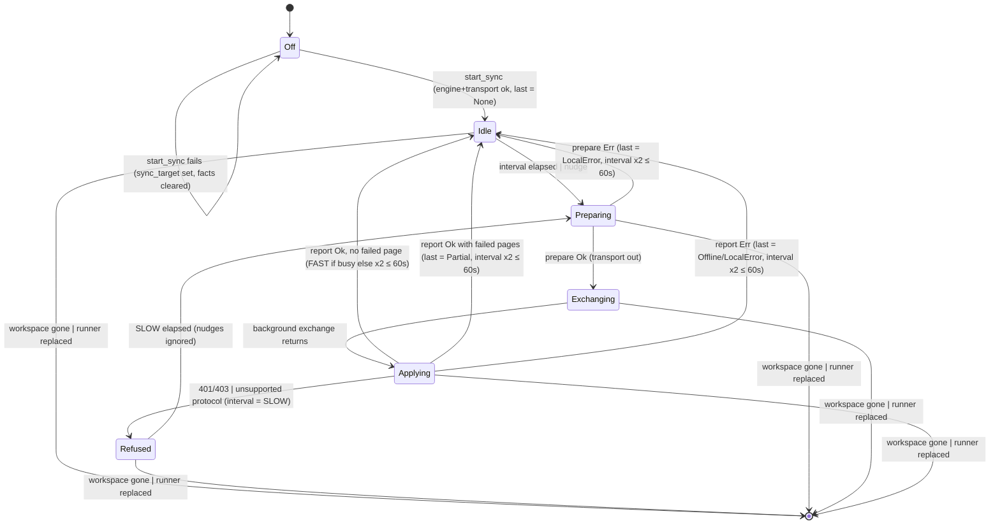

# Sync runner: the poll/exchange round

## Status

In-app setup update (§12.7): `Coordinator` now prepares transports off the UI thread and
installs them with `Workspace::start_prepared_sync`. Apply first calls `stop_sync`, which
removes the runner and its owned poll task, clears target/facts and notifies the sidebar.
The coordinator joins the old realtime listener and stops its LAN host on the background
executor before installing a replacement. A failed setup stays Off with a visible error;
a successful one starts exactly one poll task and one listener (no listener for folders).
The generation checks still discard results from an obsolete round. A blocking HTTP call
already executing may finish within its transport timeout, but it cannot apply to the new
runner or schedule another round. Test connection leaves the current runner untouched.

A launch reads the saved preferences (or the environment override) through the same
`Coordinator::run` path with `save = false`, so startup and Apply share one state machine;
the only difference is that a launch never writes Keychain or the settings file, and records
the E2E key marker only once the target has been read with that key.
Settings → Sync now edits configuration and can recover from auth refusal without a restart.
The realtime stop issue documented below is fixed by the owned cancellable listener; see
`realtime-listener.md` Status. Additional coverage:
`ac_12_7_disabling_sync_stops_polling_and_reenable_starts_one_loop` and the two listener
shutdown tests. The earlier findings and line numbers below are retained as historical
context, not as claims that setup is still launch-only.

Made explicit: the round is now one `SyncPhase` (`crates/utopia-ui/src/sync_runner.rs:129`),
so where the transport is and which half of the round is running are the same fact, and
`begin_round` (`:221`) is the only way to take the transport out of `Idle`/`Refused`; the
other transitions refuse to run out of order (`:236`, `:248`, `:255`, `:264`). `SyncRunner`
also owns its loop (`loop_task`, `:195`) and carries a `generation` (`:191`) that every loop
step checks, so a runner cannot have two loops and a stale loop cannot write into its
replacement.

Fixed from the list below:

| # | Issue | Fix |
|---|---|---|
| 1 | Two loops driving one runner | Runner owns its loop task (replacing the runner cancels the old loop *and* its in-flight exchange) plus a generation check per step (`workspace.rs:485-588`) |
| 2 | A local store error reads as "Offline" | `SyncStatus::LocalError` (`crates/utopia-sync/src/lib.rs:312`), mapped in `from_result` (`:340`), rendered in `status_text` |
| 3 | No backoff after a prepare failure | `SyncRunner::round_failed` (`sync_runner.rs:236`) doubles the interval like a failed exchange |
| 4 | `status` stale during a round | `status_line` (`sync_runner.rs:362`) reads the phase, like the dot |
| 6 | Realtime 401 terminal, HTTP not | Polling now backs off to `SLOW` instead of ending: `SyncPhase::Refused` (`:143`) / `RefusalReason` (`:151`). A transient 403 heals, a revoked token stops the 5 s polling. The realtime thread still gives up for good — see below |
| 7 | Prepared-`None` path skips the sleep reset | Unreachable: only `Idle`/`Refused` hold the transport, one loop owns it, and the setters are ordered |

Review follow-ups (second round): the first version of #6 made a refusal **terminal**
(`Halted`, transport dropped, loop exits). That regressed the one thing `main` did right — a
transient 401/403 (a proxy hiccup, a relay that restarted before loading its token file)
recovered on the next poll — and the app has no in-app re-auth, so the only way back was a
relaunch. `Refused` keeps the transport and pins the cadence to `SLOW`, ignores realtime
nudges while refused, and retries: tests `a_refusal_retries_only_at_the_slow_cadence`,
`a_refusal_recovers_without_a_restart`, `restarting_sync_after_a_refusal_polls_again` and
`sync_runner::tests::a_refusal_slows_down_and_can_recover`. `interval` is set to `SLOW`, not
doubled, so a relay that keeps refusing is polled once a minute, exactly like `main`.

Also from that round: the phase setters are now ordered (a test calls `exchange()`,
`exchange_returned()` and `end_round()` out of order and shows the transport survives —
`sync_runner::tests::phase_transitions_only_apply_in_order`); `from_result`'s `Offline` count
is a `COUNT(*)` (`Store::outbox_count`) instead of loading every queued payload on the UI
thread (`the_offline_status_counts_the_outbox_without_reading_payloads`); and the test gaps
are closed: replacing the runner mid-exchange
(`replacing_the_runner_mid_exchange_discards_the_old_round`), a store failure after the
network was reached (`a_store_failure_after_the_network_is_a_local_error`), and starting
sync again after a refusal (`restarting_sync_after_a_refusal_polls_again`).

Original deferrals (the realtime deferral is resolved above):

- **5** (`sync_target` vs `SyncFacts`). The two values answer different questions — "what was
  configured" versus "did sync start" — and the divergence is deliberate and tested
  (`a_sync_that_cannot_start_does_not_claim_to_be_on`). Collapsing them would either promise
  a sync that never started or forget the target that failed. Settings → Sync was flagged for
  the same reason during review; it documents the transport in force ("what the transport in
  force is, and how it is set up", `settings.rs:1599-1602`) and its own help text points at
  the sidebar for the round, so "Sync is on for this graph" stays true while the relay is
  refusing. Copying the phase into the `SyncFacts` global would recreate the two-copies
  drift this doc exists to remove.
- **The realtime thread's stop story** (review finding: every `start_sync` spawns another
  `utopia-realtime`, and the old one never stops). Real but pre-existing, and no longer on
  any normal path: `start_sync` is called once per launch (`crates/utopia-app/src/main.rs:371,
  401,407`) and a refusal now heals without one. A stop flag would only stop reconnects —
  the thread blocks in `socket.read()` without a timeout (`realtime.rs:54`) — so a real fix
  needs that machine's read timeout; it belongs to `realtime-listener.md` (its issues 3 and
  4). With #6's retry, HTTP recovers after a refusal while notices do not: that asymmetry is
  `realtime-listener.md` issue 2, unchanged from `main`.

`LocalError` covers an `SyncError::Store` that stops the whole round — `prepare`'s
`sync_index`, the apply-time bookkeeping (`outbox_mark_sent`, blobs, `sync_set`). A pulled
update the store cannot import is *not* that any more: `apply` isolates it, keeps the rest of
the round and reports the page in `report.failed`, which the runner shows as
`SyncStatus::Partial` ("● Synced — N pages could not sync", dot red) and backs off on
(`next_interval` only returns `FAST` when the round was busy *and* left no page failed). That
per-page machine is `sync-engine-outbox-and-cursor.md`. A local fault that surfaces as
`SyncError::Transport` — the folder transport's own I/O errors — still reads as "Offline"; it
is local, not the relay, but the two cannot be told apart from the error alone. Noted rather
than guessed at.

Uncertain item resolved: `gpui::Task` wraps `async_task::Task`, whose `Drop` cancels the
future, so dropping the runner (and its `loop_task`) does stop the old loop even when that
loop is parked in an `await` — and it drops the awaited exchange future with it, which is why
the mid-exchange test sees the abandoned round never reach the relay. The generation check is
now defence in depth, not the mechanism.

Checked by eye as well as by tests: the sidebar sync view mid-round
(`docs/verification/sync-runner-round/sync-round-in-flight.png`, "Sync: syncing…" with the
amber dot), after the round (`sync-round-done.png`), after a 401 (`sync-refused-needs-auth.png`,
"● Sync: sign-in required" with the red dot), and after the slow retry against a stub relay
that refuses everything for its first 15 s and then answers: the same window says "Synced just
now" with no relaunch and no restart (`sync-recovered-after-refusal.png`). The stub's request
log for that run shows two manifest calls, ~89 s apart — one per slow interval, not one per
5 s (the app's 250 ms wait steps are coalesced by an idle window, which only makes the retry
later; the simulated-clock tests pin the intended cadence).

## What it controls

The desktop background sync (`§12.3`, `§13.3`): when a round starts, which half runs on
which thread, what the sidebar dot and status line say, how fast the next poll comes, and
the "Merged changes…" banner. One `SyncRunner` lives in `Workspace.sync` and is driven by
a single `cx.spawn` loop in `Workspace::enable_sync_with`.

## Where the state lives

| Piece | Location | Type / meaning |
|---|---|---|
| Runner exists at all | `crates/utopia-ui/src/workspace.rs:194` `sync: Option<SyncRunner>` | `None` = sync off |
| Round phase, and where the transport is | `crates/utopia-ui/src/sync_runner.rs:129` `phase: SyncPhase` | `Idle { transport }` / `Refused { reason, transport }` = home; `Preparing` / `Exchanging` / `Applying` = the transport is with the UI thread, the background thread, the UI thread |
| Last round's outcome | `sync_runner.rs:182` `last: Option<SyncStatus>` | `None` = no round finished yet ("connecting…"); survives every phase |
| Poll cadence | `sync_runner.rs:184` `interval: Duration` | `FAST` 5 s … `SLOW` 60 s; pinned to `SLOW` while refused |
| Merge banner | `sync_runner.rs:186` `notice: Option<(String, i64)>` | shown for 5 s after `at` (`workspace.rs:2721-2726`) |
| Wake-up from realtime | `sync_runner.rs:188` `nudge: Arc<AtomicBool>` | set by the WebSocket thread (`sync_runner.rs:113`), consumed in the wait loop (`workspace.rs:507-515`), ignored while refused |
| Loop identity | `sync_runner.rs:191` `generation: u64` | a loop only drives the runner it was started for |
| Loop task | `sync_runner.rs:195` `loop_task: Option<Task<()>>` | replaced (cancelled), never accumulated |
| Sidebar label | `workspace.rs:409` `sync_target: Option<String>` | set even when the transport cannot be built (see issue 5) |
| Settings → Sync facts | `sync_runner.rs:36` `SyncFacts` global | set in `start_sync` (`workspace.rs:444`) |

The derived "dot" and the status line are computed, not stored: `sync_dot()` at
`sync_runner.rs:340` and `status_line()` at `:353` both match on `phase` (and read `last`
only when `Idle`/`Refused`).

## States (effective)

| State | `phase` | transport |
|---|---|---|
| Off | `sync = None` | – |
| Connecting (never completed a round) | `Idle`, `last = None` | home |
| Waiting (idle between polls) | `Idle`, `last = Some(Synced)` | home |
| Backing off | `Idle`, `last = Some(Offline/LocalError/Partial)` | home |
| Refused (401/403, protocol mismatch) | `Refused`, `interval = SLOW` | home |
| Preparing (UI thread, short) | `Preparing` | with the loop |
| Exchanging (background thread) | `Exchanging` | with the background task |
| Applying (UI thread) | `Applying` | with the loop |

## Events and transitions

- **start** `start_sync` → `enable_sync` → `enable_sync_with` (`workspace.rs:402-588`).
  Guards: engine builds, transport builds. On failure the runner is not created but
  `sync_target` **is** set (`:409`) and `SyncFacts.target` is cleared (`:451-459`).
  Installing the runner drops the previous one, and with it the previous loop task (and any
  exchange that loop was awaiting).
- **tick / nudge** The loop sleeps in 250 ms steps until `interval` elapses or
  `nudge.swap(false)` returns true (`workspace.rs:491-515`). A generation mismatch ends the
  loop; while `Refused`, nudges are ignored so a notice cannot restore the fast cadence.
- **prepare** `runner.begin_round()?` (`workspace.rs:520`, `sync_runner.rs:221`) moves
  `Idle`/`Refused → Preparing` and hands out the transport; `engine.prepare`
  (`workspace.rs:524`, which calls `store.sync_index()` at `crates/utopia-sync/src/lib.rs:598`)
  then runs.
  - prepare `Ok` → `runner.exchange()`: `Preparing → Exchanging` (`:248`).
  - prepare `Err` → `runner.round_failed(transport, status)` (`:236`): transport home,
    `last = from_result(Err)`, `interval` doubled (capped at `SLOW`).
- **exchange** `exchange_owned` on the background executor (`workspace.rs:545-546`); this is
  the only time `Exchanging` holds.
- **apply** `runner.exchange_returned()` (`:255`, `Exchanging → Applying`), `engine.apply`
  (`workspace.rs:556`); imported pages raise `app.changed(.., structural=true)`; banner set if
  anything imported; `runner.end_round(transport, &report, status)` (`:264`):
  `Applying → Idle` with `interval = FAST` only if the round was busy *and* left no page
  failed, else doubled (`sync_runner.rs:296-303`), or `Applying → Refused` with
  `interval = SLOW` when the report is `Unauthorized`/`ProtocolVersion`
  (`sync_runner.rs:274-278`). A report whose `failed` list is not empty still ends in `Idle`,
  with `last = Partial` (`partial_failed/queued`).
- **quit / runner removed** Any `this.update` error breaks the loop (`workspace.rs:502`, `538`,
  `581`), as does a runner that is no longer this loop's generation.

## Impossible or unhandled combinations (evidence)

1. ~~**Two loops driving one runner.**~~ Fixed. The runner owns its loop task, so
   `enable_sync_with` cancels the previous loop; every step also checks `generation`
   (`workspace.rs:494,519,550`). Tests: `enabling_sync_twice_keeps_one_poll_loop`,
   `replacing_the_runner_mid_exchange_discards_the_old_round`.
2. ~~**A local store error reads as "Offline".**~~ Fixed: a whole-round `SyncError::Store`
   maps to `SyncStatus::LocalError` (`crates/utopia-sync/src/lib.rs:340`) and the line says
   "● Sync: local error — …" rather than blaming the relay; a pulled page the store rejects
   is `Partial` (see above), never `Offline`. Tests:
   `a_local_store_error_is_not_reported_as_offline`,
   `a_store_failure_after_the_network_is_not_offline`.
3. ~~**Backoff is not applied on prepare failure.**~~ Fixed in `round_failed`
   (`sync_runner.rs:236`). Test: `a_failed_round_backs_off`.
4. ~~**`status` goes stale during a round.**~~ Fixed: the line and the dot both read the
   phase, so a round in flight says "Sync: syncing…". Test:
   `sync_runner::tests::the_status_line_follows_the_round_phase`.
5. **`sync_target` vs `SyncFacts` disagree when the transport cannot be built** — left as
   is on purpose; see Status.
6. **Realtime `Unauthorized` is terminal, HTTP `NeedsAuth` is not.** Handled on the polling
   side only: a refusal pins the cadence to `SLOW` and retries (`Refused`), so the polling
   half still recovers from a transient 401/403 — as it did on `main` — without hammering a
   revoked token every 5 s. The realtime thread still exits on 401 for good, so notices stay
   dead after a recovery; that restart belongs to `realtime-listener.md` (issue 2) and needs
   a read timeout, not a flag. Tests: `a_refusal_recovers_without_a_restart`,
   `restarting_sync_after_a_refusal_polls_again`,
   `sync_runner::tests::a_refusal_slows_down_and_can_recover`.
7. ~~**Prepared-`None` path skips the sleep reset.**~~ Impossible now: only `Idle`/`Refused`
   hold the transport and one loop owns it, so there is no `None` to prepare with. Test:
   `sync_runner::tests::one_round_at_a_time`.

## Diagram



## The state type

```rust
enum SyncPhase {
    Idle { transport: BoxTransport },                 // home; `interval` and `last` are runner fields
    Preparing,                                        // UI thread holds the transport
    Exchanging,                                       // background thread holds it
    Applying,                                         // UI thread holds it again
    Refused { reason: RefusalReason, transport },     // 401/403 | protocol mismatch: SLOW retries only
}
```

Two deviations from the sketch this doc first proposed, both because the code reads better
that way: `interval` and `last` stay `SyncRunner` fields (they are cadence and history, not a
phase, and both survive every transition), and the mid-round phases do not store the
transport — between `begin_round` and `end_round` it is a local in the loop, which is exactly
what the two-thread handoff does. `Refused` keeps it because its retry needs it.
`RefusalReason` rather than a `SyncError` because only the two refusal kinds exist there and
that is all the dot and the line need.
