# Tag-page classification: published by every write that moves the index

## What it controls

The sidebar's set of pages that exist only because of a `#tag` (SB-2). The writer thread
publishes the set so the UI never runs the whole-graph query (rule 10).

## Status

Updated on branch `fix/tag-pages-publication`; the file:line references below describe the
code after the fix.

What is now explicit:

- `writer::TagPages` (`Unscanned` | `Published(HashSet<PageId>)`, `writer.rs:150`) replaces
  `Mutex<Option<HashSet<PageId>>>`: "no set has ever been published" and "the published set
  is empty" can no longer be the same value. `Persister::tag_pages` still hands out an
  `Option` so callers do not change, but it maps the two variants one-to-one.
- `Shared::scan_tag_pages` (`writer.rs:279`) is the one full classification, used both for
  the first commit and for a republish; `Shared::publish_tag_pages` (`writer.rs:297`) keeps
  the incremental path and only touches the slot when it has a complete answer.
- `Store::republish_tag_pages` (`lib.rs:335`) classifies on the store's connection and
  publishes the result. It is the store-level "the index moved without a commit" transition,
  and the UI's startup copy goes through it too (`app_state.rs:82`).

Fixed:

1. **Writes that bypass the writer republished nothing.** `set_date_format` (`lib.rs:811`),
   `empty_trash` (`pages.rs:811`) and `rebuild_index` (`doctor.rs:122`) now republish after
   their own `sync_index`, so the three transitions that leave the writer are closed. Tests:
   `sb_2_date_format_change_republishes_tag_pages` and
   `sb_2_rebuild_index_republishes_tag_pages` (both failed before the fix;
   `crates/utopia-store/tests/v1_1.rs`), and `sb_2_empty_trash_republishes_tag_pages`. The
   `empty_trash` case cannot change a *destination's* classification in today's code — the
   trash commit already deleted the purged page's block and `ref` rows and published that —
   so its test pins the hook rather than a user-visible flip; the hook costs one scan on a
   rare, destructive action and makes the rule total.
2. **Two sources of truth at startup.** `AppState::new` used to classify beside the slot, so
   a session that opened an existing graph had a UI copy and `Unscanned`. It now calls
   `Store::republish_tag_pages`, so the copy the UI starts with *is* the published set. Test:
   `the_startup_tag_set_is_the_published_one` (`crates/utopia-ui/src/app_state.rs`, failed
   before the fix).
3. **A failure left the previous set and nobody knew.** Fixed by the commit-pipeline work,
   not here: `publish_tag_pages` is skipped when the commit fails, the UI emits no
   `IndexUpdated` for a commit that did not happen (`app_state.rs` `flush_now`), and the
   repair rewrites the shards through the writer, which republishes. The kept set is the
   classification of the index that is on disk, which is what `TagPages::Published` now says
   in its doc comment. Test:
   `sb_2_a_failed_commit_keeps_the_set_and_the_repair_republishes`
   (`crates/utopia-store/tests/commit_pipeline.rs`); it already passed on `main`.

Left as is:

- The set carries no index version. The doc's alternative sketch (`Published { at_version,
  set }`) would need a reader that acts on it; the only reader (`AppState::index_updated`)
  takes the set exactly when a commit or repair landed, and every other way the index can
  move now publishes a fresh set, so a version field would be state nothing reads.
- `Store::tag_page_scans` (the store's own connection) and `Store::tag_page_full_scans` (the
  writer) stay two counters: the first counts republishes and the UI's startup scan, the
  second the commit path's full scans, and the incremental-commit tests assert on the second.
- A store-level republish does not reach the UI's copy by itself. `set_date_format`,
  `empty_trash` and `rebuild_index` replace the published set and emit nothing, and
  `AppState.tag_pages` is replaced in `index_updated` — after a commit or a repair — only.
  A UI caller of one of those three would keep drawing the old `#` markers until the next
  commit flush. No UI or API caller exists today (Settings is the obvious future one), so no
  behaviour is wrong now; whoever adds one has to refresh the copy from `store.tag_pages()`
  (the refresh lives in a private method, so that caller needs a small addition).

## Where the state lives

| Piece | Location | Set | Cleared |
|---|---|---|---|
| Published set | `crates/utopia-store/src/writer.rs:207` `Shared.tag_pages: Mutex<TagPages>` | first commit does a full scan (`:277-289`); later commits update written pages + changed destinations (`:297-336`); `Store::republish_tag_pages` replaces it after a write that bypassed the writer (`:341-345`, `lib.rs:335-339`) | left untouched on classify error (`:329-332`) and on a failed commit, because it then still describes the index on disk |
| UI copy | `crates/utopia-ui/src/app_state.rs:60` `tag_pages: HashSet<PageId>` | published at startup by `AppState::new` (`:82`); replaced on `index_updated` only if `store.tag_pages()` is `Some` (`:253-255`) — a store-level republish reaches it only through that, see "Left as is" | – |
| Instrumentation | `writer.rs:208-216` counters; `lib.rs:341-364` | tests | – |

## States

**Unscanned** (`TagPages::Unscanned`) → **Published** (`TagPages::Published`) → **Published'**
per commit or republish. The UI never sees `Unscanned`: `AppState::new` classifies and
publishes before the first frame.

## Events and transitions

- first `write_job` success → full scan (`writer.rs:302-311`).
- later jobs → per-page classification of `written ∪ changed_refs` (`:312-335`).
- `Store::republish_tag_pages` (startup, date format, empty trash, rebuild) → full scan on
  the store's connection and one slot write (`:341-345`).
- `IndexUpdated` → UI takes the published copy (`app_state.rs:253-255`).
- failed commit → no publish; the repair's snapshot job publishes.

## Impossible or unhandled combinations (evidence)

1. ~~Writes that bypass `write_job` never republish.~~ Fixed above: `set_date_format`,
   `empty_trash` and `rebuild_index` all end in `Store::republish_tag_pages`. The purge case
   is pinned by a test even though today's code cannot flip a classification there.
2. ~~Two sources of truth at startup.~~ Fixed above: `Store::hashtag_only_pages` is still
   the direct query (`query.rs:563`), and `Store::republish_tag_pages` is the only other
   caller, publishing what it computes, so there is one copy of the fact.
3. ~~Failure leaves the previous set in place and nothing tells the UI.~~ Already fixed by
   the commit pipeline; pinned by a test (see Status).

## Diagram

```mermaid
stateDiagram-v2
    [*] --> Unscanned
    Unscanned --> Published : first commit (full scan)
    Unscanned --> Published : AppState startup (full scan, published by the store)
    Published --> Published : commit (classify written + changed_refs)
    Published --> Published : set_date_format | empty_trash | rebuild_index (full scan)
    Published --> Published : failed commit (nothing published; the repair republishes)
    Published --> Published : classify error (previous set kept)
```

## Would an explicit state type help?

Yes, and it is now there (`TagPages`). The second half of the original sketch — stamping the
set with an index version so the UI can tell it is behind — was not needed: the only
transitions that could make the set lag are the three bypassing writes, and they now
republish instead of leaving a stamp for the UI to interpret.
