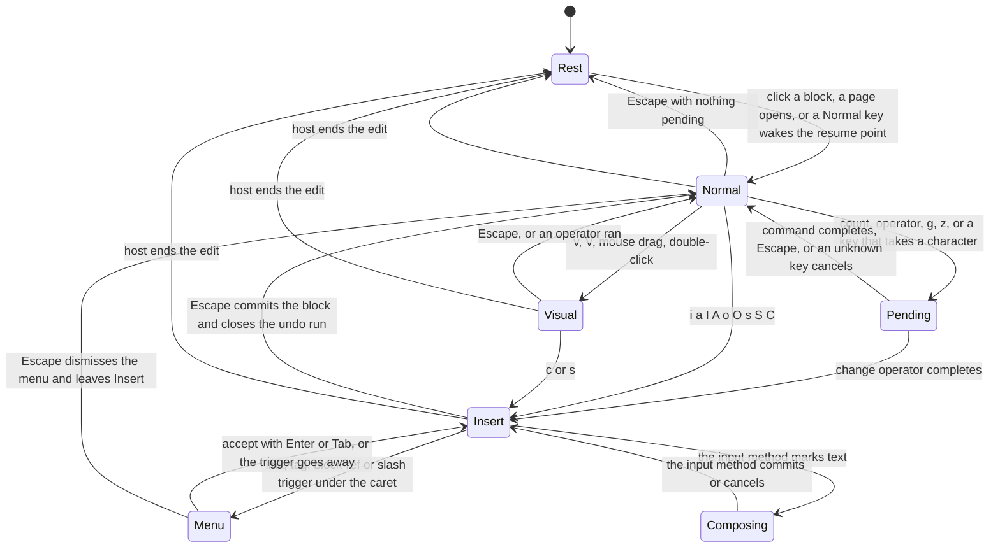

# Vim mode: Rest, Normal, Pending, Insert, Visual

The mode machine of Vim mode (PRD §9.1.1, requirements VM-1 to VM-14). This file is the
specification, from `docs/vim-mode-proposal.md` §2. PR 1 to PR 5 of `docs/vim-mode-plan.md`
build it, and `docs/adr/0013-vim-mode.md` records the implementation choices.

The machine sits on top of the block editor session (`block-editor-session.md`). Two existing
machines nest inside it and do not change: the autocomplete menu
(`block-editor-autocomplete.md`) and input-method composition
(`block-editor-ime-composition.md`).

## Where the state lives

The mode, the pending keys, the resume point and the registers are local UI state (AGENTS.md
rule 9). They live in `VimState` on the one `BlockEditor` that a window shares with every
`PageView`. They are never in a CRDT shard, the outbox or a sync message. The setting is one
boolean in `settings.json` (VM-1), and the mode itself is not saved: a launch starts in Rest.

## Diagram

## States

**Rest.** No block is in edit, so every row renders and the caret is nowhere. Rest is the
state of the app with Vim off, and it is where an Escape in Normal ends (VM-13). A Normal key
in Rest reopens the block and applies the key, so Rest is not a trap.

**Normal.** A block is in edit and its cursor rests on one grapheme, never after the last one
of a line. Keys are commands, and no key puts a character in the block (VM-5). Every entry
into an edit starts here (VM-4).

**Pending.** A count, an operator, a prefix (`g`, `z`) or a character argument (`f`, `t`, `r`,
`"`) is waiting. Pending is not a stored state: it is Normal or Visual with a non-empty
parser, and the mode label shows the keys (`2d`, `"_`).

**Insert.** Today's block editor, with one extra binding: Escape leaves Insert instead of
ending the edit. Typing, the input method, the autocomplete menu and the idle commit behave as
they do with Vim off (§13.5, VM-14). An Insert run is one undo group (VM-12, FR-2.12).

**Visual.** A charwise selection inside the block (`v`), or the whole block (`V`). The
selection is the editor's own selection, so the existing marks and copy actions work on it.
Visual and its operators are PR 3.

**Menu.** The inline autocomplete for a link, a tag, a block reference or a slash command.
The menu exists in Insert only. It is the existing machine, unchanged.

**Composing.** The input method holds marked text. This is the existing composition machine,
unchanged. Normal takes no marked text (VM-14).

## Edges

- **`[*] → Rest`.** The app starts with no block in edit. Vim mode adds no state at launch
  beyond the setting, and VM-4 applies to a block in edit, not to Rest.

- **`Rest → Normal` (click a block, a page opens, or a Normal key wakes the resume point).**
  A click into a block, a page or day that opens with focus on a block, and a Normal key in
  Rest all end in Normal with the cursor on a grapheme (VM-4). The key is applied after the
  block is in edit.

- **`Normal → Rest` (Escape with nothing pending).** Escape calls the editor's `end()`, which
  commits the block and leaves the edit, so every row renders again. A pending command does
  not end the edit: the first Escape cancels it (VM-13).

- **`Normal → Pending` (count, operator, g, z, or a key that takes a character).** A digit
  `1`–`9`, an operator (`d`, `c`, `y`, `>`, `<`), the prefix `g` or `z`, or a key that waits
  for a character leaves the rest of the command pending. The parser holds the keys and the
  mode label shows them.

- **`Pending → Normal` (command completes, Escape, or an unknown key cancels).** A completed
  command runs and clears the pending keys. Escape, and any key the grammar does not know,
  clear them and change no text (VM-5).

- **`Pending → Insert` (change operator completes).** A change operator that has its target
  deletes the range and enters Insert. The delete and the typing that follows are one undo
  group (VM-12).

- **`Normal → Insert` (`i a I A o O s S C`).** These commands move the cursor where the
  variant says and enter Insert. `o` and `O` make a block below or above. `s`, `S` and `C`
  delete first.

- **`Insert → Normal` (Escape commits the block and closes the undo run).** Escape runs the
  finishing commit, closes the Insert undo group, sets Normal, and moves the cursor one
  grapheme left. A composition in progress takes the first Escape, so the ladder starts there
  (VM-13).

- **`Insert → Menu` (link, tag, block-ref or slash trigger under the caret).** Typing `[[`,
  `#`, `((` or `/` opens the autocomplete at the caret (FR-2.17). The menu is Insert-only:
  in Normal neither it nor the idle commit that holds it can open.

- **`Menu → Insert` (accept with Enter or Tab, or the trigger goes away).** Enter or Tab takes
  the choice and stays in Insert. A trigger the cursor leaves closes the menu, and the typed
  text stays (FR-2.17).

- **`Menu → Normal` (Escape dismisses the menu and leaves Insert).** One Escape closes the
  menu and enters Normal. The typed text stays (FR-2.17), and a half-typed auto-closed
  `[[Ap]]` creates no page (FR-1.2).

- **`Insert → Composing` (the input method marks text).** The input method takes the key and
  marks text in the field. Insert behaves as it does with Vim off (§13.5).

- **`Composing → Insert` (the input method commits or cancels).** A commit puts its text at
  the caret and Insert continues. A cancel leaves the block text as it was.

- **`Normal → Visual` (`v`, `V`, mouse drag, double-click).** `v` starts a charwise selection
  at the cursor and `V` takes the whole block. A mouse drag or a double-click enters Visual at
  the selection it draws. Visual mode is PR 3.

- **`Visual → Normal` (Escape, or an operator ran).** Escape clears the selection and stays in
  Normal, with the cursor where the selection ended. An operator that ran on the selection
  also ends in Normal.

- **`Visual → Insert` (`c` or `s`).** A change command on the selection deletes it and enters
  Insert inside one undo group.

- **`Normal → Rest` (host ends the edit).** The host ends the edit when the page changes,
  another view takes focus, or the block the cursor is on is deleted. The mode returns to
  Normal, and the cursor's block and offset stay in the resume point for the wake-up.

- **`Insert → Rest` (host ends the edit).** The same host end from Insert closes the Insert
  undo group first, so the text typed in that run is one undo step (VM-12).

- **`Visual → Rest` (host ends the edit).** The same host end from Visual. The selection is
  dropped, and the resume point is kept.
