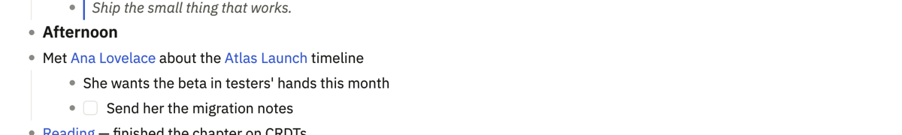
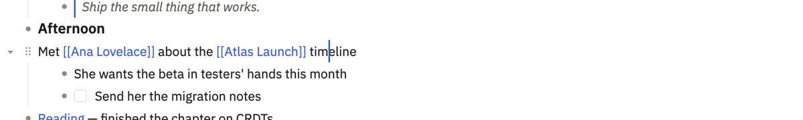

# fix/caret-jump

The caret jumped in three places. Each has a test that fails on `main` and passes here.

| Cause | On `main` | Test |
|---|---|---|
| A click in a block that has markup (`[[link]]`, `#tag`, `**bold**`, `key::`) | The caret went to the end of the block: the click was answered in the rendered text, which has no markup, and the offset was discarded | `a_click_puts_the_caret_under_the_pointer_in_a_block_with_markup`, `rich::tests::a_rendered_offset_maps_to_the_source_under_it` |
| The editor's CRDT caret anchor (PRD §6.5) | The selection keys and a mouse drag did not refresh it, so the next store change put the caret where the anchor was last set | `caret_survives_remote_edits_after_a_selection` |
| The idle commit heals `#Modern Religion` to `#[[Modern Religion]]` | The caret stayed at its byte offset, four bytes short, inside the title | `ac_3_2_the_caret_stays_after_a_tag_the_commit_healed` |

The anchor is removed (`Editing::anchor`, `Store::caret_cursor`, `Store::resolve_caret`,
`DocCursor`). When the stored text changes under the editor, the caret is carried through
the difference between the two texts (`utopia_core::text::carry_caret`), which needs no
state between edits.

## Pictures

Scratch graph from `cargo run -p xtask -- seed-daily`, script
`wait 1200; keys escape; wait 500; shot t0.png; click 774 416; shot a1.png`.

`01-row-as-text.png`: the row before the click. Two links come before the word `timeline`.



`02-caret-under-the-click.png`: after a click in the middle of `timeline`. The row shows
its source, 8 bytes longer before that word, and the caret is in the word that was clicked.



## Checks

`make check`: fmt, build, 41 test suites, 790 tests passed, 0 failed, clippy clean
(after the rebase onto `feat/inline-links`, #59).

That change added `Rendered::mirrors` and an offset map for the `↗` of an external link
only. The span map here covers it: the arrow is a run with no source behind it, and a caret
in it goes to the end of the link's source (`an_external_link_ends_in_an_up_right_arrow`).

Failing first, with the editor, page view, store and doc sources of `main`:

```
caret_survives_remote_edits_after_a_selection
  left: (">> hello world", 14)   right: (">> hello world", 9)
ac_3_2_the_caret_stays_after_a_tag_the_commit_healed
  left: ("on #[[Modern Religion]] today", 19)   right: (… 23)
a_click_puts_the_caret_under_the_pointer_in_a_block_with_markup
  left: ("alpha [[beta]] gamma delta", 26)   right: (… 16)
```

## Not done

- The carry uses one changed range per block. Two separate remote edits to the block that
  is being edited, in one sync round, replace the text between them: the caret then goes
  to the end of that replacement. The Loro cursor handled this case.
- A store change still collapses a selection to the caret (unchanged behaviour).
- A click on a `#[[tag]]`, a block reference chip or an attachment token follows the link,
  as before. Only a click next to one gets a caret, at the nearer end of its markup.
- No picture of `main`: the failing test output above is the evidence for the old behaviour.
