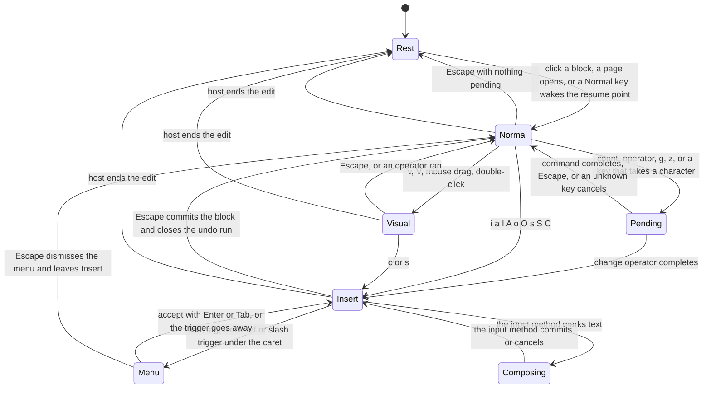

# Vim mode for Utopia — proposal

**Status:** proposal (2026-11-21), written by Claude (Fable, high effort) from a read-only study of `main` at 919afb5. Not in the PRD yet: PR 0 of the plan below adds it once the owner has answered section 8.

Read-only study of `main` at 919afb5. Nothing in the repository was changed.

**Paths used below.**
- `editor.rs`, `field.rs`, `actions.rs`, `page_view.rs`, `workspace.rs`, `settings.rs`, `appearance.rs`, `quick_jump.rs`, `line_input.rs`, `kill.rs` are in `crates/utopia-ui/src/`.
- `text.rs`, `undo.rs`, `outline.rs`, `command.rs` are in `crates/utopia-core/src/`.
- `lib.rs`, `pages.rs`, `extras.rs` are in `crates/utopia-store/src/`.
- "gpui" means `gpui-0.2.2/src/` in the cargo registry.

Anything about real input methods is read from code, not measured; it is labelled where it matters.

---

## 1. Summary, goals and non-goals

### What "Vim mode" means here

One modal layer over the existing block editor, off by default. The cursor is always on a character of one block. This is the PRD's editing model (§6.2, `PRD.md:244`: "One focused block at a time owns the caret") with a Normal mode on top.

- **Text level:** Vim motions, operators and text objects act inside the block that owns the caret.
- **Outline level:** Vim's linewise commands (`dd`, `yy`, `p`, `>>`, `<<`, `o`, `O`, `J`, `V`) act on blocks. In an outliner the block is the line.
- **No second "outline Normal" mode** with a block cursor and no text caret. It would need block selection, which is not built (`DESIGN.md:747`) and is P1 in the PRD (`PRD.md:244`).

### The eight decisions

1. **One Normal mode, anchored in an open edit session.** Existing `EditorEvent`s carry every structural command.
2. **Keys are parsed by a pure grammar in `utopia-core`,** fed by a keystroke interceptor that runs before the keymap. The Vim grammar is not in `CATALOG`; only the mode-level actions are.
3. **`j`/`k` move by visual line and cross into the next or previous block,** as Up/Down do today.
4. **`dd` deletes the block and its subtree** (today's Delete Block). Then `p` moves the same blocks back, keeping their ids, so `((references))` still resolve.
5. **Yank goes to the system clipboard; delete and change go only to an in-app register.** The Ctrl+K kill buffer stays separate.
6. **Escape is a ladder:** IME composition → Insert → Normal → no block in edit. Any Normal key then wakes the cursor where it was.
7. **One Insert run is one undo step.** This needs a small addition to the undo stack and is a change to FR-2.12, so it is an owner decision.
8. **PR 0 is documentation.** Vim is not in the PRD, and AGENTS.md sends new features through the PRD first (risk R8).

### Goals

- A Vim user can navigate, edit and restructure an outline without leaving home row or learning the Cmd chords.
- Every edit is still a `utopia_core::Command` through the existing store paths (rule 1). Nothing is hard-deleted (rule 5). Mode, registers and pending keys are local memory (rule 9).
- With the setting off, behaviour and keystroke cost are unchanged.
- IME behaviour in Insert mode is exactly today's (§13.5).

### Who it is for

The owner and Vim-fluent users of a keyboard-first outliner. It is not a teaching mode.

### Non-goals

- The ex command language (`:s`, `:g`, `:w`), `.vimrc`, user mappings (`nmap`), macros (`q`), marks, jump list, digraphs.
- Replace mode (`R`), blockwise Visual (`Ctrl-v`), increment (`Ctrl-a`/`Ctrl-x`).
- In-page search (`/`, `n`, `N`, `*`). There is no in-page find to map onto.
- Vim in `LineInput` fields: palette, filters, rename, Settings.
- Multi-cursor. There is none to interact with.
- Switching the macOS input source on leaving Insert.
- Vim plugins or emulating a specific plugin.

---

## 2. Mode model

### States

| State | Editor session | Meaning |
|---|---|---|
| **Rest** | `EditorSession::Idle` (`editor.rs:323-326`) | No block in edit; every row is rendered. |
| **Normal** | `Editing` | Block cursor on a grapheme; keys are commands. |
| **Pending** | `Editing` | A count, operator, prefix (`g`, `z`) or character argument (`f`, `t`, `r`, `"`) is waiting. A sub-state of Normal or Visual. |
| **Insert** | `Editing` | Today's editor, unchanged, plus one extra binding for Escape. |
| **Visual** | `Editing` | Charwise selection inside the block (`v`), or the whole block (`V`). |

Two existing machines nest inside Insert and are not changed:
- the autocomplete menu (`Autocomplete`, `editor.rs:150-163`);
- IME composition (`Composition`, `field.rs:35-42`).

### Diagram



### How it composes with what exists

**Editor session.** The mode cannot live in `Editing`: `begin` builds a new `Editing` for every block (`editor.rs:577`), and `j`/`k` cross blocks through `begin`. The mode is a field of `BlockEditor` next to `session` and `ac` (`editor.rs:381-393`).
- It survives `begin`.
- It resets to Normal when the session becomes `Idle` (`end` `editor.rs:590-608`, `detach` `editor.rs:654-659`).
- A blur that keeps the session (`focus_lost`, `editor.rs:886-895`, kept for the palette's QJ-5) keeps the mode and closes the Insert undo run.

**Insert → Normal is today's finishing commit without ending the session.** `VimNormalMode` runs `commit()` (`editor.rs:1019-1021`), which normalises, expands relative dates, creates link pages and seals undo (`editor.rs:1050-1054`). It then steps the caret one grapheme left. A half-typed auto-closed link still creates no page, through the existing `open_link` rule (`editor.rs:1040-1047`).

**Menus are Insert-only.** Two guards are needed, because Normal motion through `[[Alp` or `#tag` would otherwise open a menu and stall the commit:
- `refresh_autocomplete` returns early outside Insert, as it already does while composing (`editor.rs:1119-1125`). Every caret move calls it today (`moved`, `editor.rs:1535-1538`).
- `typing_link` is false outside Insert. Today it holds the idle commit while the caret sits in a link (`editor.rs:959-974`, `990-995`).

**Escape with a menu open.** One Escape dismisses the menu and enters Normal. The typed text stays, which is what FR-2.17 asks (`PRD.md:268`).

**IME (§13.5).**
- While composing, macOS hands every key to the input method first (gpui `platform/mac/window.rs:1696-1713`). The first Escape therefore cancels the composition and never reaches the keymap.
- `VimNormalMode` also returns early on `composing()`, like `newline` does (`editor.rs:1411-1414`), for the test platform where the key does arrive.
- Any other path into Normal while composing (a mouse click) takes the marked text as committed first (`accept_composition`, `editor.rs:865-871`).
- In Normal no composition may start. Section 4.3 gives the gate.

**Rest.** Escape in Normal with nothing pending calls today's `end()`. This keeps PRD §13.5 ("Escape blurs", `PRD.md:1051`) and DESIGN §5 (`DESIGN.md:709`) true: Escape is still the keyboard way out, in two presses.

Today I found no bare key that puts the caret back in a block. Re-entry is a click, or a navigation action that calls `focus_first` (`workspace.rs:1291`, `2245`, `2295`). I did not search this exhaustively.

Vim mode adds a wake-up so Rest is never a trap. With Vim on, a Normal key pressed in Rest reopens the block and offset the cursor left (kept in `VimState`). If none is known it calls `focus_first` (`page_view.rs:1452`). Then it applies the key.

**Mode at entry.** Normal, always: at launch (AC-1.1 puts the caret in today's first block), after a click, after navigation. Only commands that mean "insert" enter Insert. Enter in Insert splits and stays in Insert. Quick capture is a `LineInput` and stays non-Vim, so instant capture is not lost.

---

## 3. Key coverage, phased

"PR" is the pull request in section 6. "Exists" means a handler, event or planner is already there. "New" names what must be written.

### Utopia semantics, stated once

- **Motions see one block.** Inside it, a Vim "line" is the text between line breaks (`field.line_start` / `line_end`, `field.rs:175-182`). This is layout-free, so `0 ^ $` are testable without a frame.
- **Charwise motions and operators never leave the block.** `w` at the end of a block stops there.
- **`j`/`k` are the only motions that cross blocks** (plus `gg`/`G`). They walk wrapped lines first (`field.vertical`, `field.rs:333-343`), then cross with the screen x kept (`EditorEvent::Navigate`, `editor.rs:1955-1979`; `page_view.rs:2555-2622`).
- **Linewise operators act on blocks:** `dd yy cc >> << V o O J`, and `p` of a linewise register.
- **A count on `dd`/`yy`/`>>`** means this block and its next N−1 siblings, each with its subtree. Rows are not the unit, because a block's visible children are its own next rows.
- **A count on `j`/`k`:** up to N wrapped lines inside the block; whatever is left moves that many blocks. The next block's layout is unknown until it paints (`Goal`, `field.rs:370-385`), so the count cannot loop across blocks synchronously.
- **`gg`/`G`:** first and last visible block of the page the cursor's block is on. In the Daily Notes feed that is the day, not the endless feed. In a zoom it is the zoomed subtree.

### Modes and insert

| Keys | Meaning in Utopia | Built on | PR |
|---|---|---|---|
| `Esc` (Insert) | Normal; commit; caret one left | New action `VimNormalMode`; `commit()` exists | 1 |
| `Esc` (Normal) | Cancel pending; else Rest | `end()` exists (`editor.rs:590`) | 1 |
| `i` `a` `I` `A` | Insert at / after cursor, at first non-blank / end of the line | New; caret moves exist | 1 |
| `o` | New block below, Insert | Exists: `EditorEvent::Split` at end of text. It makes a first child when the block has expanded children (`outline.rs:43-45`), which is the next visible line | 1 |
| `O` | New block above, Insert | Exists: `EditorEvent::InsertAbove` (`page_view.rs:2472-2484`) | 1 |
| `u` / `Ctrl-r` | Undo / redo | Exists: `history` (`editor.rs:2143-2159`) | 1 |
| `v` / `V` | Visual charwise / the whole block | New; reuses `field.sel` | 3 |

### Motions

| Keys | Meaning | Built on | PR |
|---|---|---|---|
| `h` `l`, arrows, `Space`, `Backspace` | One grapheme, not past the line | Exists: `prev_grapheme` / `next_grapheme` (`text.rs:15-27`); Normal clamp is new | 1 |
| `j` `k` | Wrapped line, then the next block | Exists (above); count handling is new | 1 |
| `w` `b` `e` `W` `B` `E` | Vim words | **New functions.** `prev_word_start` / `next_word_end` skip punctuation and `next_word_end` lands on word ends (`text.rs:29-52`); Vim's `w` lands on word starts and treats punctuation as words | 1 |
| `0` `^` `$` | Start, first non-blank, end of the line | Exists: `line_start` / `line_end`; `^` is new | 1 |
| `f` `t` `F` `T` `;` `,` | Find a character on the line | New | 1 |
| `gg` `G` | First / last block of the page | New host event; `focus_first` is the model | 1 |
| counts (`3w`, `2j`) | Repeat | New (parser) | 1 |
| `%` | Matching bracket in the block | New | 4 |
| `{` `}` | Previous / next sibling block | New host event | 4 |

### Operators and edits

| Keys | Meaning | Built on | PR |
|---|---|---|---|
| `x` `X` `D` `r{c}` `~` | Delete or replace graphemes | Exists as a pattern: `discrete_edit` is one sealed undo step (`editor.rs:1749-1768`) | 2 |
| `d{motion}` `y{motion}` `c{motion}` | Inside the block | `discrete_edit` + register; `c` enters Insert | 2 |
| `C` `s` `S` / `cc` | Change to end, change grapheme, change the block's text (children stay) | Same | 2 |
| `dd` | Delete block and subtree; `N dd` takes N siblings | Exists for one block: `EditorEvent::DeleteBlock` → `outline::delete_subtree` (`page_view.rs:2696-2704`, `outline.rs:272-302`). New planner `delete_blocks` for N: `Command::SetDeleted` already takes a list (`command.rs:198-200`) | 2 |
| `yy` / `Y` | Yank block and subtree | Exists: `subtree_to_markdown` (`editor.rs:2063-2068`); structured register is new | 2 |
| `>>` `<<` | Indent / outdent | Exists: `EditorEvent::Indent` / `Outdent` (`page_view.rs:2485-2509`) | 2 |
| `J` | Join the next visible block into this one with a space; its children re-parent; it is tombstoned | New planner `join_next`, modelled on `merge_into_previous` (`outline.rs:160-221`) | 2 |
| `p` `P` (charwise) | Paste after / before the cursor | `discrete_edit` | 2 |
| `p` `P` (blocks) | Paste as sibling blocks below / above | New planners (below) | 2 |
| `.` | Repeat the last change | New | 3 |
| `d`/`y`/`>` with `j`/`k` | Multi-block linewise | New planners; one plan each | 4 |

### Text objects

| Keys | Meaning | PR |
|---|---|---|
| `iw` `aw` `iW` `aW` | Word | 2 |
| `i(` `a(` `i[` `a[` `i{` `a{` | Brackets; `ci[` inside `[[Alpha]]` leaves the caret in the link, so the `[[` menu opens | 2 |
| `i"` `a"`, `i'`, and the backtick pair | Quotes and inline code | 2 |
| `il` `al` | A Utopia reference under the cursor: `[[page]]`, `#tag`, `((block))`. Ranges from `inline::extract_refs`, which the editor already uses (`editor.rs:1343`) | 4 |

### Outline and app

| Keys | Meaning | Built on | PR |
|---|---|---|---|
| `Tab` / `Shift-Tab` | Indent / outdent, as today | Passes through to the keymap | 1 |
| `Cmd` chords | Move block, zoom, collapse, to-do, bold, copy block ref | Pass through to the keymap | 1 |
| `za` `zo` `zc` | Toggle / open / close the fold | Exists: `toggle_collapse` (`page_view.rs:2834-2843`), local state (FR-2.8) | 4 |
| `zM` `zR` | Fold / unfold all | Exists as a toggle (`page_view.rs:2845`); explicit set is new | 4 |
| `gd` | Open the page under the cursor | `PageViewEvent::Open` exists | 4 |
| `:` | Open the palette on its command list | The palette lists commands after `>` (`quick_jump.rs:51`) | 4 |

### Blocks, yank and paste: the part that is not like Vim

Three facts in the code shape this:

1. Copy with no selection already yields the subtree as nested Markdown, and Cut then deletes the block (`editor.rs:2053-2093`).
2. Paste decides "blocks or inline" by whether the text has a line break (`editor.rs:2103-2106`). So a yanked childless block would paste inline. The system clipboard cannot carry a linewise flag.
3. Outline paste mints new block ids and makes every block a bullet (`outline.rs:503`, `521`). A to-do or heading loses its kind, and `dd` then `p` would break every `((reference))` to the moved block.

So the register is structured:

```
Register::Chars(String)
Register::Blocks { markdown, tree: Vec<(depth, text, kind, checked)>, cut: Option<(PageId, Vec<BlockId>)> }
```

| Case | Behaviour |
|---|---|
| `yy` then `p` | Copies. New ids; kind and checked state kept. New planner `insert_tree_after`: `InsertBlock` carries `kind` (`command.rs:172-178`), plus `SetBlockKind` for checked blocks. |
| `dd` then `p`, first paste | **Moves.** Restores the tombstoned blocks (`SetDeleted { ids, None }`) and moves them. Same ids, one undo step. |
| `dd` then `p`, later pastes | Copy. |
| `dd` then `p` after the delete was undone, or the trash emptied | Copy. |
| `dd` then `p` on another page | Same-page restore-and-move is certain. Across pages, `cross_page_move` keeps ids but refuses a block that is not live (`extras.rs:394-405`). It needs a store method that restores and moves in one group. Decide in PR 2; the fallback is a copy. |
| `p` of clipboard text with line breaks | Today's outline paste (`EditorEvent::PasteOutline`, `page_view.rs:2705-2713`). |

**After `dd`** the cursor goes to the next block, as in Vim. `delete_subtree` focuses the previous one today (`outline.rs:278-287`); the Vim path passes its own focus.

**Registers and the clipboard.**
- `y` writes the register and the system clipboard (Markdown for blocks).
- `d`, `c`, `x` write the register only.
- `p` uses the system clipboard when its text differs from what Utopia last wrote there, otherwise the register.
- Named registers are not in the first four PRs. `"_` (discard) and `"+` (clipboard) are in PR 2.
- The Ctrl+K / Ctrl+Y kill buffer (`kill.rs:1-32`) stays as it is. Its doc says it is never clipped, and it is the Insert-mode pair.

---

## 4. Architecture

### 4.1 Where the state lives (rule 9)

New `crates/utopia-ui/src/vim.rs`:

```rust
pub enum Mode { Normal, Insert, Visual { anchor: usize, blockwise: bool } }

pub struct VimState {
    mode: Mode,
    parser: utopia_core::vim::Parser,   // count / operator / prefix / char-argument
    last_change: Option<Change>,         // dot-repeat
    resume: Option<Caret>,               // where Rest wakes up
    insert_run: Option<InsertRun>,       // text at entry and the open undo run
}
```

- `VimState` is a field of `BlockEditor` (`editor.rs:381-393`). The workspace creates one editor and shares it with every `PageView` (`workspace.rs:405`), so the mode is per window.
- Registers are a thread local in `vim.rs`, on the model of `kill.rs:14-20`.
- Nothing is persisted, synced or put in a shard.

**The setting.** `settings.json` gains `"vim": false`. It is a field on `Prefs` (`appearance.rs:271-289`), parsed in `from_json` (`appearance.rs:307`), with `appearance::vim(cx)` and `set_vim` on the pattern of `density` / `set_view_mode` (`appearance.rs:588-591`, `629-632`). An unknown value means off, logged.

**The switch** is in Settings → Keybindings, above the list: a segmented control "Standard | Vim" (`DESIGN.md:690`). A `ToggleVimMode` action with no default key lets the palette flip it.

### 4.2 Key dispatch: a parser behind one interceptor

**Recommendation.** The Vim grammar is a pure parser, `utopia_core::vim::Parser::feed(Key) -> Step`, with `Step::{Pending, Run(Command), Cancel, Pass}`. It is fed from one keystroke interceptor in `Workspace`. It is not a list of `CATALOG` rows.

**Why before the keymap.** gpui runs interceptors, then the keymap, then key-down listeners (gpui `window.rs:3778-3783`, `3785-3846`, `3848-3859`). Bare Enter, Backspace, Tab, the arrows and the Ctrl letters are bound in `BlockEditor` today (`actions.rs:269-276`, `439-486`, `674-770`), so a key-down listener would run after they had already edited the block. The Settings key capture uses an interceptor for the same reason (`settings.rs:347`), and so does the page menu's Escape (`workspace.rs:471-495`).

**Why not one catalog action per Vim key.** I priced it:

- Each action is written in four places in `actions.rs` — `actions!` (`15-121`), `CATALOG` (`186-921`), `action_for` (`931-1026`), `binding_for!` (`1174-1270`) — plus one `.on_action` line (`editor.rs:2353-2421`). About 80 commands.
- Quick Jump lists every catalog row; its test asserts the count equals `CATALOG.len()` (`quick_jump.rs:1415`). `command_ready` only asks whether a block is in edit (`quick_jump.rs:598-600`), so Vim rows would be offered with Vim off.
- User overrides are installed last and win at equal depth (`actions.rs:1605-1612`). A rebound base action could silently shadow a Vim key.
- Counts, `f{char}`, `r{char}` and text objects still need a state machine. The grammar would then live in two places.
- gpui's own multi-key bindings cannot carry operators or prefixes. Pending input flushes after one second (gpui `window.rs:3801-3831`), and the abandoned key is replayed into the input handler (gpui `window.rs:3973-3978`). `d`, a pause, `w` would fail, and an abandoned `g` would be typed into the block.

**What does go in `CATALOG`** (rebindable, in Settings and the cheat sheet):

| Action | Default | Context | Note |
|---|---|---|---|
| `ToggleVimMode` | none | whole window | Palette-runnable. |
| `VimNormalMode` | `escape` | `BlockEditor && VimInsert` | Listed after `Escape`, so it wins at equal depth — the rule `AcceptCompletion` relies on (`actions.rs:795-804`). `scopes_touch` reads the extra identifier as a narrower layer, not a clash (`actions.rs:1511-1529`), so `defaults_do_not_conflict` stays green. A user can rebind it, including to `j k`: gpui holds the `j` and types it if no `k` follows. |

The editor adds `VimInsert`, `VimNormal` or `VimVisual` to its key context next to `BlockEditor` (`editor.rs:2341-2345`).

**The fixed grammar is shown, not hidden.** Settings → Shortcuts gets a "Vim" card rendered from `utopia_core::vim::REFERENCE`, a table of keys and descriptions. A unit test asserts every row parses, so the sheet cannot drift from the parser.

**The interceptor's rule.** One interceptor, merged with the page menu's. gpui calls every interceptor even after one stops propagation (gpui `window.rs:1524-1536`), so two separate ones would both act on the same Escape.

It claims a keystroke only when all of these hold: Vim is on; the window is ours; the page menu is closed; the editor's handle is focused; a block is in edit; the mode is not Insert; nothing is composing. Then:

| Keystroke | Handling |
|---|---|
| Named keys without Cmd, Alt or Fn: Escape, Enter, Space, Backspace, Delete, arrows | To the parser. Classified by `key` first: the test platform gives Enter, Tab and Space a `key_char` (gpui `platform/keystroke.rs:248-251`). |
| Anything with a `key_char` and no Cmd | To the parser by `key_char`, so `$`, `^`, `G` work on layouts that type them with Shift or Option (`should_match` documents the case, gpui `platform/keystroke.rs:74-98`). Unknown keys are swallowed, never typed. |
| Ctrl + letter | On macOS all claimed (known ones run, the rest do nothing). Elsewhere only those in the parser's table, because there `cmd-` defaults become `ctrl-` (`actions.rs:1054-1060`). |
| Tab, Shift-Tab, every Cmd chord, Alt chords without a character | Propagate to the keymap unchanged. |

For the Rest wake-up the condition is: Vim on, the workspace's own handle focused (`workspace.rs:416-426` puts focus there on `Blurred`), main content is a page, no block in edit.

### 4.3 The second way text arrives (IME and dead keys)

Text reaches the field without a dispatched keystroke in two ways:

- **Committed text:** `replace_text_in_range` (`field.rs:550-573`) — a dead-key result, an IME commit, the emoji palette, the held-key path (gpui `platform/mac/window.rs:1741-1753`).
- **Marked text:** `replace_and_mark_text_in_range` (`field.rs:575-629`). It does not pass through the `$intercept` hook.

A dead key has no `key_char` (gpui `platform/keystroke.rs:229-236`). macOS hands such a key to the input context first, and gpui returns as soon as that reports the key handled (gpui `platform/mac/window.rs:1709-1730`). On dead-key layouts that can cover `^`, `~`, `'`, `"` and the backtick, so gpui dispatch may never see them.

So the input handler stays registered, and two gates are added:

- **Committed text outside Insert goes to the parser** as characters and never touches the buffer. The seam exists: `BlockEditor`'s intercept is `typed_bracket` today (`editor.rs:425-429`, `772-821`). It becomes `intercept_typed`, which feeds the parser outside Insert and returns `true`.
- **Marked text outside Insert is ignored.** A new `FieldHost::accepts_marked_text()` (default `true`) is checked at the top of `replace_and_mark_text_in_range`. The block's text and `Composition` are not touched.

**Unmeasured.** Whether macOS still delivers the composed character after its marked text was ignored, and what a Japanese or non-Latin input source sends for a bare `j`. gpui documents `key` as the ASCII-equivalent on layouts without ASCII keys (gpui `platform/keystroke.rs:22-27`), which would give a free fallback. A manual layout matrix (US, one dead-key layout, Japanese, one non-Latin) is an acceptance item of PR 1.

**Text that arrives without any key, in Normal:**

| Path | Behaviour in Normal |
|---|---|
| `insert_text`, `attach_paths`, a dropped file (`editor.rs:732-764`) | Applied at the cursor as one sealed step; cursor re-clamped. |
| `run_plugin` (`editor.rs:662-729`) | As today; cursor re-clamped. |
| A store change: sync, undo, an assistant's write (`sync_from_store`, `editor.rs:610-639`) | As today (`carry_caret`); cursor re-clamped; a pending operator is kept, since ranges are computed when it runs. |
| Cmd+V | Passes through to today's `paste`. |

### 4.4 Every edit stays a Command with the right undo grouping (rule 1)

The Vim layer adds no write path:

- **Charwise edits** use `discrete_edit` (`editor.rs:1749-1768`): seal, replace, persist through `set_block_text`, seal. One undo step. `EmacsKillLine` is the model: compute a range from the field, remember the text, delete through `discrete_edit`, guard on `composing()` (`editor.rs:1876-1896`).
- **Structural edits** emit an `EditorEvent`; the host runs one `outline` plan through `Store::execute_plan`, which seals on both sides (`lib.rs:1159-1182`). One plan is one undo step. `3dd` must therefore be one plan, not three events.
- **New `EditorEvent`s:** `Navigate` gains `count`; `DeleteBlocks { count }`, `JoinNext`, `PasteBlocks { before }`, `GoEdge { first }`; and `VimChanged` for the indicator. New arms go in `on_editor_event` (`page_view.rs:2408-2745`).
- **New planners in `outline.rs`:** `delete_blocks`, `join_next`, `insert_tree_after`, `restore_after`; `indent_many` / `outdent_many` in PR 4.

**One Insert run = one `u`.** Today it is not. Text edits coalesce only within 500 ms (`undo.rs:12`, `49-63`), and the idle commit 300 ms after the last keystroke seals the group (`editor.rs:959-974`, `1053`). So a sentence typed with pauses is several undo steps, and `cw` plus the new word is at least two.

Proposed addition, pure and small:

- `UndoStack::begin_run()` and `end_run()` in `undo.rs`. `end_run` folds every group pushed since `begin_run` into one. That is safe because a group is an ordered list of steps whose inverses are applied in reverse (`undo.rs:1-7`, `15-21`).
- The run closes itself if an undo starts, and tracks the 1000-group limit (`undo.rs:136-138`).
- `Store::begin_undo_run` / `end_undo_run` wrap it.
- The editor opens a run when Vim enters Insert (before the delete of a `c` command, before the split of `o`) and closes it on Escape, on blur, and when the session ends.

This changes FR-2.12 for Vim mode only (see section 8).

**Dot-repeat.** `last_change` stores the parsed `Command` and, for insert-type changes, the inserted text: the `text::diff` (`text.rs:104`) between the block at Insert entry and at Escape. An Insert run that created blocks with Enter repeats only its opening command. That is a stated limit.

### 4.5 Cursor rendering

Today the caret is a 2 px `--link` bar, painted after the text (`field.rs:772-776`, `809-813`), and DESIGN fixes it so (`DESIGN.md:189`).

- `FieldHost` gains `caret_shape() -> CaretShape { Bar, Block }`, default `Bar` (`field.rs:388-397`). `LineInput` implements `FieldHost` with the defaults (`line_input.rs:47`, `59`) and is unaffected.
- **Block shape:** the cell from the cursor's grapheme to the next one on the same visual line, painted **under** the text, like the selection quads (`field.rs:796-798`).
  - Fill `--selection`, 1 px `--link` outline. `--selection` is already the fill text must stay readable on (`DESIGN.md:189`), so no new colour is needed.
  - A minimum width (a new `theme.rs` constant) applies at an empty block (the hint is shown, `editor.rs:2279-2290`), at a line break, and where the next grapheme wraps.
  - Steady, not blinking; the blink is the Insert caret's (`DESIGN.md:163`).
- **Normal clamp:** the cursor rests on a grapheme, never after the last one of a line; an empty block has it at 0.
- **Visual:** `field.sel` holds anchor to cursor inclusive, so the existing selection paint (`field.rs:743-771`) and the existing selection actions work unchanged: Cmd+B/I/E (`mark`, `editor.rs:2023-2037`), Copy, Cut. The cursor end gets the same outline.

This needs a DESIGN.md amendment: a row "Editing, Vim Normal" in the §3.1 state table (`DESIGN.md:192-196`).

### 4.6 Mode indicator

DESIGN has no status bar, and the sidebar footer disappears when the sidebar is collapsed. The block cursor is the main signal.

- **Where:** the top bar's right-hand group (`DESIGN.md:244-250`), left of the view mode control, only while Vim is on.
- **What:** `NORMAL` / `INSERT` / `VISUAL` in the Mono label role, `--ink-3`, no fill, no blue. Pending keys follow it (`2d`, `"_`).
- **Redraw:** the label is drawn by `Workspace`, which must not re-render on every keystroke (rule 10). The editor emits `EditorEvent::VimChanged` only when the mode or the pending text changes. The workspace already subscribes to editor events (`workspace.rs:416-426`).

### 4.7 Files and types

| File | Change |
|---|---|
| `crates/utopia-core/src/vim/` (new: `mod.rs`, `parse.rs`, `motion.rs`, `textobj.rs`) | `Key`, `Parser`, `Step`, `Command`, `Operator`, `Motion`, `TextObject`, `REFERENCE`; word and find motions on `&str`, grapheme-aware. No gpui, loro or rusqlite. |
| `undo.rs` | `begin_run`, `end_run`. |
| `outline.rs` | The planners in 4.4. |
| `lib.rs` (store) | `begin_undo_run`, `end_undo_run`; possibly restore-and-move across pages. |
| `crates/utopia-ui/src/vim.rs` (new) | `VimState`, `Mode`, registers; `impl BlockEditor { vim_key, vim_typed, vim_run }`. |
| `editor.rs` | `vim` field; key context; `intercept_typed`; the two menu/commit guards; `VimNormalMode` handler; mode reset in `end` / `detach`; `mouse_down` (`2170-2191`) sets Normal or Visual; new events. |
| `field.rs` | `CaretShape`; `caret_shape`, `accepts_marked_text` on `FieldHost`; block quad in `prepaint`; paint order. |
| `actions.rs` | Two actions in the four places; context names beside `EDITOR_CONTEXT` (`123-126`). |
| `appearance.rs` | `Prefs.vim`, getter, setter. |
| `workspace.rs` | The merged interceptor; Rest wake-up through `PageView::restore_caret` (`page_view.rs:2760-2772`); the label; `ToggleVimMode`. |
| `page_view.rs` | New `on_editor_event` arms. |
| `settings.rs`, `help.rs`, `theme.rs` | The switch, the Vim reference card, a Help topic, the caret constant. |
| Docs | PRD, DESIGN, `docs/state-machines/vim-mode.md`, the `settings.json` line in AGENTS.md. |

---

## 5. Interactions and edge cases

**IME.** Covered in 2 and 4.3. Insert is unchanged. Composing keys go to the input method. Normal takes no marked text. Characters that need composing (`f` then `日`) are not valid targets in the first version.

**Autocomplete and link typing.**
- Menus exist only in Insert.
- Entering Insert re-reads the trigger, so `i` inside `[[Alp` opens the menu, as clicking into a link does today.
- `ci[` on a link is the fast way to re-pick a page.
- An auto-paired `[[Ap]]` left with Escape creates no page (existing `open_link` rule).

**Markdown rendering.** A block in edit shows raw markup (`DESIGN.md:195`). In Normal the cursor's block is therefore raw as the cursor passes through it; every other block is rendered. Escape in Normal (Rest) shows the current block rendered. This matches the app today and I recommend accepting it.

**Selection.**
- There is no multi-cursor and no block selection in the code. A grep for either found nothing, and the PRD keeps one caret (`PRD.md:244`).
- Before PR 3, a selection made with the mouse or Cmd+A collapses on the next motion.
- From PR 3, a non-empty selection is Visual.

**macOS text shortcuts already bound.**

| Chords | In Insert | In Normal |
|---|---|---|
| Emacs Ctrl keys (`actions.rs:674-770`) | Unchanged; they overlap Vim's own insert keys | Claimed by the Vim layer; only its own (`Ctrl-r`) act |
| Cmd and Option chords (word/line moves, deletes, block moves) | Unchanged | Pass through. An edit made this way is one discrete step. |
| `FocusPaneLeft` / `Right` (`alt-left` / `alt-right`, `actions.rs:862-879`) | Shadowed by word moves, as now | Shadowed by word moves, as now |

**Escape.** The ladder in section 2. The page menu's Escape keeps priority (merged interceptor). A Settings key capture is in another window; the interceptor checks the window handle, as the existing ones do (`workspace.rs:477`).

**Command palette.**
- It is a `LineInput`. It takes focus, the block commits (`focus_lost`), and the interceptor passes every key, because the editor is not focused.
- An editor command picked there is dispatched back to the block (`workspace.rs:1790-1801`) and works in any mode.
- The two Vim rows are listed like any other. `VimNormalMode` with Vim off does nothing; mark it unavailable in `command_ready`.

**`LineInput` fields stay non-Vim.** They have their own key context (`line_input.rs:613`), their own handlers (`line_input.rs:619-661`) and the `FieldHost` defaults. The interceptor requires the block editor's handle.

**Properties bar** (`DESIGN.md:320-342`). Property rows are blocks edited by the same editor, so text-level Vim works there. Structural commands follow the existing guards: no split, indent or insert-above on a property row (`page_view.rs:2453-2494`). So `o`, `O`, `>>` do nothing there.

**Accessibility.**
- PRD §15.4 asks for full keyboard operability and promises no VoiceOver parity (`PRD.md:1166-1167`). There is no accessibility tree (`DESIGN.md:771`).
- Vim mode adds keyboard reach and removes none: Tab, Shift-Tab, Escape and every Cmd chord keep their meaning.
- The mode is shown in words, not colour alone.
- The block cursor does not blink, so it adds no motion.

**Performance (rule 10).**
- With Vim off: one boolean check in the interceptor and one branch in `render`.
- With Vim on: the parser is O(1) per key; motions are O(block length); the block cursor is one quad.
- Nothing reads the store in `render` beyond what it does now.
- `bench --ui` runs for PR 1 and PR 2, which touch the keystroke path (AC-2.2).

**Layout timing.**
- `field.vertical` needs a layout shaped from the current text, and returns `None` otherwise (`field.rs:279-284`, `333-343`). The editor reads `None` as "leave the block" (`editor.rs:1969-1978`).
- After an edit and before the next paint, `x` then `j` typed fast could therefore leave a multi-line block early.
- Mitigation: when the layout is stale, queue the vertical move and resolve it in `prepaint`, where `Goal` is already resolved (`field.rs:716-731`).

**Deleting the last block of a page.** `delete_subtree` can empty a page. The editor detaches (`editor.rs:654-659`) and Vim goes to Rest. The next key wakes through `focus_first`, which creates a block on an empty page (`page_view.rs:1461-1476`).

**Platforms other than macOS.** Emacs keys have no defaults there (`actions.rs:1067-1075`), and `cmd-` becomes `ctrl-`. The interceptor claims only the parser's own Ctrl keys there, so Ctrl+K stays Quick Jump.

---

## 6. Phased delivery plan

The order follows dependency and value. PR 1 and PR 2 together are the usable core.

Every code PR ends with AGENTS.md's four steps: `make check`; a seeded scratch graph; `UTOPIA_SHOT_SCRIPT` captures in light and dark; reading every PNG. Shots go under `docs/verification/<branch>/`.

### PR 0 — Specification (docs only)

- **Scope:**
  - PRD §9.1.1 "Vim mode (VM)" with requirement ids (VM-1 …) and acceptance ids, and the FR-2.12 note for Insert runs.
  - DESIGN.md: block cursor row in §3.1, mode label in §3.3, the switch in §4.9.
  - `docs/state-machines/vim-mode.md` with the diagram in section 2.
- **Checks:** none needed (documentation only, per AGENTS.md).
- **Acceptance:** the owner has answered section 8; later tests can cite VM ids.

### PR 1 — Modes, motions and insert

- **Scope:**
  - The setting and switch; `VimState`; the merged interceptor; the parser with counts.
  - Every motion marked PR 1; `i a I A o O`; `u`, `Ctrl-r`.
  - The Escape ladder and Rest wake-up; the two input gates (4.3).
  - Block cursor; mode label; menus Insert-only; the idle-commit guard.
- **Files:** `utopia-core/src/vim/*`, `vim.rs`, `editor.rs`, `field.rs`, `actions.rs`, `appearance.rs`, `workspace.rs`, `page_view.rs`, `settings.rs`, `theme.rs`.
- **Tests:** parser and motion unit tests; new `crates/utopia-ui/tests/vim.rs` (see 7); one `tests/layout.rs` case for the label.
- **Acceptance:**
  - With Vim off, all existing tests pass unchanged.
  - With Vim on, a seeded outline can be walked and edited with the keys above.
  - No key types in Normal.
  - Shots show the block cursor and label in both themes.
  - `bench --ui` passes.
  - The manual layout matrix is recorded in the PR.

### PR 2 — Operators, registers and block commands

- **Scope:**
  - `d c y` with motions and text objects; `x X D C s S r ~`.
  - `dd yy cc >> << J` with counts over siblings.
  - The structured register and clipboard rule; `p P` including the id-keeping move.
  - Undo runs.
- **Files:** `vim/*`, `undo.rs`, `outline.rs`, store `lib.rs`, `vim.rs`, `editor.rs`, `page_view.rs`.
- **Tests:** the reference table (7); undo-depth tests; planner unit tests; a store test that `dd` then `p` keeps ids and a `((reference))` still resolves; `doctor` stays clean after a scripted run.
- **Acceptance:**
  - Each command is one `u`.
  - `ciw`, typing, Escape, `u` restores the word in one step.
  - A to-do yanked and pasted is still a to-do.
  - `bench --ui` passes.

### PR 3 — Visual mode and repeat

- **Scope:** `v`; `V` on one block; `o` to swap ends; operators on the selection; mouse drag and double-click enter Visual; `.` with counts.
- **Files:** `vim/*`, `vim.rs`, `editor.rs`, `field.rs`.
- **Tests:** selection ranges with multi-byte text; `.` after `dw`, `cw…`, `dd`, `>>`; Cmd+B on a Visual selection.
- **Acceptance:** shots of a Visual selection in both themes; `.` repeats each change class in the table.

### PR 4 — Outline extras

- **Scope:** folds (`za zo zc zM zR`); `d`/`y`/`>`/`<` with `j`/`k`; `{` `}` `%`; `il` / `al`; `gd`; `:`; the Help topic and its screenshot (`xtask help-shots`); the Vim card in Shortcuts.
- **Files:** `vim/*`, `outline.rs`, `page_view.rs`, `settings.rs`, `help.rs`, `xtask`.
- **Tests:** multi-block planners are one undo step each; folds stay local state (FR-2.8); the reference-card test.
- **Acceptance:** a five-block reorder done with `dj` and `p` keeps every id.

### PR 5 — Optional, needs a PRD decision first

- Multi-block Visual-line (`V` then `j`/`k`), drawn as DESIGN's block selection (`DESIGN.md:196`). This is the PRD's P1 cross-block selection.
- Text-line semantics inside code blocks.
- A remembered column for `j`/`k`.
- Named registers.

---

## 7. Testing strategy

**Parser and motions (unit, `utopia-core`).** Table-driven, no gpui.
- Key strings to `Command`: `d2w`, `2dw`, `"_dd`, `ci[`, `3j`.
- Every unfinished prefix is `Pending`; every unknown continuation is `Cancel`.
- Motions use a cursor marker: `"he|llo, world"` + `w` → `"hello|, world"`.
- Cases include emoji ZWJ sequences, combining marks, CJK, an empty string, and text with line breaks.

**Vim reference table.** A checked-in file of `(before, keys, after, register)` rows for the single-block subset, which is where Utopia should equal Vim.
- I recommend generating it once from headless Neovim with a small `xtask` step, and reviewing it by hand. CI only reads the file.
- A second, short table lists the deliberate deviations and asserts Utopia's behaviour: `dd`, `yy`, `p`, `J`, `o`, `j`/`k`, `gg`/`G`.

| Before | Keys | After | Source |
|---|---|---|---|
| `one \|two three` | `dw` | `one \|three` | Vim |
| `call(a\|lpha, beta)` | `ci(` + `x` + Esc | `call(\|x)` | Vim |
| `see [[Al\|pha]] now` | `dal` | `see \|now` | Utopia |
| block with two children | `dd` | all three tombstoned, one undo step | Utopia |

**Keystroke tests (`crates/utopia-ui/tests/vim.rs`).** The `workspace.rs` harness, with Vim on: `simulate_keystrokes` and `simulate_input` (`tests/workspace.rs:21-34`, `73-75`). Assertions are on store state, undo depth (`Store::undo_depth`, `lib.rs:1239`), the editor's target and cursor, never on absent bounds. Names carry the PRD ids, for example:
- `vm_2_normal_mode_types_nothing`
- `vm_5_dd_deletes_the_subtree_in_one_undo_step`
- `vm_6_cut_then_paste_keeps_block_ids`
- `vm_8_escape_ladder_ends_at_rest_and_a_key_wakes_it`

**IME tests.** Driven through the input-handler methods, as the `ac_13_5_*` tests are:
- Marked text in Insert, then Escape, leaves the composition and the mode alone.
- Marked text offered in Normal changes neither the text nor `Composition`.
- Committed text in Normal reaches the parser and not the block.
- A click into Normal during a composition keeps the composed characters.
- The real-IME layout matrix is manual and recorded in PR 1.

**Undo tests.**
- An Insert run with pauses longer than 300 ms is one group (the clock is settable, `Store::set_clock`).
- `cw` plus text is one group.
- A run closed by blur is one group.
- Undo during an open run closes it first.
- 200 undos after a scripted Vim session return a byte-identical projection (AC-2.3's shape).

**Robustness.** A seeded random key string, a few thousand keys, run against a small graph: no panic (rule 11), `doctor` clean (rule 2), full undo restores the start (rule 5).

**By eye.** `UTOPIA_SHOT_SCRIPT` shots for each PR: block cursor on ASCII, on an emoji, in an empty block, at a wrap; Visual; the label; both themes.

---

## 8. Risks and open questions for the owner

### Decisions only the owner can make

| # | Question | Recommendation |
|---|---|---|
| 1 | `j`/`k`: wrapped lines crossing blocks, or always block to block? | Wrapped lines, crossing at the edges. It is what the screen shows and what Up/Down do. |
| 2 | `dd` on a block with children: the subtree, or the block only? | The subtree, as Delete Block does today. A count takes siblings. |
| 3 | Does `dd` then `p` move the same blocks (ids kept)? | Yes. It is the main way a Vim user reorders, and copies would break `((references))`. |
| 4 | Registers and the clipboard. | Yank to the clipboard; delete and change to the register only; no named registers yet; the kill buffer stays separate. |
| 5 | Escape in Normal. | It ends the edit (Rest), and any Normal key wakes the cursor. PRD §13.5 and DESIGN §5 stay true. The alternative, Escape does nothing in Normal, leaves no keyboard way to see the current block rendered. |
| 6 | One Insert run as one undo step (changes FR-2.12 for Vim mode). | Yes, in PR 2. Without it `u` after `cw` is not Vim. |
| 7 | Vim keys not rebindable in Settings. | Accept. The grammar is fixed; the two mode actions are rebindable; the reference card documents the rest. |
| 8 | Mode at launch and on click. | Normal, always. |
| 9 | A remembered column for `j`/`k`. PRD §13.5 says none (`PRD.md:1051`). | Keep the PRD rule in PR 1; consider a remembered column for Vim mode only, in PR 5. |
| 10 | Inside a code block, should linewise commands act on code lines? | Not at first. It is a clear rule to add later; PR 5. |
| 11 | Block cursor look and label place (4.5, 4.6). | Existing tokens only; label in the top bar. Needs your eye on the shots. |
| 12 | Multi-block Visual. | Only after the PRD's P1 cross-block selection is decided; PR 5. |

### Risks

- **Real input methods are unmeasured.** The dead-key and CJK paths in 4.3 are read from gpui's source. If macOS does not deliver the composed character after ignored marked text, dead-key layouts lose `^`, `~` and quotes in Normal until a different gate is found. The PR 1 matrix exists to find this early.
- **The interceptor outranks the whole keymap.** A wrong claim condition would swallow keys in the palette or Settings. The conditions are narrow and each gets a test: wrong window, palette open, `LineInput` focused, graph view, Vim off.
- **gpui is pinned (`=0.2.2`).** Interceptor order, key-context depth rules and `key_char` behaviour are 0.2.2 facts. A gpui upgrade needs the Vim tests and the layout matrix rerun.
- **Stale layout between an edit and the next paint** (section 5). Mitigated by the deferred vertical move; needs a test with a multi-line block.
- **Scope creep.** Vim is large. The reference table is the scope: a key not in it is swallowed in Normal and does nothing.
- **Restore-and-move across pages** may need a new store method (section 3). The fallback is a copy.

---

## 9. Effort estimate and what to build first

Relative sizes, with PR 0 as the unit.

| PR | Size | Why |
|---|---|---|
| 0 Specification | S (1) | Text only, but it settles section 8. |
| 1 Modes, motions, insert | L (5) | The interceptor, parser core, two input gates, cursor paint, Rest wake-up and the layout matrix. Most of the risk is here. |
| 2 Operators, registers, block commands | L (5) | Many commands, but each maps to `discrete_edit` or one plan. Undo runs and the id-keeping paste are the careful parts. |
| 3 Visual and repeat | M (3) | Reuses `field.sel` and the PR 2 operators. |
| 4 Outline extras | M (3) | Planners and small host events; the Help shot. |
| 5 Optional | L (5) | Block selection does not exist yet. |

**Build first:** PR 0, then PR 1 and PR 2 back to back. PR 1 alone is navigable but not yet worth switching on. PR 1 with PR 2 is a Vim a daily user can live in: modes, motions, `d`/`c`/`y`, `dd`/`p`, `o`/`O`, `>>`/`<<`, `u`. PR 3 adds `v` and `.`. PR 4 is comfort.
